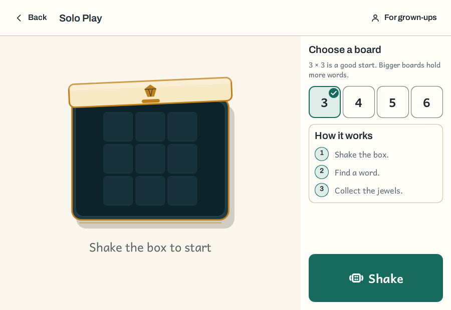
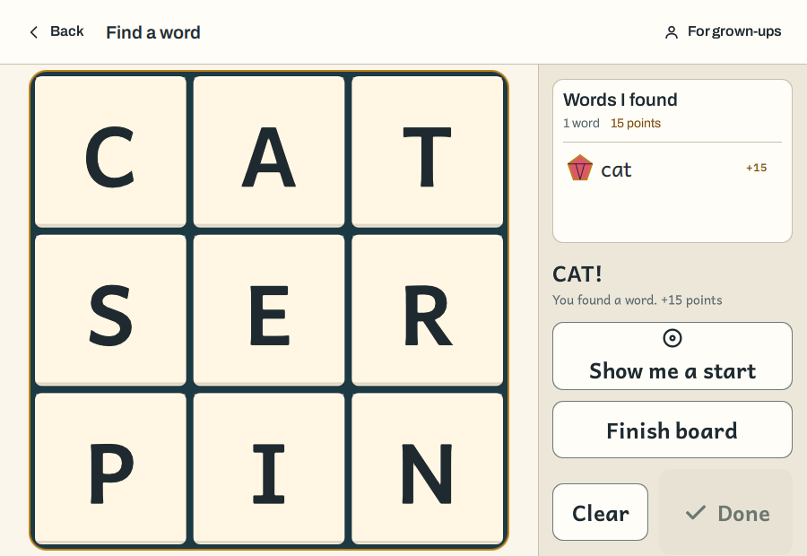
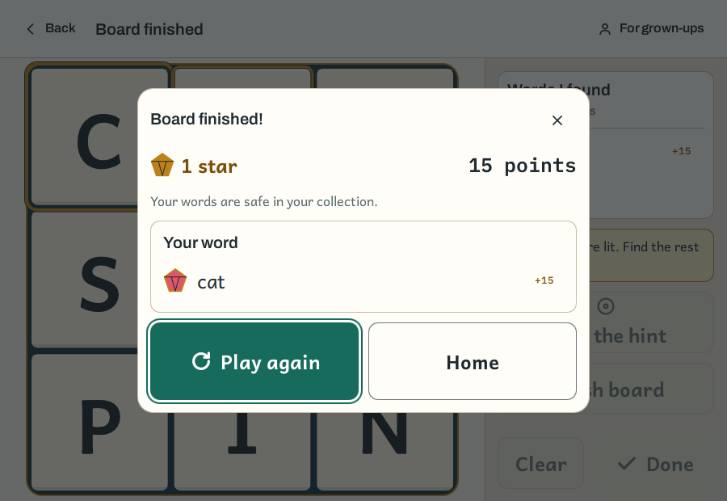
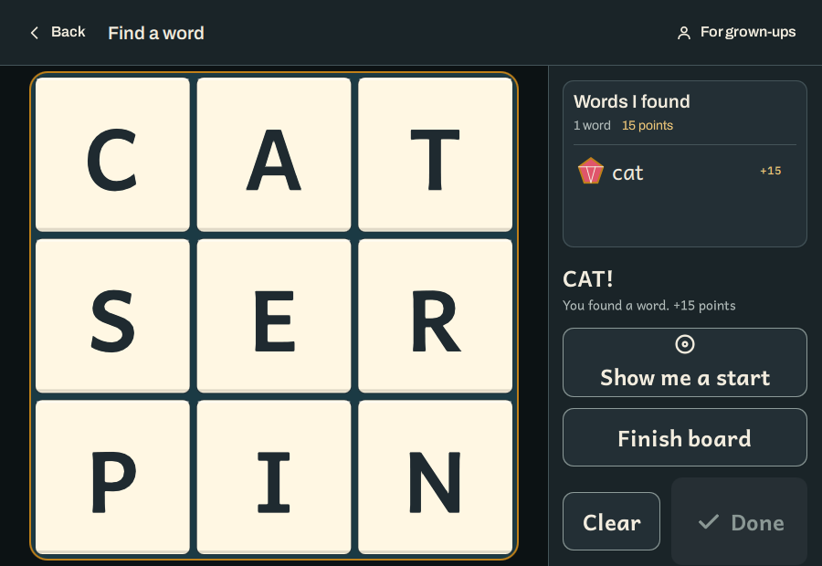

# Game design

How Solo Play (Mode B) and the Family Assistant and Scanner (Mode A) behave:
what the child does, what the app answers, what it reveals and what it keeps.
Written from [product requirements](../product-requirements.md) sections 3, 4,
6, 7 and 12 and brought into line with the 0.1 code. A statement is a proposal
unless marked **Fact** or **As built**; a sentence marked **Not built** says
what the design wants and the code does not do yet. The numbered questions are
in the [product requirements](../product-requirements.md).

> **Decided 2026-10-16.** The first release's board is the **standard board**
> (dice) by default, and the **phonics board** described on this page and in
> [Phonics](phonics.md) is a parent's switch. Where this page says "Mode B
> boards are seeded", it means the phonics board; a standard board is a roll of
> dice and holds as many words as it holds. The two game modes (alone, with
> others) are separate from the two board modes. The standard board solves
> against the full dictionary, with no block list in the MVP (a decision of the
> author; see [MVP library](mvp-library.md)), so every dictionary word of three
> letters or more counts there and the "real, not today's" cue below is the
> phonics board's.
>
> **Accepted risk, recorded 2026-10-21.** Because there is no block list, the
> standard board **can show and speak any word in ENABLE**, including words a
> parent would not want a five-year-old to read. This page used to promise that
> no unsuitable word is ever shown or read; that promise holds for the phonics
> board only (its words are a reviewed list), not for the standard board. A test
> pins the risk, so lifting it is a deliberate edit
> ([MVP library](mvp-library.md#accepted-risk-the-full-dictionary-and-what-a-child-is-shown)).

> **Decided 2026-10-21 (the 0.1 build does these, and the pages now say so).**
> Three things the design pages ruled out are built and stay: a parent-set
> **board clock** (count up or count down, off by default; a count-down ends the
> round); a **one-hold parental gate** (a single press-and-hold of two seconds,
> [Parent area](parent-area.md#the-gate)); and the child's **My jewels** screen,
> which shows the best board for each size, the points and the week without a
> gate. Each is a decision in the
> [roadmap](../roadmap.md#4-decisions-that-gate-the-plan) (D8 to D10), with the
> weakness it carries. A fourth difference, a **help** the parent sets in three
> steps, is recorded there as D12 for the author to confirm.

## What the first release plays

Section 12 narrows the full brief. Where this page says **MVP** it means that
scope; the rest is the product that follows.

| | MVP (section 12) | After the MVP |
| --- | --- | --- |
| Words | A hand-filtered, reviewed phase index (Phase A, SATPIN) | Further phases; the open dictionary |
| Mode B boards | 3x3 and 4x4, seeded to hold three to five viable words | 5x5 and 6x6; dice |
| Mode B end | The board clears, or the child finishes it, or a parent-set count-down runs out; one summary card ([The end of a board](#the-end-of-a-board)) | |
| Mode A | A single capture, confirm-and-correct, the start tile highlighted | Standing camera that watches the lid come off |
| Help | The start tile; **as built** the parent also chooses off, or the start tile followed by its first two letters ([Help](#help)) | A ladder of five rungs the parent sets |
| Reward | Stars by word tier | Worlds, the mascot, accessories (to confirm) |
| Parent | An on-device dashboard behind a gate | Weekly report, time played, a limit, an export |
| Left out | Voice capture, export, network, a limit on play, passive time played | Each is deferred, not removed (question 62). A board clock the parent chooses is built and off by default ([decision D8](../roadmap.md#4-decisions-that-gate-the-plan)) |

## Principles

| Principle | What it rules out |
| --- | --- |
| **Nothing can be lost or failed.** | A game over, a lives count, a buzzer, a red cross, a score that goes down (7.1) |
| **Nothing pulls.** | A streak, a daily reward, a prompt to carry on, a hint offered unasked, a high score to chase (12.3). **A timer is the parent's to switch on and is off by default**; the app never starts one, and nothing is stored about how long anyone played |
| **A board ends.** | An endless game. The phonics board holds three to five words; any board ends when the child finishes it. The end is a summary the child dismisses, not a prompt to carry on |
| **Sound before text.** | A screen a child has to read to use. Letters and words are the only text a game screen needs |
| **The child does the finding.** | A hint that is the word, until the parent allows it and the child asks for it |
| **Everything stays on the device.** | A network, an account, a microphone, an export (12.2) |
| **A parent is a different person.** | A child changing the help or reading the dashboard by accident: those sit behind a deliberate action |

## Words and what each does

**Fact, measured, from this repository's data.** The dictionary is ENABLE,
172,823 words, and the library's default minimum is 3 letters. The child-facing
lists in `data/lexicon` are a core tier of 237 words and ten category lists,
689 words together, which is small beside the dictionary:

| Length | ENABLE words | In a child-facing list | Share |
| --- | --- | --- | --- |
| 2 | 96 | 1 | 1% |
| 3 | 972 | 155 | 16% |
| 4 | 3,903 | 231 | 6% |

`mat`, `is`, `at`, `in`, `on`, `up` and `go` are in none of them. In the MVP the
word set is neither of these but a third, the phase index (section 12.1),
**which does not exist yet**: a reviewed list derived from the 249 words
spelled with S, A, T, P, I and N, fewer than 249 once stripped. The five
early-reader words (NIP, PAT, SAT, SIT, TAP) are where it starts.

A traced path is one of three things:

| State | What it is | What the child gets |
| --- | --- | --- |
| **Viable** | A word of the active phase's index that is on this board | A jewel in the tray; the stars of its tier; the sound-it-out sequence; its sticker the first time. It counts toward clearing the board |
| **Real, not today's** | A dictionary word that does not count on this board, of any length (the session answers a real word of two letters this way too, so a child is never told a real word is not one). On the standard board only a real two-letter word is this, because every longer dictionary word counts | A neutral cue: a soft tick, no star, **no word shown or read**. Nothing says wrong. **As built** the board also says, for a moment, "That's a real word. It is not on this board." |
| **Not a word** | Anything else | The path fades. No sound. **As built** a short line, "Not this time. Try another word.", shows for a moment; the design had no text here |

Why this is the answer to questions 3, 16 and 61:

- A real word is not called "not a word". `TAP` traced when only `SAT` and `SIT`
  count is a real word, and a child who is told it is not has been taught
  something false; this is the risk [Licensing](../licensing.md#the-word-list)
  already names. The neutral cue says *it is not one of today's*, with no
  words.
- On the **phonics board** the neutral cue never shows or reads the word and
  only reviewed words are spoken, so no block list is needed there. On the
  **standard board** every dictionary word of three letters or more counts and
  is shown and spoken, whatever it is: there is no block list in 0.1 (the
  accepted risk, above). A word a parent would not choose can therefore appear
  in the tray. Adding a block list, or an allow-list for the standard board, is
  open (PRD 12.7).
- The cue for "real, not today's" should differ from "not a word" so a child
  can learn the difference by touch alone. Whether they can is a test with
  children.
- Which inflections are viable is the reviewer's: 127 of the 249 end in S.
  Recommended: an inflection of a viable word is viable, earns stars, and
  shares its base word's sticker (the `base` field in
  [Phonics](phonics.md#the-data)).

## Stars, tiers and stickers

The author's table (7.2), unchanged except that the sticker and accessory are
the post-MVP part:

| Tier | Letters | Feedback | Reward |
| --- | --- | --- | --- |
| Spark | 3 | Soft sparkle; the word is read | +1 star |
| Power | 4 | A rainbow trail on the text; a cheer | +2 stars, a word sticker |
| Mega | 5 or more | A large burst; a voiceover | +5 stars, an accessory (after the MVP) |

**As built:** the tiers, the stars (+1, +2, +5) and the first-time sticker are
the library's (`game_rules`), and the word is read, with the cheer and the
chime. **Not built:** the sparkle, the rainbow trail, the burst, confetti and
the Mega screen shake. The jewel's size shows the tier and no particle effect
exists in the QML. The sticker is worked out for a first-time Power or Mega
word (`TraceOutcome::sticker`), and the traced-word signal the screens receive
does not carry it, so no screen shows it to the child.

- A word's tier is its letter count, `Qu` counting two. So `QUIT` is a Power
  Word (question 19).
- Stars are earned on **every** find, a sticker only the **first** time a word
  is found on this device. Repeating the five words on many boards therefore
  earns stars and nothing is lost by repeating.
- A found word is drawn as a **jewel** (the original brief's "jewels collected
  in a bank"), whose size follows its tier. Jewels are the picture; stars are
  the count. The two descriptions in the brief are one thing seen two ways.
- There are no negative stars and no buzzer (7.1).
- The Mega voiceover and screen shake are the effects question 25 asks about:
  see [Application design](application.md#motion). The screen shake is replaced
  by a bounce of the jewel for everyone (design; the effects themselves are
  **not built**).

## Mode B: Solo Play

### What it looks like

The box before the first shake, a board in play after a find, the summary card when
a board is finished, and the same board in the dark scheme, at 900 by 620 (the
smallest window). Captured on 2026-10-21 from the Solo Play design pass; the screens
change, so these show the shape and not the pixels.

| | |
| --- | --- |
|  |  |
|  |  |

### The flow

```text
  solo.box ──Shake──▶ solo.shaking ──still──▶ solo.dropping ──▶ solo.playing
     ▲                                                              │
     │                                                  trace or tap │
     │                                      viable / real / not a word│
     │                                                              ▼
     │                                         solo.word-found ─ more words ─▶ solo.playing
     │                          Finish board ─────┐                 │
     │                          count-down ends ──┤                 │ last viable word
     │                                            ▼                 ▼
     └── Play again / Close ◀──── the summary card ◀──────── solo.cleared
```

| id | When | Leaves to |
| --- | --- | --- |
| `solo.box` | The box with its lid on. A **Shake** button, the board-size choice (3, 4, 5 and 6, on the standard board), and the bar's back, earlier boards and for-grown-ups buttons | **Shake**, a device shake or Space: `solo.shaking` |
| `solo.shaking` | The box rattles, at least as long as the staged script says and while the device is shaken | `solo.dropping` |
| `solo.dropping` | The lid lifts, the dice fall, the board moves to the leading two-thirds and the panel slides in | `solo.playing` |
| `solo.playing` | The board and the panel. The child traces or taps | A word: `solo.word-found` (viable) or back at once (real, not today's; not a word). **Start tile**: the highlight. **Finish board**: the summary |
| `solo.word-found` | The word is sounded out and the jewel drops into the tray | `solo.playing`, or `solo.cleared` after the last viable word |
| `solo.cleared` | The last viable word is found; the summary card opens over the settled board | **Play again**: `solo.box`. **Home**. **Close** or Escape: `solo.box` |

Nothing is a countdown unless the parent chose one. The summary appears by
itself only because the board has no word left to find, the child pressed
**Finish board**, or a parent-set count-down ran out; it never moves on by
itself. **As built:** a cleared board does not go on to a separate resting
screen. An earlier design had `solo.cleared` fall through to a calm
`solo.resting` after about three seconds (see
[The end of a board](#the-end-of-a-board)); that was not built and the screen was
removed on 2026-10-21. `resting` is still a state the game can be saved in and
restored from; a game restored on it opens on the settled board under the same
summary.

### The board size

Chosen on `solo.box` with a row of numerals, 3, 4, 5 and 6 (64 dp each; the
phonics board offers 3 and 4 only). The parent sets which size the box offers
first in the parent area, 3 or 4; the app never moves a child from 3x3 to 4x4 by
itself, and a new device starts at 3x3.

### Shake, lid, drop

The board is **decided before the shake begins**: the library seeds it (see
[Phonics](phonics.md#seeding)) and hands the animation a finished board. The
shake is the presentation of that, so a replay is identical and a physics
engine is not needed. Timing, sound, the 3D scene and the reduced-motion
versions are in [Board design](board.md#the-shake-and-the-drop).

Ways to shake, all always available:

| Way | Where | Note |
| --- | --- | --- |
| Shake the device | Phones and tablets | Needs an accelerometer. The detector is pure logic over samples, so it is unit-tested with recorded traces |
| **Shake** button, 96 dp | Everywhere | A tap starts a shake of fixed length |
| Space, or drag the box fast | Desktop, browser | |

A device shake is never the only way (WCAG 2.5.4), and shake detection can be
turned off in the parent area.

### Tracing and tapping

Two ways to make a word, both always on, so no gesture is required:

| | How | Ends with |
| --- | --- | --- |
| **Trace** | Press a tile and slide across neighbours, diagonals included | Lifting the finger |
| **Tap in order** | Tap a tile, then each neighbour in turn | The **Done** jewel, or tapping the last tile again |

- Each tile lights as it joins and plays its letter's *sound* ("kuh", "a"), not
  its name. A sound is cut off by the next one.
- Tiles that make one sound link into a block as they join. How is on
  [Phonics](phonics.md#binding-a-trace-into-grapheme-blocks).
- The path is a pale line in a gold edge with a thin dark line, drawn as a
  ribbon under the letters so that it shows on the dice and on the tray and
  never crosses a letter (see [Application design](application.md#colour-and-contrast)).
- Sliding back onto the previous tile takes the last tile off the path.
  Lifting outside the board cancels with no penalty. A tile cannot be used
  twice and a non-neighbour is ignored, not an error. The library will check a
  path with `validate_path` (written; `wjs::validate_path`).
- The hit area is a circle smaller than the tile, and the path stays on a tile
  until the finger leaves a larger circle, so a diagonal slide does not skip a
  tile. The two radii are **starting values for a small finger**, the one thing
  no unit test settles (roadmap, M1).
- Only the first touch draws a path. A second finger or a resting palm is
  ignored.

### The panel

| Part | Holds | Behaviour |
| --- | --- | --- |
| **Words I found** | One jewel and the word in lower case, in the order found, for this board | Tap a word to hear it. Nothing is ever removed. It does not show how many are left |
| **Hint** | One button, **Show me a start**, when the parent allows help | The start tile of one viable word not yet found; see [Help](#help). Absent if the parent has turned help off |
| **The clock** | The seconds played, or left, in the panel | Only when the parent has chosen a clock; absent by default |
| **Finish board** | A quiet button | Ends this board early: the words are kept and the summary opens |
| **Clear** and **Done** | Clear takes the path off; Done hands in a word that was tapped in order (a traced word hands itself in) | At the foot of the panel, in a fixed place |

Earlier boards are not in the panel: the bar's **Earlier boards** button opens
a sheet of them, newest first, and **My jewels** on the home screen holds the
child's collection ([Progress without a pull](#progress-without-a-pull)). There
is no **New board** button: the box is where a new board starts. A child who
wants to stop uses the back control, which goes home and leaves the round as it
is; the next visit finds it there, because the game is saved on every find.

### The end of a board

A board ends in one of three ways: the last viable word is found (**cleared**),
the child presses **Finish board**, or a parent-set count-down reaches zero. All
three open the same **summary card**, a sheet over the whole window with the
board still settled behind it.

- **What it shows (as built).** The stars and the points the board earned, the
  words found with their jewels, and, after a count-up board, "You played for
  ...". After a count-down it says the time ran out and that everything found is
  kept; after a board with no words it says "No words this time. Every board is a
  new chance."
- **What it does not do.** Start another board by itself, remind, or ask. The
  two buttons, **Play again** and **Home**, are the same size (96 dp), and
  **Close** or Escape puts the lid back on. Nothing is timed, and nothing fades
  to another screen.
- **What is kept.** The board, its words and its stars are saved to history.

**Decision, 2026-10-21: the resting screen is not built.** The design asked for
a calm, still screen with no numbers, no stars and no words that fades in after
a cleared board and invites putting the device down (PRD 12.3). The code never
built it: the summary card shows stars, points and words, which that screen was
to avoid; the standard board's real endings (Finish board, the clock) never pass
through "cleared"; both buttons of the cleared card ended the board in one tick;
and a three-second hold would have pulled the summary away from a child reading
it. `SoloResting.qml` and its token `Theme.clearedHold` were removed or left
unused, and the summary card is the ending. The weakness: nothing invites the
child to stop. A rest screen that does is open for after 0.1.

### Points, the best board and the week

The original brief wants a high score, and section 12.3 asked that it be worked
out "without a pull to continue". **As built, differently from the design
originally written here:** a board earns stars by tier and points by its words,
both shown on the summary card; the **best board for each size**, the points and
this week's stars and new words are shown to the child on **My jewels**, which
needs no gate, and to the parent on the dashboard. The design had the best
recorded silently, celebrated once in the moment and never shown as a number to
the child. That was not built, and the author kept what was built
([D10](../roadmap.md#4-decisions-that-gate-the-plan), 2026-10-21): a child can
open a number to beat. The records are the device's own, with no name and no one
else's score beside them, and nothing is lost by a poor board. It is the weakest place in the "nothing pulls"
principle and the first to revisit if testing with children shows a pull.

## Help

**MVP: one level, the start tile.** It is the same in both modes (question 68).
**As built** (recorded 2026-10-21 for the author to confirm, [D12](../roadmap.md#4-decisions-that-gate-the-plan)):
the parent chooses **Off**, **Start tile** or **Start tile, then two letters**,
and the default is the last. The first press of **Show me a start** lights the
start tile of one viable word (rung 2 below); at the third setting a second
press lights the word's first two tiles, and the next hides the hint. After a
find made from the hint's start, a line says how many more words begin with
those tiles. Rungs 1, 3, 4 and 5 are not built. The child still never gets a
hint unasked.
| Rung | The child sees | Gives away | In |
| --- | --- | --- | --- |
| 1 | A number: "5 words for you" | How many are left | After the MVP |
| 2 | **One tile glows and pulses** | Where a word starts | **MVP** |
| 3 | Slots `C _ _` and, if it has one, a picture for its group | Length, first letter, group | After |
| 4 | The first two tiles lit and an arrow | Which way it goes | After |
| 5 | The whole trail lit; the word read | The word | After |

After the MVP the parent sets the highest rung in a dial of five stops (Off,
Nudge to 2, Clue to 3, Trail to 4, Answer to 5), the child climbs one rung a
press, and the app never offers a hint unasked. Questions 2 and 6 are answered
on that footing.

How a start tile is chosen: among viable words not yet found, the shortest,
then the one nearest the top left, so the same press gives the same answer; it
stays until that word is found or the child asks again. Nothing is announced,
lit or nudged by the app on its own.

## Progress without a pull

| What | Design |
| --- | --- |
| **Stars** | The count. Kept on the device. Shown to the parent on the dashboard, and to the child on the summary card and on **My jewels** |
| **My jewels** | **As built:** the child's collection, opened from the home screen by the child on purpose and never after a board. It shows the jewels and stars, the points, the words found (the latest forty, as chips that speak when tapped), the best board for each size and this week's stars. No gate guards it ([D10](../roadmap.md#4-decisions-that-gate-the-plan)) |
| **The vault ("My Word Vault")** | The design: one album, a sticker for each word of the active phase's index; a word not yet found is a grey outline; **Tap to talk** reads the word and a sentence. **Not built** as an album: the words found are chips on My jewels, with no outlines and no sentences, because there is no phase index and no art (question 21) |
| **Worlds (7.2)** | A theme: the board's look and the background. The unlock is by stars. **Not in the MVP** unless the author says so (12.5). Designed as a swap of design tokens, so no world changes a rule |
| **The mascot** | After the MVP; the same character in every world (question 28) |
| **Phases** | Chosen by the **parent**, never by the app (question 29). Two axes: the phase is *what the board is made of*; tiers and stars are *what the child earns* |

The brief's thresholds (0 to 20, 21 to 50, 51 and up stars) are reached in a
sitting or two: a board holds 3 to 5 words worth 1 to 2 stars each, which is
about 3 to 10 stars, so 20 stars is two or three boards (**estimate**, from the
brief's own numbers). If worlds come in, the author should set the thresholds
from how many boards a week they expect.

## Mode A: the Family Assistant and Scanner

The family plays with a real board; the tablet looks at it and helps the
child. The app is not the game.

### The MVP: one capture

Section 12.4 and the planning assumption of question 67.

```text
 scan.ready ──Capture──▶ scan.reading ──▶ scan.check ──Yes, play──▶ assist.playing
     ▲                                        │                        │
     └──────────── Read again ◀───────────────┘         New board      │
     └────────────────────────────────────────────────────────────────┘
```

| id | When | Leaves to |
| --- | --- | --- |
| `scan.ready` | The camera is on, with a frame to put the board in. A **Capture** button, 96 dp. **Type in your board** if there is no camera or the parent prefers | **Capture**: `scan.reading`. **Type in**: `scan.check` with an empty grid |
| `scan.reading` | One frame is read on the device. A still picture says so | `scan.check` |
| `scan.check` | The replica, upright, with doubtful tiles ringed. A grown-up confirms | **Yes, play**: `assist.playing`. **Read again**: `scan.ready`. A tile: the letter picker |
| `assist.playing` | The replica in the leading two-thirds and the panel. **Show me a start** | **New board**: `scan.ready` |

The camera is **on only in `scan.ready`**: once the frame is taken nothing
needs it, and a child's room is in the picture. The brief has the camera on
while the tablet is on its stand; this keeps it on only while it has something
to do, and the author may reverse that. Frames are processed on the device and
not kept (roadmap section 8), there is no audio capture, and nothing is sent.

**As built (2026-10-19).** Three choices this page left open, settled by the
first screen, and one that the screens made:

- **Entry.** The scanner is an adult's workflow, so the home screen's family
  picture opens the parent gate, and the scan screen is reached from the
  dashboard once the gate is open. The gate stays open while the scanner is
  shown, so Back returns to the dashboard and not to the gate. The design above
  had the family picture open the scanner directly.

- **Back from `assist.playing`** goes to `scan.check`, where the person came
  from, and records the board to the store on the way. **New board** is a new
  scan: it puts the scan screen back to `scan.ready`, and Back from that new
  scan returns to the board that was left, not home (the board is already saved).
  An earlier version of this page had Back go home; the shell does the other
  (`Main.qml`), and no test drives the real route.
- **The store record** is the standard board's form: no phase, and the count of
  the words that counted (`viable_total`) rather than a list, with each find's
  day and whether the start tile was shown. The app plays that form because the
  repository has no phase index yet (see the next point); a board played against
  one later records its words instead.
- **The word set is the full English dictionary today.** The MVP paragraph above
  says the confirmed board is solved against the phase index only, and no phase
  index exists; the standard board's rule (every real word of three letters or
  more counts) is what the app can play, and it is the board mode the first
  release plays by default. The middle cue ("real, not today's") is therefore
  unreachable in Mode A until a phase is loaded, exactly as it is in Solo Play;
  the port keeps it, and its test holds it down, for the day the index exists.
  This is the same stand-in as Solo Play's, not a new decision.

### The check screen

```text
  +-----------------------------------------------------------+
  |   Is this your board?                        [ turn ]     |
  |                                                           |
  |        +------+------+------+------+       4 x 4          |
  |        |  C   |  A   |  T   |  S   |                      |
  |        +------+------+------+------+                      |
  |        |  O   | (R?) |  E   |  D   |   ringed: the reader  |
  |        +------+------+------+------+   doubts this tile    |
  |        |  ...                       |                      |
  |        +------+------+------+------+                      |
  |                                                           |
  |   [ Read again ]               [      Yes, play      ]    |
  +-----------------------------------------------------------+
```

- The replica is **upright**: the real dice are turned every which way and the
  replica is not, which is itself a help to a young reader. **Turn** rotates
  it a quarter turn to match how the child sees the real board.
- A tile is one to three letters (**Fact**, the library's limit). The picker has
  A to Z, `Qu` and a multi-letter entry, because some larger sets carry other
  pairs (**unverified**, see [Board design](board.md#sizes)).
- The size is counted from the picture and shown first; nothing is solved until
  the board is confirmed (question 11).
- An OCR error would otherwise feed a wrong board to the solver (question 67),
  so **the check is never skipped in the MVP.** The reader and the data flow of
  this screen are built and measured on synthetic frames ([Scanner](scanner.md));
  no tile accuracy has been measured on real dice.
- Nothing on this screen is for the child, and no message says the app could
  not read something because of what the child did.

### Playing

- The confirmed board is solved against the **phase index only** (section
  12.4). **Fact, measured:** a real-looking 4x4 board (letters drawn by ENABLE
  letter frequency, which is a test corpus) holds, for an index of the 68 to 122
  SATPIN words that is the likely size of a stripped Phase A, a mean of 3.2 to
  3.4 viable words, and **35% of boards hold none**. If the index were only the
  five early-reader words, 70% hold none (mean 0.4). The design therefore has
  to handle "nothing for you this time" as an ordinary case: a picture of the
  box and a button to read the next board, not a message and not a blame.
- **Show me a start** highlights one viable word's first tile at a time (above).
  It is the only help. The child traces from it on the replica and the same
  sound-it-out sequence plays.
- The child's words are the tray's jewels and stars, for the round. The app keeps
  **no scoreboard** against the other players (question 5); a word found on the
  real board and not traced is not counted and nothing says so.
- Hint audio is silent in this mode by default, because the others are at the
  same table; the display is a picture.
- The stars go into the same total as Solo Play's; a round does not make a
  "best", because the board was not shaken by the app.

### After the MVP

- **Stand-and-watch.** The camera runs on the stand, finds a board-shaped grid
  that has been still for about a second (to be tuned on recorded frames) and
  reads; a **Read it now** button stays. Not the lid coming off: a hand and a
  lid moving over the board look like a board moving. It reads, then asks for
  the same check.
- **A new round** is the **New board** button, never "the camera noticed a
  different board": an adult lifting the board to look at it would end the
  child's game.
- **Tailorable help** (rungs 1 to 5, above) in the parent's dial.

### No camera

With no camera, or one the person refuses, the Mode A tile says so in a
picture and `scan.ready` offers **Type in your board**: the check screen with an
empty grid, the size chosen by the adult. It is a screen Mode A needs anyway;
the current window already has a grid to type a board into. Mode B is whole
without a camera.

## What this design does not do

- **No timer unless a grown-up chooses one, and never a limit on play.** The
  real game has a sand timer and a family may use it. **As built** (D8,
  2026-10-21) the parent area has a **Time on the board** setting: off (the
  default), a count-up shown in the panel and on the summary, or a count-down of
  1 to 30 minutes that ends the board and keeps everything found. It is the
  parent's setting behind the gate, and the child cannot set it. The app starts
  no clock of its own, locks no session and keeps no total.
- **No level that changes itself.** The app never moves a child from 3x3 to
  4x4, from one phase to another, or raises the help.
- **No streaks, daily rewards, unlockables to buy.**
- **No scoreboard across players, and no accounts.** My jewels compares a child
  only with their own earlier boards.
- **No "words you missed" list.** A standard board keeps no list of the words it
  held, and a list of misses is a loss cue.
- **No voice capture, no export, no network, no analytics.**
- **No time played.** Nothing is stored from which a figure for time on screen
  could be made: a count-up is shown while the board is open and on its summary,
  and is not written to the store.

## Unknowns

- Whether a child of five can use tap-in-order and trace without being shown.
  There is no first-run tutorial in this design; it is a test with children.
- The phrases, the voice and the accent. Recordings follow the review.
- Whether the "real, not today's" cue is understood, and whether the best
  board for each size on My jewels is a pull.
- The size of the phase index, and so how often a scanned board holds nothing.
