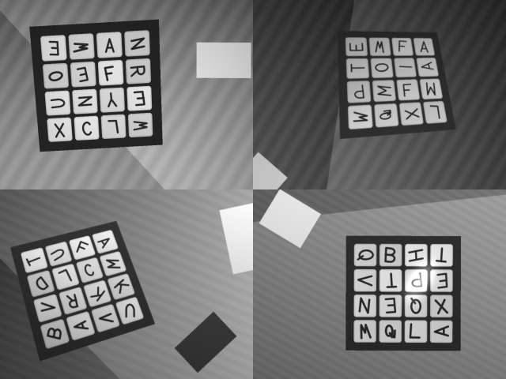

# Scanner design

How Mode A reads a real board: the camera and the reader behind two platform
interfaces, the library that finds the board in a frame and reads each tile, the
check that stands between the reader and the solver, the accuracy it is held to
and the synthetic corpus that holds it there. Written from the
[game design](game.md#mode-a-the-family-assistant-and-scanner), the
[application design](application.md#privacy-built-in-and-checked), the
[roadmap](../roadmap.md) (M4) and [Platform isolation](../platform-isolation.md).
Proposals unless marked **Fact**; the marks are the ones on the
[overview](index.md#how-to-read-these-pages).

**Status.** The first working slice is built and tested **on synthetic frames
only**: a Qt-free library, the platform interfaces and the confirm-and-correct
model, a corpus, a numeric target and the tests that hold it. Mode A's screens
are built on it (`ScanModel`, `AssistModel` and the QML in `apps/app/qml/scan`,
[Mode A as built](#mode-a-as-built)) and are reached through the parental gate
and the dashboard. **The desktop camera is built too**: Mode A's ready screen
shows a live picture through Qt Multimedia and its Capture reads one frame on
the device, as a variant of the application's camera source rather than of the
platform interface ([below](#the-qt-multimedia-desktop-backend)). That path has
not been run on a real board: **this machine has no camera**, so what is
verified is the build, the no-camera/refused/broken states, the picture
conversion from a made frame, and the whole model and screen flow with a fake
source and a synthetic frame. The reader itself is measured on synthetic frames
only. **The accuracy on real dice is not demonstrated:** the recorded-frames
harness (`[.recorded]`) is tested on frames the corpus draws and has never run
on a photograph. **Nothing here has been run on a tablet, on an iPad, on a
photograph of real dice or in real light**; the ad-hoc iOS build is written and
has never run on a device ([What is left](#what-is-left-for-a-real-camera-a-mac-and-an-ipad)).
The board-size policy for the scanner is settled in the PRD (12.4): the MVP
target is the 4x4, the check screen offers 3 to 6 and shows a size the reader
counted outside them, and a typed board starts at 4x4
([Mode A as built](#mode-a-as-built)).

## What this slice is

A frame in, a board and a doubt per tile out, and the data flow that makes a
grown-up confirm it before the solver sees it. Not the screen when this page was
written (the Solo Play UI owned `apps/app/src`); Mode A's screens are now built in
`apps/app/qml/scan` and bind to `sns::scan::BoardDraft` through `ScanModel`
([Mode A as built](#mode-a-as-built); docs/architecture.md, "The Qt Quick window").
And not the iOS reader (it needs a Mac and an iPad: see
[What is left](#what-is-left-for-a-real-camera-a-mac-and-an-ipad)).

```text
 camera (CameraSource / platform)   sns::scan (portable, Qt-free)            UI binds to
 ───────────────────────────────    ─────────────────────────────            ───────────
 OwnedFrame ──▶ read_board(frame, options)                        BoardDraft
                  1. luma, a working picture of 480 px
                  2. find the board: dice → lattice → convex quad
                  3. draw it square, count the cells, centre each die
                  4. read each cell's one rotated glyph (templates)
                  ──▶ BoardReading  (letters, confidence, runners-up, per tile)
                                          try_from_reading ──▶ BoardDraft
                                                          set_tile / accept_tile / turn / resize
                                                          doubtful()  (the ringed tiles)
                                                          confirm() ──▶ sns::Board ──▶ solver
```

Three rules hold the shape of it:

1. **The solver sees only a confirmed board.** A `BoardReading` has no
   conversion to `Board`. The only way from a reading to a `Board` is
   `BoardDraft::confirm()`, which a grown-up's *Start playing* (the design's *Yes, play*) calls (game design:
   "the check is never skipped in the MVP"). `static_assert`s in
   `libs/scan/tests/scan_confirmation_test.cpp` hold this at compile time.
2. **A doubt is data, not a message.** Each tile carries a confidence, its
   runners-up and a `doubtful` flag; what the screen does with them (a ring and
   a `?`, [board design](board.md#the-tile)) is the UI's. Nothing in
   `sns::scan` produces text for a child, lists a word, or calls the solver.
   Mode A highlights only the start tile (PRD 12.4); that is the session flow's,
   after `confirm()`.
3. **Frames live in memory only.** No code under `libs/scan` or in the two
   interfaces opens a file, and a build check says so
   ([Privacy](#privacy-built-in-and-checked)).

## The target, set before the code

A number is needed because the check screen makes a *wrong* tile expensive in
one way only: a wrong tile the reader **did not doubt** is the one the
grown-up confirms without seeing, and the solver then answers a different
board. A tile the reader doubts costs one tap. So the targets bound the silent
error first, the cost of doubt second, and the plain accuracy third.

**Definitions**, per tile, over the frames in which the board was found:

| Term | Meaning |
| --- | --- |
| Correct | The reported letters equal the truth (`QU` is one tile) |
| Flagged | The reader marked the tile `doubtful` |
| **Silent error** | Not correct **and** not flagged. The costly outcome |
| Offered | The truth is the reading or one of its listed runners-up (at most two), which is what the letter picker puts first |
| Board found | The reader returned a board of the right size. A frame it cannot read is an error (`board_not_found`, `size_not_found`, `no_letters`; the other two are `invalid_frame` and `invalid_options`, [below](#the-library)) which the screen answers with *Read again*: it costs a retake and never a wrong board |
| Turned wrong | The board was found and read with the grid turned a quarter other than the one its corners give |

**Rotation is counted.** The reader numbers the board's corners from the one
whose first edge runs nearest to +x, so the grid it returns may be a quarter turn
of the board as it lies (the check screen has a *Turn* control for the rest).
The judge (`libs/scan/tests/synth/evaluate.cpp`) now takes the turn from the
**corners** (`expected_quarters`, written from that rule and not by calling the
reader's own geometry) and judges every tile against the truth in that turn. It
used to take whichever of the four turns of the truth matched best, which scored
a board numbered from the wrong corner as right. A board in another turn now
has its tiles wrong (they show in *correct* and *silent*) and is counted in
`rotation_errors`; **no rotation error is allowed in any condition**, because one
is a fault in how the corners are numbered and not noise. A recorded real frame
has no corners to turn the truth by, so the `[.recorded]` harness judges at turn
0: a board the reader numbers from another corner scores as wrong tiles.

### The bounds, and how they are set

The first limits were chosen by hand before any code, and three were relaxed
after the first run on the split they were then held against
([History](#history-the-first-limits)). A bound set that way says the reader
passes, not that it generalises. So the limits are **derived by a rule** from
one split and **held against another** that nothing was chosen from. The rule
is in `libs/scan/tests/scan_corpus_test.cpp`:

- The reader is developed on the **tuning** split. The counts it gives (frames,
  frames found, tiles, correct, flagged, silent, offered, per condition) are
  recorded in `kTuning`; nothing else is looked at to set a bound.
- `derive()` moves each figure to the unfavourable side by **three standard
  errors of a proportion**, then rounds outward to the next half percent. The
  standard error is of the adjusted proportion `(x + 2) / (n + 4)`, so that a
  figure of none or all does not have an error of nothing.
- The bounds are **held against the `heldout` split** (`Split::heldout`, base
  seed 6,000,000), which the target tests read and nothing that steers does. If
  a bound is missed there the test is red, and the reader is not changed until
  it passes by looking at that split: a reader change is made against the tuning
  split, `kTuning` is re-recorded (the hidden case `[.scan-thresholds]` prints
  it, and the bounds that follow) with the reason in the commit message, and a
  heldout split that has been looked at to steer is retired and replaced by a
  new base seed.

**The bounds,** over the synthetic **heldout** split, as `derive()` gives them
from the tuning counts now in `kTuning`. A condition passes only if all five hold
and no board is turned wrong:

| Condition | Board found | Correct | Silent errors | Flagged | Offered |
| --- | --- | --- | --- | --- | --- |
| `upright`: tilt up to 10°, dice square in their cells | ≥ 85% | ≥ 97% | ≤ 1.5% | ≤ 13.5% | ≥ 99% |
| `angled`: tilt up to 35°, any turn of the board, dice square in their cells | ≥ 85% | ≥ 97.5% | ≤ 1.0% | ≤ 16% | ≥ 99% |
| `loose`: as `angled`, each die's letter at any angle | ≥ 85% | ≥ 97% | ≤ 1.0% | ≤ 17% | ≥ 98.5% |
| `glare`: as `angled`, with one or two soft highlights and a streak | ≥ 71.5% | ≥ 94.5% | ≤ 2.0% | ≤ 19.5% | ≥ 98% |

The table is a copy: the constants in the test are the authority, and nothing
checks that this page still matches them after the reader is re-tuned. The
bounds differ from the hand-set limits in both directions (found, and upright's
silent and flagged limits, are looser; correct on angled, loose and glare, and
flagged on loose and glare, are tighter), because they follow
the reader's counts and what 24 frames and 558 tiles can tell apart, and not a
number written beforehand.

And on **frames with no board** (a room, a sheet of paper, a tiled floor): at
least 95% answer an error, and none answers a board with more than half of its
tiles trusted. This is unchanged.

**Why the silent-error bound is 1.0 to 2.0 percent and not 0.3 to 0.5.** An
earlier version of this page held 0.3% (upright), 0.5% (angled), 1.0% (loose)
and 2.0% (glare). A condition has 24 boards, 558 tiles, so one silent tile is
0.18%, and even a count of none, three standard errors up, is about 0.75%
(which rounds out to 1.0%): the
sample **cannot confirm** a rate under 1%, nor refute one. The figures of 0.3
to 0.5% were wishes the test could neither hold nor fail honestly, and they are
not claimed. A larger corpus (more boards a condition) is the only way to
tighten the bounds; the cost is run time (about 4 s per 24 frames in a Release
build).

- *Silent errors* are the number that matters. At 1.0% a 4x4 board has about a
  1 in 7 chance of one unseen wrong tile, and at 2.0% about 1 in 4. That is not
  zero and cannot be made zero by a reader: the adult's *Start playing* is the
  safety, which is why the check is never skipped. (What the reader gave on the
  heldout split was 0 to 2 silent tiles of 558, [below](#what-was-measured); the
  bound is what the sample could not rule out, not a measure of the rate.)
- *Flagged* at 13.5 to 17% is about two to three ringed tiles on a 4x4 board: a
  grown-up can look at three. Glare's 19.5% is three; a heavier glare would be a
  *Read again*, and that row is there to be honest about it, not to set a standard.
- *Correct* is the convenience measure: the less the picker is opened, the better,
  but a wrong tile that is flagged is already cheap.
- *Offered* says the picker's first suggestions hold the truth, so a correction
  is one tap and not a scroll through A to Z.

None of this is derived from a field study. Nothing in the target speaks to real
dice, real light or a real child's room; see
[What this does not prove](#what-this-does-not-prove).

### History: the first limits

Kept so the change is not mistaken for a plan. The limits first written, before
any code, were the left column of each pair in the table below; they are **not
held any more**. The rule written beside them was "revised only with a reason
written beside the change, never to turn a red run green" (the rule for the
performance budgets too:
[Testing](../testing.md#what-a-failure-means-and-how-to-move-a-budget)).

| Condition | Board found | Correct | Silent errors | Flagged | Offered |
| --- | --- | --- | --- | --- | --- |
| `upright` | ≥ 99% | ≥ 97% | ≤ 0.3% | ≤ 12% | ≥ 99.7% |
| `angled` | ≥ 97% | ≥ 95% | ≤ 0.5% | ≤ 15% | ≥ 99.5% |
| `loose` | ≥ 97% | ≥ 92% | ≤ 1.0% | ≤ 20% | ≥ 99% |
| `glare` | ≥ 90% | ≥ 80% | ≤ 2.0% | ≤ 35% | ≥ 97% |

Three cells were relaxed after the first run on the then-current test split
(a fresh draw, [below](#splits-and-size)):

- *Upright's silent and flagged limits* were 0.3% and 12%, and the first run read
  **0.54% (3 tiles of 558) and 12.7%**. The reader does not treat an upright
  board differently from an angled one, and 0.3% of 558 tiles is 1.7 tiles, so
  the limits asked for more than a sample of that size can tell apart. They
  became 1.0%, 15% and 99.5% offered.
- *Glare's found rate* became 85%, not 90%: one frame is 4.2 points, and the
  tuning split read 22 of 24, so a third unread frame would have failed a limit
  meant as a regression gate.

That is the point at which the rule above was adopted: a limit moved after the
number it is held to was read says the reader passes, not that it generalises.

## The corpus plan

**Recorded camera frames show a child and a room. They are never committed**
(`.gitignore` already excludes `/tests/data/captures/` and `/docs/evidence/`;
[Licensing](../licensing.md#camera-input-and-letter-recognition)). What is in the
repository is **synthetic**: a generator in `libs/scan/tests/synth` that draws a
board of dice from numbers and a seed, and nothing else. It is a test library, not
the application: nothing in `src` links it.



*Four frames of the corpus (`sns_scan_render --sheet`): upright, angled, loose
and glare, each a 4x4 board, at a third of the size they are read at.*

### What the generator draws

A frame is a grey image drawn from a scene in the board's plane and seen through
a pinhole camera, by inverse mapping (every pixel asks the scene what it is):

| Part | What is drawn |
| --- | --- |
| The board | An N x N grid of cream dice in a dark tray, 4x4, 5x5 or 6x6 (the corpus draws no 3x3, 7x7 or 8x8 board, though the reader counts 3 to 8: [Board design](board.md#sizes)); a gap between dice of 9 to 14% of a die; rounded die corners; a die-to-die brightness spread |
| The letter | One glyph a die, upper case, 50 to 60% of the die high ([Board design](board.md#the-tile)), as strokes of a weight that varies by board; `Qu` is a large Q and a small u. Each die's glyph is a **perturbed** copy of the reader's skeleton: a smooth distortion of a few waves across it, a slant, a width, a shift of a few percent of the die, and a weight that varies by die. So the test is not the template matched to itself. It is **not a different typeface**, which is the largest thing the corpus cannot say (below) |
| The turn of a letter | A multiple of a quarter turn plus a few degrees (dice in cells), or any angle (`loose`) |
| The view | A tilt, a turn of the whole board in the image, a distance, a position. A pinhole homography, so the dice are quadrilaterals that shrink with distance |
| The room | A light gradient and a vignette, a table edge and a wood-grain stripe, one or two bright or dark rectangles (a sheet of paper, a phone) that are not the board and that can sit beside it, sensor noise, blur |
| Glare | Soft elliptical highlights added over the dice and the tray, saturating, and a thin streak; letters under them wash out |
| Colour | None: the corpus is grey. A separate case reads the same frame as RGBA and as a strided Y plane |

**What it deliberately leaves out**, so the numbers are not read as more than
they are: reflections of the room in the dice, the sides of the dice (their
visible edges under tilt), shadows of the hand, motion blur, a lid or a hand in
the frame, rolling shutter, a camera's own sharpening and compression, a die
that is not flat on its cell, and every real typeface.

### Splits and size

| Split | Used for | Seed base |
| --- | --- | --- |
| **Tuning** | Developing the reader and choosing the doubt thresholds; the counts the bounds are derived from (`kTuning`). Never held to the target | 1,000,000 |
| **Test** | The second split. It was read and reported on while the reader changed, so it is **no longer held out**: it is not what any bound is held against | 4,000,000 |
| **Heldout** | The split the bounds are held against. Read by the target tests and by nothing that steers | 6,000,000 |

**The splits were drawn three times.** The first test draw (seed base 2,000,000)
was run a number of times during development, and the numbers it gave steered
work, so it was **retired** and a fresh one (4,000,000) drawn. That one was in
turn read while the reader changed, and the first limits were relaxed after its
first run ([History](#history-the-first-limits)); so it is no longer a measure of
anything unseen either. The **heldout** split was drawn after the bounds were
derived and fixed, and its first reading is the one reported under
[What was measured](#what-was-measured). The reader is developed against the
tuning split alone. `SNS_SCAN_SPLIT=test` or `=heldout` tells a hidden diagnostic
to read another split, and reading the heldout one with a tool **is looking at
it**: if it steers a change, the split is retired and a new base seed taken
(`seed_of` in `libs/scan/tests/synth/scene.cpp`). That is a convention: nothing but
that sentence and review stops a tool reading it.

Each condition has 24 boards in a split (12 of 4x4, 6 of 5x5, 6 of 6x6), 558
tiles, so one tile is 0.18%: the resolution is coarse, which is why the
silent-error bounds are about 1.0 to 2.0% and not lower
([the bounds](#the-bounds-and-how-they-are-set)). Board
`i` of a condition is drawn from `std::mt19937` seeded from the condition, the
split, the size and `i`, with draws **taken modulo**, never
`std::uniform_int_distribution` (its algorithm is each standard library's own), so
a seed is the same frame on MSVC, libstdc++ and libc++
([Testing](../testing.md#the-corpus)). Only the arithmetic of the picture (a float
rendering) can differ in the last digit between compilers, and the limits keep a
margin for that.

### Where it runs

| Build | Runs |
| --- | --- |
| Release (`ctest --preset linux-gcc-release`, the `Performance` leg) | The whole heldout split against the derived bounds, and 21 frames with no board |
| Debug with the sanitizers (the build legs) | A **smoke** subset: one board of each condition and one frame with no board of each kind, the judge's rotation rule, the turn taken from corners, and the recorded-frames harness on made frames. The pipeline runs clean under ASan and gets the plain cases right. The target is **skipped**, not failed, as the performance tier skips: the corpus is much longer there |

`sns_scan_render` (built with the tests) writes the corpus, or a contact sheet of
it, to a directory, for a person to look at. **The app never writes a frame**; the
generator is a test tool and its PNG writer is in `tests/`.

### Recorded frames, outside the tree

The real measurement is on real photographs, and the repository cannot hold
them. `libs/scan/tests` has a hidden case, `[.recorded]`, that reads frames from the
directory in `SNS_SCAN_RECORDED_DIR` (binary PGM, grey, with a `<name>.txt`
beside each holding the true board in the board text format) and prints the same
five numbers. It skips when the variable is unset, as
[Licensing](../licensing.md#camera-input-and-letter-recognition) asks. The
harness itself is tested: a visible case writes frames the corpus draws as PGM
(plain, and with comments in the header as an editor writes them), with their
truth text, and reads them back through the same code, and a second case holds
that a file that is not a whole grey PGM is passed over. **The `[.recorded]`
case has never run on a photograph**, because no frames were recorded; this is
the first thing to do on the iPad (below). Its figures are not a target: there
are no recorded-frame bounds, and the harness only prints.

## The library

`sns_scan` (`sns::scan`), a static library of its own in `libs/scan`. It links
`sns::lib` for `Board` and nothing else; the solver library does not link it and
stays free of image code.

### No image dependency

**The pipeline adds nothing to the dependency diff**: `vcpkg.json` is unchanged
and the library is plain C++23 over a byte buffer, about 3,500 lines (sources and headers). So there is no opt-in switch: the default CI legs
build and test it, and they stay fast (the library compiles in a few seconds, and
the full accuracy gate runs in the Release leg only).

Why not OpenCV, the obvious choice and Cubeulator's: it would add a package
whose first vcpkg build on a clean runner is long (the practice is to pay it once
into the binary cache), a second set of per-platform packaging for iOS and
Android, and no capability this job needs. The work is *one board of one kind of
object in one known typeface*: find a bright quadrilateral lattice, warp it, and
compare a glyph with 27 templates. OpenCV's strengths (feature detection,
learned models, calibrated cameras) are not used by it.

The price is that the image code is ours: a threshold, a connected-component
label, a convex hull, a homography and a bilinear warp, each tested here and none
tuned on a camera. If the real dice or real frames show a limit that a general
library would cure, `board_reader` is the seam to put it behind (Vision on iOS
needs the same seam), and an OpenCV-backed reader would be an opt-in vcpkg
feature like `profiling`: it would add `opencv4` (Apache-2.0, compatible with
GPL-3.0-or-later; **not added now**).

### The pipeline

| Step | What it does | Notes |
| --- | --- | --- |
| Frame | A `Frame` is a view of a pixel buffer: gray, RGB, BGR, RGBA or BGRA, with a stride. It becomes luma (integer BT.601), averaged down in whole blocks to an analysis picture of at most 960 px on the long side and a working picture of at most 480 | A YUV camera's Y plane is a `gray8` frame at no cost. `Frame::valid()` is **overflow-safe**: a side is capped at 65536, and the buffer is checked by division and not by a product that could wrap, because the sizes and the stride come from a camera and are not trusted. A frame that is not valid is `invalid_frame`; options out of range (`ReadOptions::valid()`: picture and board sizes, a cell count of 2 to `Board::max_dimension`, the glyph height, finite doubt thresholds) are `invalid_options`, answered before the frame is looked at |
| Find the board | A local threshold (a pixel is bright if it exceeds the mean of a window by a margin) marks the bright. Its 4-connected blobs that are die-shaped (a convex, four-sided hull, about square, a size window; the letter's hole does not count against it) are candidates; the largest set of them that are each a neighbour of another at a size and spacing that agree is the dice. The board is the **largest convex quadrilateral** of their outline: their convex hull, reduced to the four corners that enclose it | A bright sheet of paper is one blob with no neighbours at lattice spacing, so it is not a die |
| Hold the outline to a comb | A sheet of paper beside the board can be a die's size at a die's pitch, and is then grouped with the dice. So each outline is drawn square and held to what a board is: a comb of bright dice and dark gaps. If it is not, the die that adds most to the outline is dropped and it is tried again, up to five times | Found on the tuning split: with no check, 17 dice were "found" for a 4x4 and the corners were 100 to 480 px out |
| Several looks | Uneven light (a highlight on some dice, a shadow on others) hides dice from one threshold. The board is looked for with five settings of the window and margin; of those whose outline combs well, the one that found the most dice wins | Without it, a good-looking board of nine dice in the middle of sixteen was accepted |
| Draw it square | A homography from the four corners to a square, sampled bilinearly from the analysis picture, 480 px a side. The corner order is the one whose first edge runs nearest to +x | |
| Count the cells | The row and column profiles of the square are a comb: bright at the middle of each cell, dark at the seams. The count (3 to 8) is the one whose comb fits best, among those the dice found and the outline's length against a die's side allow | The size is **shown first** on the check screen ([Game](game.md#the-check-screen)) and the adult can change it |
| Centre each die | The cell divisions of an even split are off by up to 4% of a cell because the dice have gaps between them: the middle of each die is found from where the gaps are (the centre of each dip below its half depth), and the outer dice from the pitch | The even split read 72% correct on the first run; centring read 95 to 97% |
| Find the glyph height | Every die on a board is one typeface at one size, and a ring drawn a tenth too big is nearer a D than an O. A sample of eight cells is read at trial heights, coarse (0.8, 1.0, 1.25 times the nominal) and then fine (a tenth either way), and the height at which they match best is used for every cell | Knowing the true height would read 98.2% correct; estimating it reads 98.4%: it is the largest single gain |
| Read a tile | The cell is a circular patch (a half-side of 0.34 of a cell, at the found height) sampled to 24 x 24; its ink is the depth below a plane fitted to the lighter half, so a gradient of light across a die is not ink; it is turned through 48 angles, every 7.5°, and each is compared with each of the 27 templates by normalised correlation. A letter's score is its best over the turns | Absolute glyph size is kept, so `N` turned a quarter and `Z` differ in proportion as well as shape |
| Confidence | The best letter's score and its lead over the next. A tile is **doubtful** if the score is under 0.55 or the lead under 0.06, or the cell had less than 24 grey levels of ink. Confidence is 0.5 at either threshold and 1 at twice it | The thresholds are set on the tuning split only |
| Output | Per tile: letters, confidence in [0, 1], the turn found, the score and lead, up to two runners-up; per board: size, corners in the frame, a size confidence, the glyph height taken | A `std::expected<BoardReading, ReadError>`. `ReadError` has **five** values: `invalid_frame`, `board_not_found`, `size_not_found`, `no_letters` and `invalid_options` (never produced with the default options) |

The templates are renders of the library's own stroke font
(`sns/scan/stroke_font.hpp`): 26 letters and `Qu`, as polylines and elliptical
arcs in a box 4 wide and 6 tall, drawn at any angle and weight by distance to the
strokes. **Template matching and a bitmap of the real dice font are
interchangeable behind `GlyphReader`**, which is how a font of the real dice (once
its licence is read) or a trained classifier replaces the stand-in without
touching the rest.

The thresholds and tolerances are **starting values**, tuned on synthetic frames
and expected to move on the first real ones.

### Confirm and correct

`BoardDraft` (`sns/scan/confirmation.hpp`) is the model the check screen binds
to. It is Qt-free and holds no pixels.

| Operation | What it does |
| --- | --- |
| `BoardDraft::try_from_reading(reading)` | A `std::expected<BoardDraft, DraftError>`: the grid as read, with each tile's doubt and runners-up. A cell the reader saw nothing in is empty and doubtful. A reading that is not a grid (no rows or columns, more than a `Board` can have, or other than rows x columns tiles) is refused with `inconsistent_reading` (or `empty_grid` / `too_large`): a draft over such a reading would index past its tiles |
| `BoardDraft::from_reading(reading)` | **Deprecated, kept as a safe shim** for code written before `try_from_reading`. For a reading that is a grid it is the same draft; for one that is not, it is an empty grid of the reading's size held to 1 to 16 a side, every tile blank and doubted, so that nothing overruns and the grown-up types the board in. `ScanModel` checks the reading itself first and still calls the shim; moving it to `try_from_reading` is open |
| `BoardDraft::empty(rows, columns)` | The *Type in your board* grid; nothing is doubted, nothing is filled |
| `tile(position)` | Letters, `origin` (read, corrected, typed, empty), confidence, `doubtful`, runners-up |
| `set_tile(position, letters)` | A grown-up's correction: one to three letters A to Z, upper-cased; the tile is settled |
| `accept_tile(position)` | "This one is right": settles a doubtful tile without changing it |
| `clear_tile(position)` | Empties a tile |
| `turn(direction)` | A quarter turn of the whole grid, for the *Turn* control; a tile's doubt goes with it |
| `resize(rows, columns)` | A grown-up corrects the counted size; tiles in the overlap are kept |
| `doubtful()`, `unfilled()`, `complete()` | The positions to ring, the positions to fill, and whether any are left |
| `confirm()` | A `Board`, or `incomplete` if any tile has no letters |

A refusal is a `DraftError`: `empty_grid`, `too_large`, `bad_letters`,
`off_grid`, `incomplete` and `inconsistent_reading`.

`confirm()` does not refuse a board with ringed tiles left: the *Start playing*
press is the grown-up's statement that they looked, and the check is for them,
not against them. The screen is free to ask first; `doubtful()` is how it knows.
The whole flow, from a reading to the words on the board, is a test
(`the solver is given the confirmed board and finds its words`).

## The platform interfaces

Two headers under `libs/platforms/interfaces/sns/platform/`, one definition each
per platform, chosen only by `cmake/Platform.cmake` through the platform
fragments:

| Interface | What it is | Windows, Linux, macOS (today) |
| --- | --- | --- |
| `camera.hpp` | `enumerate_devices`, `start`, `stop`, `is_capturing`, `try_pop_latest_frame`, `open_permission_settings`: Cubeulator's `camera.hpp` without OpenCV types (an `OwnedFrame` for its `cv::Mat`) and without its photometry lock, which is about colour sampling and not about letters | **Still no native desktop backend**: every function answers `unavailable`, or nothing. Mode A's desktop camera is not this interface: it is the application's `CameraSource` over Qt Multimedia ([below](#the-qt-multimedia-desktop-backend)), which is the optional-module variant pattern. This interface stays for a platform whose own camera API must be used (the iPad's AVFoundation), so the model can use either. *Type in your board* is the answer on a desktop with no camera ([Game](game.md#no-camera)) |
| `board_reader.hpp` | `read(frame, options)`: a `BoardReading` or a `ReadError`; `kind()` and `name()` say whether the reader is the portable one or a native one | **The portable reader**: the three desktops forward to `sns::scan::read_board`, from one file all of them name |

Both are implemented in `libs/platforms/detail/`, the directory for what no
platform differs in (the isolation check has always allowed it; the
platform fragments name the files). The camera hands out frames the way Cubeulator's
does, a single-slot mailbox: the latest frame not yet taken, or none. The UI
session decides when the camera is on (only in `scan.ready`,
[Game](game.md#the-mvp-one-capture)); the interface only provides it. Cases in
`libs/scan/tests/scan_platform_test.cpp` hold any implementation of either to its
contract without naming a platform, so the iOS ones are held to the same once
they are written. The contract is **positive**, not only a list of ways to fail
(`libs/scan/tests/platform_contract.hpp`): each rule is a function that returns the
violations, so that a camera that keeps the rules is shown to, a fake that breaks
each rule is shown to be caught (the contract is not vacuous), and the platform's
own camera and board reader are held to it (today the always-unavailable desktop
camera and the portable reader). `kind()` and `name()` are called only by tests;
no production code yet reads them.

`sns_platform` now links `sns_scan` (for the frame and reading types the two
headers use), so the layering is `sns_lib` ← `sns_scan` ← `sns_platform` ← the
front ends; `sns_scan` does not include a platform header.

### The Qt Multimedia desktop backend

The camera the desktop actually uses is the application's, not the platform
interface's, and it is selected the way the feedback engines are: an optional Qt
module, one directory per variant, and no `#if` in a source.

| Piece | Where | What it is |
| --- | --- | --- |
| `CameraSource` | `apps/app/src/camera/camera_source.*` | The QObject and `QML_ELEMENT` Mode A binds to: `available`, `devices`, `problem`, `running`, `start()`, `stop()`, `capture()` and the frame in hand. It is in the QML module `SnapAndSpell.Scan`, so `Main.qml` makes one and hands it to `ScanModel::cameraSource` |
| The backend seam | `apps/app/src/camera/camera_backend.hpp` | An interface that names no Qt Multimedia type: a `Changed` callback, the device list and state, `start`/`stop`, `capture()` returning a `sns::scan::OwnedFrame`, and a preview hand-over by `QObject*`. The none backend is the same interface answering `no_camera` |
| The multimedia backend | `apps/app/src/variants/camera-multimedia/sns/app/camera_backend.cpp` | `QCamera` → `QMediaCaptureSession` → `QVideoSink`. The sink keeps the newest `QVideoFrame` only; capture converts it with `QVideoFrame::toImage()` and copies it into an owned RGB24 frame (`frame_from_image`, `apps/app/src/camera/frame_conversion.*`: `QImage::Format_RGB888`, bytes R, G, B, rows packed, `stride = width * 3`). No `ImageCapture`, no `QMediaRecorder`, no file |
| The none backend | `apps/app/src/variants/camera-none/sns/app/camera_backend.cpp` | A kit without Qt Multimedia: no device, no preview, no frame. It is the variant CMake compiles there; the rest of the application is unchanged |
| The preview | `CameraPreview.qml` in each variant | A `VideoOutput` (multimedia) or an empty `Item` (none). The source sets the item's `videoSink`; the QML names no camera type of its own, so the shared screen builds either way |

**The lifecycle.** `ScanModel::open()` starts the camera only in `scan.ready`.
`capture()` waits for the newest frame with the existing patience (100 ms polls,
40 of them, so a camera that never delivers returns to `ready` with `no_frame`).
As soon as a frame is in hand the camera is stopped, before the frame is read;
the `sns::scan::OwnedFrame` is read through `board_reader::read` and dropped, and
only the `BoardReading`'s letters and doubts remain. Leaving the screen, the
check screen opening, or the model being destroyed stops the camera too.

**Permission.** The multimedia backend asks for the camera when the platform's
answer is *undetermined* (Qt's `QCameraPermission`), before it lists devices
(some platforms list none until the person has said yes), and waits for the
answer; an answer that arrives after the camera was stopped does not start it. A
refusal is the `permission` code below. It is tested against a **fake** permission
object: the platform's real prompt has never been seen, and the refusal text
points to the device's settings while no button calls the interface's
`open_permission_settings`.

**What a failure says.** The source reports one code: `no_camera` (no device or
no backend), `permission` (the person refused, or the platform reports it), or
`failed` (the platform's camera failed). `ScanWording.cameraProblem` turns it
into a sentence and the typed-board button stays beside it; a frame is never
faked. A source supplied to `ScanModel` is used when it can start; without one
(every stub shell and every test) the model keeps the platform interface's path,
which is still `unavailable` on the three desktops.

**What is verified, and what is not.** Built and tested on Windows 11 with the
shared Qt 6.12 kit (MSVC, Debug and the Release package). `camera.screens`
drives the real `ScanScreen`, the real `CameraSource` and a real `VideoOutput`
headless, with a **fake backend** and one **synthetic** board frame: the preview
is shown, Capture opens the check screen, and the camera stops. `sns_app_tests`
holds the conversion, the availability/refusal/failure states, the frame that
never arrives and the model's use of a supplied source. **No camera is attached
to this machine**, so no device was opened, the live picture path and the
platform's permission prompt were not exercised, and nothing here says the
reader reads a real board; that is still the iPad's measurement. The multimedia
module is shipped with the application: `windeployqt` and Qt's install-time
deploy copy `Qt6Multimedia.dll`, `plugins/multimedia/*` and `qml/QtMultimedia`,
and `tools/package/check_package.ps1` requires them when the window links the
module.

**The camera, on a kit without Multimedia.** CMake chooses `camera-none`: the
QML module compiles the same `CameraSource`, `ScanModel` and `ScanScreen`, and
the ready screen says there is no camera with the typed board beside it. That
build was configured and built here (the kit's Multimedia disabled), and it is
the same no-camera path every desktop had before this backend; **no CI leg builds
it**, so it is not kept built by anything.

### What is left for a real camera, a Mac and an iPad

Written down so it is not taken as done. **None of this has been run on a device
or on a real board, and the native iPad pieces do not exist:**

| Piece | What it is | Needs |
| --- | --- | --- |
| A real camera on a desktop | The Qt Multimedia camera is built ([above](#the-qt-multimedia-desktop-backend)), but no webcam is attached to the machine it was built on. Opening a device, the picture the preview shows, the platform's permission prompt and the browser of resolutions the camera offers are all unexercised | A desktop with a camera, and a board photographed through it |
| iOS build | **Written, never run on a device.** `libs/platforms/ios/platform.cmake` (with the camera usage text in `packaging/Info.plist.in` and no microphone string), the `ios-release` preset and the `ios-build.yml` workflow build an ad-hoc IPA for the author's own devices ([iOS install](../ios-install.md)). It carries the Qt Multimedia camera and the portable reader through `detail/`, not the native pieces below. Whether the hosted build runs, installs and shows a camera is the author's to see | A Mac, the Qt iOS kit, an iPad, an ad-hoc profile |
| `camera_ios.mm` | Objective-C++ over `AVCaptureSession` with a video-only input (no audio input is ever created: the privacy rule), `AVCaptureVideoDataOutput` delivering `CVPixelBuffer`s, the Y plane of a bi-planar 4:2:0 buffer wrapped as a `gray8` `Frame`, copied into the mailbox. Camera permission through Qt's `QCameraPermission` as Cubeulator does, and `open_permission_settings` for a refusal | An iPad, an ad-hoc profile, the Info.plist usage string (and **no** microphone string) |
| `board_reader_ios.mm` | Option 1: the portable pipeline finds, warps and centres the cells; `VNRecognizeTextRequest` (or a Core ML classifier trained on renders of the dice font) classifies each cell's image at four quarter turns; the results fill `TileReading`. Option 2: Vision's rectangle detector finds the board. **Whether Vision reads a single rotated capital on a glossy die better than the template matcher is unknown, and is what the iPad decides** | An iPad and recorded frames |
| Recorded frames and their truth | A dozen boards of the author's own dice, photographed on the iPad at ordinary angles and in ordinary light, **never committed**, with a truth text beside each, read by `[.recorded]` | The author's dice and the iPad |
| The real typeface | The dice's letters measured against the stand-in stroke font, and the templates re-rendered from the real face (a licensed font or a scan of the dice, with the licence read) | The dice |
| Tuning | The doubt thresholds, the glyph-height search and the grid tolerances re-tuned on the recorded frames | The above |

The interface was designed so each fits: a platform's `board_reader` receives a
`Frame` (so the Y plane needs no copy) and returns the same `BoardReading`; the
portable pipeline is a library a native reader may call for the parts it does not
replace (find the board, draw it square, centre the cells), as
`board_finder.hpp` and `glyph_reader.hpp` expose them separately.

## Mode A as built

**As built.** The family assistant (`scan.*` and `assist.*` in the
[game design](game.md#mode-a-the-family-assistant-and-scanner)) is built in
`apps/app/src/scan` (the models) and `apps/app/qml/scan` (the screens). Verified by
tests on a fake camera and synthetic frames; never driven with a real camera or
a real board.

**How a family gets there.** Not from the home screen directly. The home
screen's *Play with a real board* card asks for the grown-up area
(`onParentRequested` in `Main.qml`), which is behind the parental gate (a single
press-and-hold, a brake against accidents and not security: [Parent
area](parent-area.md)); the dashboard's *Set up a board* button emits
`scanRequested`, and `Main.qml` handles it with `onScanRequested:
Navigation.go("scan")`. The parent area keeps the gate open while the scanner is
shown, so Back from the scanner returns to the dashboard and not to the gate.
The scanner is an adult workflow.

| Piece | Where | What it is |
| --- | --- | --- |
| `ScanModel` | `apps/app/src/scan/scan_model.*` | `scan.ready`, `scan.reading`, `scan.check`. Owns the `BoardDraft`; the camera's little lifecycle ([above](#the-qt-multimedia-desktop-backend)); `capture()`, `typeBoard()`, `readAgain()`, `setTile`, `acceptTile`, `turn`, `resize`, `confirm()`. A read is a failure code (`no_camera`, `no_frame`, `invalid_frame`, `board_not_found`, `size_not_found`, `no_letters`, `invalid_reading`); `invalid_options` is mapped to `invalid_reading`. It checks a reading is a grid, then still calls the `from_reading` shim ([above](#confirm-and-correct)) |
| The reader's thread | `ScanModel::readFrame` | The read runs on a **worker thread named `scan`**: a `QThreadPool` of one thread, a task that holds nothing of the model, and a `QPromise`/`QFutureWatcher` to bring the result back to the UI thread. The frame is cleared in the task when the read is done. Leaving the screen while a frame is being read drops the answer |
| `AssistModel` | `apps/app/src/scan/assist_model.*` | `assist.playing`. Made by QML with no arguments; `begin(rows, columns, letters)` takes the **plain values** of the confirmed board (so it does not itself know that `confirm()` ran: only the call order guards that) and asks `make_assist_game()` for a round. Path tracing, the tray, the start tile and the history |
| `AssistGame` | `apps/app/src/scan/assist_game.*` | Qt-free: what a traced path is on this board, the tray, the one help, and the record on leaving. `viable`, `realNotTodays` (a real word that is not today's: no word is given) and `notAWord` |
| The maker | `apps/app/src/main.cpp`, `assist_game_factory.*` | main installs one maker before the engine loads, over the program's one dictionary and store. With none installed `begin()` answers false and there is no fake board (unlike Solo Play) |
| The screens | `ScanScreen.qml`, `CheckScreen.qml`, `AssistScreen.qml`, `AssistBoard.qml`, `AssistHistory.qml`, `ScanWording.qml` | The ready screen (preview, *Capture*, *Type in your board*), the check screen (a replica, the doubted tiles ringed, the letter picker, *Turn*, the size buttons, *Start playing*) and the assistant. Wording in all eight languages |

**The check screen.** A tile the reader doubted is ringed with a `?`; tapping a
tile opens a picker with the reader's runners-up first, then A to Z, *Qu* and a
box for other letters. The counted size is shown and changeable; the picker
offers **3 to 6** (`ScanModel::sizes`, the sizes the game plays), the reader counts
3 to 8, a typed board starts at **4x4**, and the MVP target is the 4x4 (PRD 12.4).
A size the reader counted outside 3 to 6 is shown in the size choice and chosen.
A 7x7 or 8x8 read plays but is not recorded in the store (the store holds 3x3 to
6x6 squares).
*Turn* is shown for a board a camera read and hidden for a typed one. *Start
playing* waits for every tile to have a letter, and with ringed tiles left it
asks first (*Check them* or *Play anyway*); the press is still the grown-up's
statement that they looked, so the silent-error bound and that question are the
safety.

**What the assistant does.** The confirmed board is played on a replica; the
child traces words. Mode A is a helper and not a game: there is no scoreboard and
no timer in it (the parent-set board clock, an option for Solo Play, is not part
of it). It uses the **standard board's** word set: the full ENABLE list as both
the words that count and the words that tell a real word from a string of
letters, so `realNotTodays` never arises. **The standard board has no block
list**, so any ENABLE word can be shown to the child here (an accepted risk
recorded in the roadmap's [decisions](../roadmap.md#4-decisions-that-gate-the-plan)
and pinned by a test, [vocabulary](mvp-library.md)); the phonics board's
suitability promise is not Mode A's. Help is **on or off**, read from the
parent's setting: *Show me a start* is offered only when it is on and lights the
start tile of the shortest viable word (nearest the top left), the same one until
it is found; the three-step help of Solo Play (the two-letter level) is not read
here. A new round is a new scan (*New board*, which enters the scanner with
`Navigation.go("scan")`, so Back from that scanner returns to the assistant). The
board is recorded once on leaving, in the standard form (no phase, a count of
viable words and no list); a failed save is held in `AssistModel.saveFailed` and
**no screen shows it**.

**Not built, and not tested.** *Nothing for you this time* (a board with no
viable word): `viableCount()` reaches no screen, and *Show me a start* does
nothing when there is none. A Mode A mute and silent hints (the model emits cues
as Solo Play does). The refusal text points to the device's settings and no
button opens them. The real route in and out (dashboard, scanner, assistant,
Back, *New board*) is exercised only through a stub shell in tests, not through
`Main.qml`; the check screen's size buttons, *Qu* button and other-letters box
and the assistant's drawn ring have no QML test. Auto-read when the board is
still, and a lid, are deferred: the scan starts from a button.

## Privacy, built in and checked

[Application design](application.md#privacy-built-in-and-checked) freezes the
MVP's rules; the scanner touches one of them closely, a camera pointed at a
child's room.

| Rule | In the build | Checked by |
| --- | --- | --- |
| Frames are processed on the device and **not kept** | `Frame` is a view; an `OwnedFrame` is a buffer in memory with no save. Nothing under `libs/scan`, in the camera and `board_reader` files, or in Mode A's `CameraSource`/backend includes a file or stream header or calls a file API; the multimedia backend has no `ImageCapture`, no recorder and no writer | `scan.privacy` (`libs/scan/tests/check_privacy.cmake`), run in every `ctest`: fails on a file-output facility in those files, which now includes `apps/app/src/camera` and both `apps/app/src/variants/camera-*` |
| No audio input | The camera interface has no audio and `start` takes a video device; the Qt Multimedia backend creates only a video `QCamera`/`QMediaCaptureSession`; the iOS notes above forbid an audio input | The same scan fails on an audio-capture class or a microphone usage string, which would also cover `camera_ios.mm` when it is written |
| No network | The library includes no network header | The same scan fails on a network class or socket header |
| No export | No share, print or save | The file scan above |
| No profiler in what ships | The scanner's zones (`scan.find_board`, `scan.read_tiles` and the steps inside them, listed under [Performance](#performance)) go through `sns/profiling.hpp`, which is empty in a normal build | `profiling.shipped_presets` and `profiling.zone_names` (existing) |

The scan holds four rules, named in its findings: **file output**, **frame
capture** (an image-capture or buffer class, or a save of an image), **audio
capture** and **network**. `scan.privacy.catches_a_leak` is the check's own test
(`libs/scan/tests/check_privacy_selftest.cmake`): it runs the scan on a fixture tree
for **each rule**, which does exactly one thing that rule forbids, and requires
the scan to fail, to name that rule and that file and no other rule; it also runs
it on a clean tree, which must pass and be counted, and on an empty one, which
must be refused and not pass for lack of anything to read. (It used to run one
file that opened an `ofstream` and expect any failure.) It is a pattern scan, not
a parser: a leak through an API the patterns do not list passes. A recorded frame
can be read only by the `[.recorded]` test, from outside the tree, and only when
the person who recorded it sets the variable.

The comments in `camera.hpp` and `libs/scan/tests/synth/png.hpp` cite a check named
`scan.no_frame_files`. No such check exists: the one that holds this is
`scan.privacy`, and those comments are stale.

## Performance

[Performance design](performance.md) proposes 3 s from capture to the check
screen. The library carries the usual counters and zones:

- `sns/scan/work.hpp` tallies, per thread, the reads, the pixels of the frame, the
  working picture and the warps, the blobs and die candidates, the cells read, the
  template comparisons and the pixel buffers allocated (and the most any one read
  took), as `sns/solver_work.hpp` does for the solver.
- `libs/core/bench` holds **work budgets** for four fixed frames and opt-in
  **wall-time** ratios (rows `scan.*` and `time.read.*`; see
  [Testing](../testing.md#performance-tests)). A change that reads each cell at
  four times the angles, or allocates a buffer a row, fails a count before a
  stopwatch notices.
- The profiler's zones are `scan.find_board` and `scan.read_tiles`, with the
  steps inside them (`scan.decode_frame`, `scan.convert_working`,
  `scan.box_blur`, `scan.bright_mask`, `scan.find_blobs`, `scan.warp_board` and
  `scan.read_glyphs`) and `scan.process_frame`, the whole read on the app's
  worker thread. A check lists the zone names the profiling tier requires.
- The read runs on a **worker thread named `scan`** in the app: `ScanModel` owns
  a `QThreadPool` of one thread and hands the frame to a task that holds nothing
  of the model, so a model that goes first only loses the answer
  ([Mode A as built](#mode-a-as-built)). There is no end-to-end timing from
  Capture to the check screen, and no zone around the capture itself.

## What was measured

**Where:** one Windows 11 desktop, MSVC, Release, the synthetic corpus. The
Linux GCC Release `Performance` leg holds the same bounds on every push (what it
last said is CI's record and not this page's), and the Debug legs under the
sanitizers run the smoke subset only ([Where it runs](#where-it-runs)). The first
slice of the reader was also built with GCC 15.2 in the CI image and read the
splits of that time to the same numbers digit for digit; the figures below are
from the MSVC Release run recorded in `libs/scan/tests/scan_corpus_test.cpp`.
**Not measured:** a tablet, an iPad, a real camera (the desktop's Qt Multimedia
path is built, but this machine has no camera), real dice, real light. **The
accuracy on real dice is not demonstrated.**

**The bounds, on the heldout split** ([above](#the-bounds-and-how-they-are-set)).
This is the first reading of it, with the bounds already fixed from the tuning
counts. Every board was found in every condition, and **no board was turned
wrong**:

| Condition | Frames found | Correct | Flagged | Silent errors | Offered | Tiles |
| --- | --- | --- | --- | --- | --- | --- |
| upright | 24 of 24 | 99.3% (554) | 11.1% (62) | 0% (0) | 100% (558) | 558 |
| angled | 24 of 24 | 97.7% (545) | 10.2% (57) | 0.36% (2) | 100% (558) | 558 |
| loose | 24 of 24 | 98.4% (549) | 11.8% (66) | 0.36% (2) | 99.8% (557) | 558 |
| glare | 24 of 24 | 98.9% (552) | 13.3% (74) | 0.18% (1) | 99.6% (556) | 558 |

Every bound held, by little in one place: angled *correct* (97.67%) is 0.17 points
over its bound (97.5%), which is as close as the corpus can place one. The silent
errors here are 0 to 2 tiles of 558; that does **not** say the rate is under
0.5%, only that the sample is too small to say more than the bound does
([why](#the-bounds-and-how-they-are-set)).

**The tuning split**, the counts the bounds are derived from (`kTuning`):

| Condition | Frames found | Correct | Flagged | Silent errors | Offered | Tiles |
| --- | --- | --- | --- | --- | --- | --- |
| upright | 24 of 24 | 98.7% (551) | 9.5% (53) | 0.36% (2) | 100% (558) | 558 |
| angled | 24 of 24 | 99.1% (553) | 11.5% (64) | 0% (0) | 100% (558) | 558 |
| loose | 24 of 24 | 98.7% (551) | 12.7% (71) | 0% (0) | 99.8% (557) | 558 |
| glare | 22 of 24 | 97.0% (510) | 14.4% (76) | 0.57% (3) | 99.4% (523) | 526 |

**The second (test) split**, read and reported on while the reader changed, so
it is not held out and nothing is held against it. Its first run, which is the
run the old limits were relaxed after:

| Condition | Frames found | Correct | Flagged | Silent errors | Offered | Tiles |
| --- | --- | --- | --- | --- | --- | --- |
| upright | 24 of 24 | 97.5% | 12.7% | **0.54% (3)** | 99.8% | 558 |
| angled | 24 of 24 | 98.8% | 12.0% | 0% (0) | 100% | 558 |
| loose | 24 of 24 | 98.8% | 12.7% | 0.18% (1) | 99.6% | 558 |
| glare | 22 of 24 | 99.2% | 13.5% | 0% (0) | 99.6% | 517 |

The spread between the three splits (flagged 9.5 to 12.7% for the same
condition; upright correct 97.5 to 99.3%) is the noise to read the tables by. On
the frames with no board (7 each of an empty room, a room with sheets of paper in
it, and a tiled floor: 21 frames) all were answered with an error, and so were 60
more frames drawn from tuning seeds.

**How the number got there**, because the order matters more than the final
figure:

| Step | Tuning split, correct | What it was |
| --- | --- | --- |
| First end to end | about 72% | Cell centres from an even split of the board square |
| Dice centred by their gaps | 95 to 97% | The grid was offset by half the gap, about 1.4 px of the 24-px patch, which is most of a stroke |
| Outline held to the comb; dice and size constraints; several looks | the same, and boards found 62% → 92% under glare | A sheet of paper beside the board was grouped with the dice |
| A smooth distortion in the corpus | the same | The corpus's first jitter moved each point of a curve independently, so the arcs of an `O` came out lumpy: a flaw in the corpus, not the reader |
| **Glyph height estimated per board** | **96% → 98.4%**; the doubt needed for 0.3% silent errors fell from about 28% to 12% | An `O` drawn a tenth too large was nearer a `D` than an `O` |

**What was tried and did not help** (all on the tuning split, all reverted; kept
here so the next person does not repeat them):

- A larger patch (40 x 40): worse (92% against 95%); the strokes are thinner than
  the alignment error. A smaller one (16, 20): the same as 24.
- Blurring the patch and the templates twice instead of once: the same.
- A different nominal stroke weight for the templates (0.6, 0.9, 1.05 against
  0.75): no difference at all.
- Dividing the lead by the distance between the two templates (so a small lead is
  doubtful only if the pair could be told apart): no gain.
- Taking a template's "centrality" off its score (a D scores well against every
  round letter): worse (92% and 74%).
- A **trained classifier**: a ridge regression of the letter on 56 distorted
  drawings of each, with the nearest templates deciding the turn, replacing the
  templates. 73% as a drop-in (a linear classifier answers wildly at a turn it
  was not trained on), 88% with turned negatives in the training. Both worse than
  plain templates (94.8% at that point). The classifier is the roadmap's other
  option and remains one: with real frames to train on it may be different.

**What is left** after all this (the first slice, on the tuning split of the time)
is the O / D / Q / G family: on the tuning split a
true `O` is read right 79% of the time (64 of 81), a `D` 91%, every other letter
97 to 100%. The stand-in font draws an `O` as an ellipse and a `D` as a flat left
side and a half ellipse, which is what a sans-serif face does, and they differ at
four corners. A real typeface may separate them better or worse; the iPad decides.

**What a read costs** on this desktop, one frame read (not drawn), measured when
the first slice was built and not re-measured since: **45 to 50 ms
for a 4x4 and 61 to 69 ms for a 6x6**, about 0.4 to 0.55 of the performance
tier's heavy calibration (three runs); drawing the synthetic frame is another
60 ms. The proposal is 3 s from capture to the check screen on a tablet: this is
a desktop figure, a tablet is **unmeasured** (Cubeulator's own estimate of three
to five times a desktop core is the only basis), and the template bank (27
renders) is built on first use, a few milliseconds.

## What this does not prove

- **Real dice.** The templates are the project's own stroke font; real dice have
  a different typeface, a moulded or printed face, wear, and a gloss the
  synthetic glare does not model. The accuracy on them is **unknown**. The
  corpus can say the geometry works (a board is found under tilt and turn, a
  glyph is read at any angle, a sheet of paper beside the board is not taken for
  a die) and that doubt is raised where the reader is unsure; it cannot say the
  dice are readable.
- **A corpus drawn by the same hand as the reader.** The glyphs are the reader's
  skeleton, distorted by a model of what a typeface does; the glyph height search
  finds the very parameter the generator varies. A real set varies in ways this
  one does not think of.
- **Real cameras and light**: the tablet's noise, sharpening, auto-exposure and a
  ceiling light in the dice. Cubeulator's measured work on camera automatics
  (exposure that drifts 14 to 18 L points inside a scan) is a warning that the
  synthetic noise understates it.
- **The desktop camera on a device.** Its code, conversion and screen flow are
  tested, but no camera is attached to the machine they were built on: a live
  device, the preview's actual picture, auto-exposure and the platform's
  permission prompt have not been seen. The application has only been built on
  Windows in CI: Linux and macOS compile the same Qt Multimedia variant only in
  the release workflow, which has never run
  ([Releasing](../releasing.md#not-verified-until-it-runs-on-github)).
- **A child in the frame**: hands, a lid, the shake.
- **Devices.** Every time on this page is a desktop; the iPad's is unmeasured.
- **The board sizes.** The corpus draws 4x4, 5x5 and 6x6 only. The reader counts
  3 to 8, so 3x3, 7x7 and 8x8 reads are unmeasured even on synthetic frames, and
  the 5x5 and 6x6 are measured on synthetic frames only. The sizes the scanner is
  for are settled as follows (the PRD, 12.4, says so): the MVP target is the 4x4;
  the check screen offers 3x3 to 6x6, the sizes the game plays (12.7), so a typed
  board can be any of them; a size the reader counts outside those (it counts 3
  to 8) is shown and chosen, so the grown-up can see and change it; a typed board
  starts at 4x4 ([Board](board.md#sizes)).
- **That the thresholds transfer.** They were tuned on one synthetic split.
- **That a bound is a standard.** The bounds say what this corpus can tell apart
  and what the reader did on it; a silent-error bound of 1.0 to 2.0% is not a
  finding that such a rate is acceptable. On a real board the grown-up's *Yes,
  play* is the only safety.
- **Sample size.** 558 tiles a condition: a silent-error rate is a few tiles, and
  one tile is 0.18%.
- **Recorded frames.** The `[.recorded]` harness is tested on made frames and has
  never read a photograph. It judges at turn 0, so a real board the reader
  numbers from another corner will score as wrong tiles.

## Unknowns

- Whether the template matcher or Vision reads a real die better, and with what
  doubt (the iPad decides).
- The real dice's typeface, and whether any of its letters is ambiguous under
  turn in a way the stroke font is not (`N` and `Z`, `M` and `W`, `H` and a
  serifed `I`, `C` and `U`). The stand-in font keeps the glyphs' absolute size
  and uses the proportion, which separates `N` from a turned `Z`; a real face
  with similar widths may not.
- Which board sizes the scanner is for (above, and
  [Mode A as built](#mode-a-as-built)).
- Whether the tray of a real set has gaps between the dice wide enough for the
  lattice step to see. If it has none, the dice are one bright blob and the finder
  has no fallback yet (the largest bright quadrilateral would be the natural one).
- The camera's exposure and the glossy dice: whether the tablet needs an
  exposure lock (Cubeulator's photometry API was left out of this interface
  because nothing here samples colour; an exposure lock may come back).
