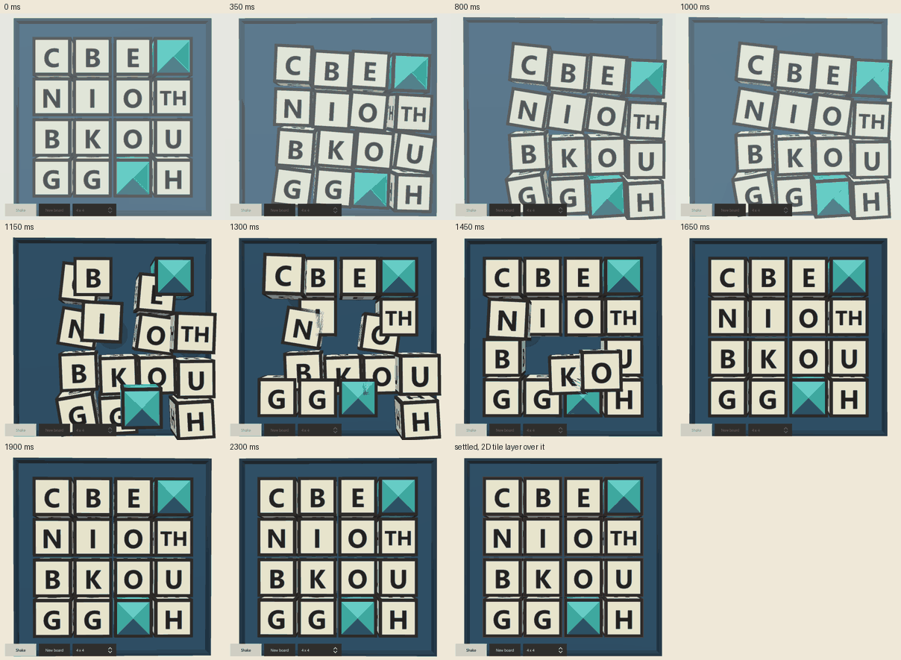
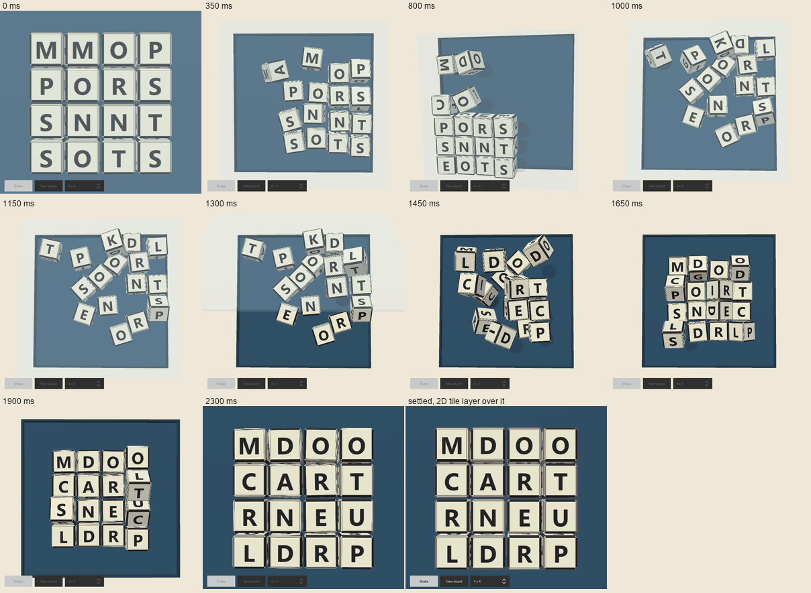
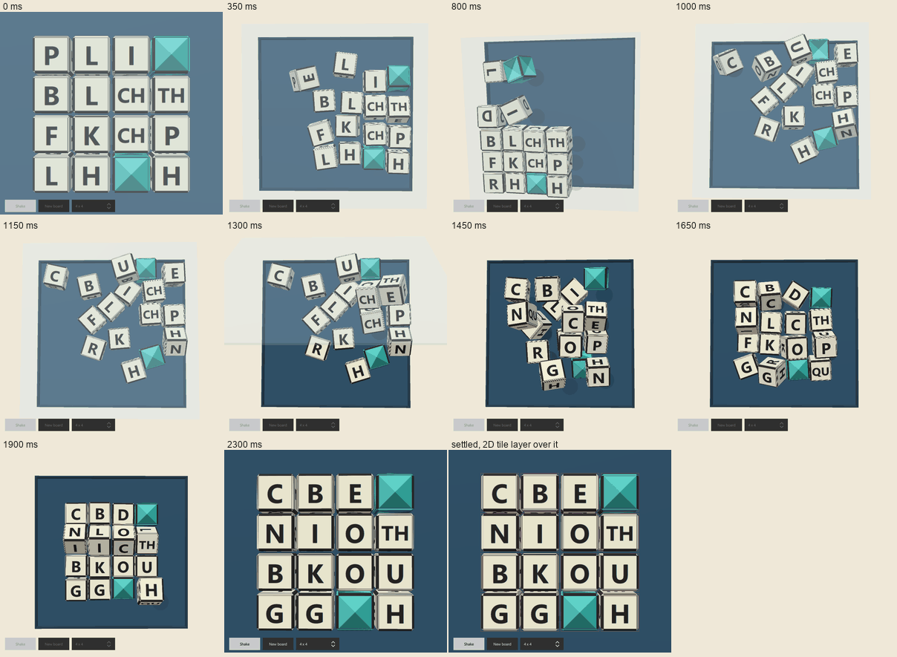
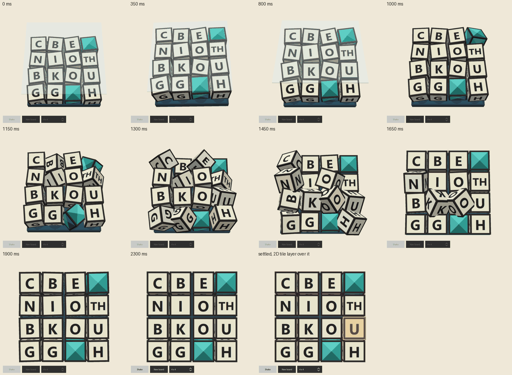

# Shake prototype

The board scene of [Board](board.md#the-shake-and-the-drop), built in Qt Quick 3D
behind its one-component seam, what it cost on one desktop, and the harness it was
measured with. It is the scene the application plays: the QML module
`WordJewelsSolver.Scene` (in `src/app/scene`, with its QML in
`src/app/qml/scene`) is linked by both `WordJewelsSolver` and the harness,
`ShakePrototype`. The harness is still a program of its own, for timing, stills
and the physics that are not a game screen.

**Nothing here was measured on an iPad, or on any tablet or phone.** The shared
Qt tree has no iOS kit, so the prototype could not be built for one. Every
figure is from one Windows desktop (below), and the multiple to a tablet is
still the estimate [Performance](performance.md#budgets) already makes.

**Licence.** A build that links Qt Quick 3D is **GPL-3.0 only**: Qt offers
`Quick3D` as `LicenseRef-Qt-Commercial OR GPL-3.0-only` (SBOM, checked in
[Board](board.md#rendered-3d-or-drawn-in-2d)). `WordJewelsSolver` links the scene
module and so is GPL-3.0 only; `ShakePrototype` links it too. The decision stands
as the author made it on 2026-10-16: the MVP is a private build, and D2 is taken
before any store, with the seam in hand. The 2D implementation of the same
interface is kept at `src/app/qml/scene/fallback/` and is not built.

## Deploy

Before the application linked Quick 3D itself, `windeployqt` already copied
`Qt6Quick3DUtils.dll` (GPL-3.0 only in the SBOM) into the application's deploy
directory, because it copies the QML debugger's
`qmltooling\qmldbg_quick3dprofiler.dll`, which depends on it. The plugin loads
only when QML debugging is switched on, but it was in the folder that would
ship. `src/platforms/windows/platform.cmake` now passes
`windeployqt --skip-plugin-types qmltooling`: the whole debugger plugin type is
left out, so no program gets the Quick 3D profiler plugin, and a program that
does not link Quick 3D no longer gets `Qt6Quick3DUtils` through it. A program
that does link Quick 3D still gets `Qt6Quick3DUtils` as one of that module's own
runtime DLLs, which is expected: the application now links Quick 3D and is
GPL-3.0 only. The deploy log says
`Skipping plugin qmldbg_quick3dprofilerd.dll due to skipped plugin type
qmltooling` for every program this function deploys.

## What was built

| Part | Where | What it is |
| --- | --- | --- |
| The scene | `src/app/qml/scene/BoardScene.qml` | The component: a `View3D`, the box, the lid, one `Model` for each die, a letter atlas, a baked light probe. Draws the poses the script gives it. It is the application's, in the QML module `WordJewelsSolver.Scene` (`src/app/scene/CMakeLists.txt`) |
| The script | `src/app/qml/scene/ShakeScript.js` | The shake, lid and landing as a function of the board, the seed and the time, in two ways: prescribed curves (staged) or the simulated dice. Keeps the clock, the stages, the box, the lid and the camera. Plain JavaScript, no QML and no renderer |
| The dice | `src/app/scene/sim/` (the `wjs_dice_world` library), `dice_sim.*`, `die_geometry.*` | Rigid cubes in a box, simulated from first principles by sequential impulses, in about 1,400 lines of plain C++ with no Qt, and two thin objects over it for QML: the simulation, and the mesh of a bevelled die whose six letters each turn a quarter turn at a time. Tested without a window by `tests/prototype/dice_world_test.cpp` |
| The faces | `src/app/qml/scene/FaceAtlas.qml`, `src/app/qml/scene/Die.qml` | One texture for the board's dice, a block of 3 x 2 cells for each, a cell to a face; each die's cube samples its own block. A dead jewel is a die of six cells of four facets, drawn once and shared. The scene holds two atlases, so that a board can be drawn ahead (`prepare`) |
| The harness | `src/app/prototype/shake/qml/ShakeWindow.qml`, `frame_stats.*`, `dice_roller.*`, `main.cpp` | A window with a Shake button, a mouse drag standing in for the accelerometer, a reduced-motion switch, a 2D tile layer over the scene, the library's dice roll (`DiceRoller`, which links `wjs::lib` and embeds `data/dice`), and the timing and measurement runs. It imports the scene module and creates the same `BoardScene` the application plays |
| The probe | `tools/lightprobe`, `src/app/qml/scene/lightprobe/sky.ktx` | Qt's procedural sky prefiltered in advance (128 x 128 texels a face, 1 MB), made by Cubeulator's tool over the same sky |

It is behind `-DWJS_BUILD_SHAKE_PROTOTYPE=ON`, off by default. The application no
longer needs the option: with `WJS_BUILD_APP=ON` it links Quick 3D and the scene
module, so its binary is GPL-3.0 only. The scene has no game rules in it: a face
is an opaque string and `""` is a jewel (a dead jewel is a die of six). Its
script is also run by a ctest case when the application is built
(`tests/app/shake_script_test.cpp`), against the application's copy of the file.

### The interface

| Member | Kind | Meaning |
| --- | --- | --- |
| `play(board, seed)` | function | Shake, lid, drop, settle, for `board = { rows, columns, tiles, faces, up }`: for each tile, row-major, its letters, the six faces of the die on it, and which is up ([Real faces](#real-faces)). The dice are in the box at the first frame |
| `show(board)` | function | The board already down, with no motion: a resumed game, a rotated window |
| `prepare(board)` | function | Draws the board's faces ahead of `play` or `show` of that board, so that the frame in which it arrives has less to do ([the real faces](#the-real-faces)); nothing changes on screen. A board that was not prepared is drawn when it arrives, as before. The application gives the dealt board to it and starts the play on the next frame |
| `reducedMotion` | in | The cross-fading variant of every stage |
| `pushMotion(ax, ay, az, wx, wy, wz)` | function | One sample of the device's motion, about a hundred a second: the accelerometer's reading in g, gravity included (face up and still it reads 0, 0, 1; x right, y up the screen, z out of it), and the gyroscope's in rad/s. The dice answer to it sample for sample, and the rattle holds on, up to 3 s, while it reads as shaking. With none, a seeded stand-in shakes |
| `settled()` | signal | Once per play, when the dice have stopped |
| `landed(index, pitch)` | signal | A die has come down on its cell: its place in the board, and a pitch for its click |
| `rattled()` | signal | The box rattles, at most 8 a second, for the haptic tap |
| `busy`, `rows`, `columns`, `tileSize`, `tileGap`, `boardRect` | read-only | The geometry by [the rule](board.md#the-rule), for the 2D layer that traces over the scene |
| `overdraw` | read-only | How far past its item the scene draws, on every side (0.8 of a tile), so a die tumbling at the edge and the tipping rim are not cut off. The item is still the board's area; the application must not `clip` it |

`lean`, `probeMode`, `cameraDistance`, `warmUp`, `weighted` and `mockBurstMs`
are settings of the 3D implementation and are not part of the seam.
`seek(board, seed, ms)`, `digest(board, seed)` and `faceReport(board, seed)` are
for tests and pictures.

The application creates the scene once, behind home, in `Main.qml`: `SoloScreen`
is made at start-up and kept, rather than built when Solo Play is opened or when
Shake is pressed. The box it draws before the first board is the scene's empty
board (no dice, the lid on). A board with no faces in the map, as the phonics
board and a board the store brought back have, is drawn with the tile's letters on
all six sides, the way the first scene drew it.

### The two scripts

**Simulated** (the default; the property is still called `weighted`) and
**staged** are two ways of making the same play, chosen by `weighted`; reduced
motion is the same cross-fade in both. The harness has a switch for it so they
can be compared in one window.

**Staged** is [the stages of the board page](board.md#the-stages) as prescribed
curves: dice hover a tile above their cells and jitter on sine waves, then fall
in a seeded order on a parabola with one rebound, and the camera comes upright
over the fall.

**Simulated** is the same play with the stages kept (the shake for as long as
the device shakes, 0.4 s at least and 3 s at most; the lid; the dice go home)
and the dice in between simulated, from first principles, as rigid cubes in a
box. This is the fourth version of the motion, and the first that is a
physical model (see [What it looked like](#what-it-looked-like)).

- **Rigid cubes with mass.** A die is a cube of one tile's edge and one unit of
  mass, so its moment of inertia is 1/6 about every axis through its centre (a
  cube has no gyroscopic term). A tile is taken as 20 mm, so 1 g is 490.5 tiles
  a second squared and time is real: a die falls a tile in 64 ms. Position,
  orientation (a quaternion), velocity and angular velocity are integrated at a
  fixed 1,200 steps a second in double precision; the scene sees 20 steps a
  frame.
- **The input is the device's own signal.** In the box's frame a die is
  accelerated by *minus what the accelerometer reads*: gravity, a tilt, a shove
  and a jolt are one thing, and a spike in the reading is a spike in the dice.
  The gyroscope adds the centrifugal, Coriolis and Euler terms of the box's
  turning, to the position and to the die's own spin. That is six axes, about a
  hundred samples a second, each taken as the reading for its share of a
  frame, so a jerky hand is a jerky shake.
- **A box with room in it.** A floor, four walls 1.4 tiles past the board on
  every side, and a lid 3 tiles up, so that a die can leave the floor, roll
  over, stack on another and slide off, hit the lid, and tumble. (At 0.6 of a
  tile past the board and a lid at 2.4 the sixteen dice were a packed grid that
  could only slide as one piece, and 0 or 1 of them rolled over in a shake.)
  The camera stands back while the box is shaken, so that all of it is in the
  item, and comes in as the dice go home, to be square by the time the last is
  down; the board is at its own scale at rest, and the 2D layer over it is
  unchanged.
- **Contact.** Two dice are tested on all fifteen separating axes; a face
  against a face is clipped to up to four contact points and an edge across an
  edge gives one. A die's eight corners are tested against each plane of the
  box. Points within 0.03 of a tile of touching are held too, so a die cannot
  close on a surface in one step. Each contact is solved by sequential
  impulses: an impulse along the normal that can only push, and two friction
  impulses held inside the cone of the normal impulse, accumulated and carried
  to the next step for the contacts that persist (warm starting), six passes a
  step, with what overlap is left pushed out in position alone so it adds no
  energy. A fast impact bounces by the contact's restitution, and the closing
  speed it is taken from is read before any carried impulse is applied. Floor
  0.52 restitution, 0.5 friction; walls 0.45 and 0.2; lid 0.38 and 0.2; dice
  against dice 0.60 and 0.3 (hard plastic dice on a hard board; the first
  values, 0.25 to 0.40, were dead: they did not bounce as the author expects,
  and it was the bounce, more than anything, that made dice roll over).
  **These are starting values, not measured from real dice.** Each die's grip and bounce differ from the next's by up to 15%,
  seeded, as no two real ones are alike.
- **Home (the guide).** The physics decides how a play looks and never where a
  die ends, nor which of its faces is up, because the board is decided before
  the play. When the reading goes still, the lid lifts, and from a moment of its
  own in the seeded order each die is kicked up (a hop of 0.3 to 1.6 tiles, by
  how far it has to go; the dice that have furthest to go start first, so that
  they cross the box while it is still open), pulled toward its cell by a
  spring in the plan and turned flat and square to the board by a spring on its
  orientation, its friction nearly off. The dice still collide on the way. A
  die that is on the floor and not getting closer (not by 0.05 of a tile in 0.07
  to 0.19 s, a time of its own, so that two that are stuck against one another
  do not hop in step) hops again, higher, over the others. When every die has
  been on its cell, flat and still, for 40 ms, they are put exactly there and
  the play is over. If that has not happened 1.8 s after the last die started,
  they are put there anyway.
- **Its cell, and its face.** A die has faces of its own (the library's die on
  that tile, [Real faces](#real-faces)), so it is a particular die and goes to
  the cell the roll gave it: dice that were interchangeable could go to the
  cell that is nearest (the assignment that makes the dice travel least in the
  plan, by the Hungarian method, which the simulation still does, and the
  script does when the board gives no faces), and these cannot. The face that
  is to be up is given to the simulation, and the guide squares the die to the
  nearest of the four ways to lie with that face up, and not the nearest of the
  twenty-four. A die that is not on that face when it is launched is thrown
  1.7 tiles up, so that it has time in the air to turn over (a die on the
  floor is held there by its weight more firmly than the guide's spring turns
  it: in the simulation, a die that had to turn a quarter turn lay on the wrong
  face for the rest of the play), and one that lands on the wrong face is
  thrown again, as one that is stuck is.
- **The letters.** A die is a `DieGeometry`, a cube with a small bevel whose six
  faces each read their own cell of the die's block of the atlas (3 cells
  across and 2 down) and each have a quarter-turn setting for the letter. Once
  the lid is going, the face that is up has its letter turned to read upright
  for the way the die would lie if it were squared to the board, so by the time
  a die is down its letter reads upright, and a die that lands on a side shows
  that side's own letter.

With no device there is a stand-in, `mockSampleAt(seed, k)`, a function of the
seed and the sample number. It is meant to be a hand, not a signal generator:
a burst of 0.8 to 1.2 s of strokes at three to five hertz that wanders, back
and forth along an axis that drifts, reaching 2.4 g at the turns, with the up
and down of the arm (to 2.4 g) so that dice leave the floor, a little ripple
from the box, small knocks now and then, noise on every sample, a slow tip of
the device, and a twist on the gyroscope that goes with the strokes. The Shake
button, a replay and the tests use it, so they are the same shake every time;
a real device, or the drag in the harness, is live.

It is seeded and replays: the same board, seed and stream give the same
checksum, because the step is fixed, the arithmetic is double precision, and
the only random numbers are a generator seeded from the seed. That holds for
one build on one machine; it is **not** promised across compilers or
processors, whose floating-point rounding (fused multiply-add, for one) can
differ, and a replay that has to be exact across them would need the dice
stored, or an integer simulation.

| Play (simulated) | Measured, play to `settled` | What it is |
| --- | --- | --- |
| 4x4, full motion | 1.72 to 2.52 s | A 1.05 to 1.28 s shake (a burst of 0.8 to 1.2 s and the time for the reading to go still), the 0.25 s of the lid, and 0.47 to 0.88 s for the dice to go home (the lid lifts while the first dice go) |
| 3x3, full motion | 1.44 to 2.34 s | The same |
| Either, reduced motion | 0.55 to 0.57 s | 0.30 rattle, 0.12 lid fade, 0.12 dice fade |
| Rattle held at full | 3.5 to 4.6 s | A 4 s burst, cut at the 3 s limit, then the lid and the hops |
| The mouse drag, 2 s of it | 1.9 to 2.4 s | A scripted back-and-forth pointer path, with the arm's up and down added |

(Staged: 1.97 s at 4x4 and 1.73 s at 3x3, with a 0.87 s drop.)

How it moves, from the script run by itself, four seeds on the 4x4, as the
screen at 60 Hz sees it (a tile is the die's edge):

| | |
| --- | --- |
| Shake, then the lid, then home | 1.05 to 1.28 s, then 0.25 s, then 0.47 to 0.88 s |
| Speed of a die, peak; 95th percentile | 64 to 78 tiles a second; 44 to 52 (1.3 to 1.6 m/s for a 20 mm die: a hand's stroke) |
| Distance a die moves in a frame | median 0.10 to 0.16 of a tile, 95th percentile 0.73 to 0.86, none over 1.3 |
| Turn in a frame | 95th percentile 17 to 22 rad/s; none over 1.0 rad a frame |
| Acceleration seen at 60 Hz (second difference), 99th percentile | 5.4 to 6.2 g |
| Dice off the floor by more than 0.15 of a tile | 36 to 45% of die-frames; all sixteen at once at some frame in every play |
| Highest a die's centre gets | 2.5 to 4.2 tiles (the lid is at 3; the highest are thrown past it as it lifts) |
| What an average die does in a play | 24 to 33 tiles of path; 395 to 632 degrees of turning |
| Dice that end the shake on a different face than they began on, over 300 shakes of 4x4 with 2.4 g strokes in the simulation alone | 10.7 of 16, turning 627 degrees each (3x3: 6.7 of 9, 402 degrees; 5x5: 14.7 of 25, 890). At 0.6 of a tile of room, 0.3 of 16, 110 degrees |
| Deepest overlap between two dice, or past a wall, over 300 plays of 4x4 and 100 of 3x3 with the tests' gentler stand-in (every 50 ms) | 0.05 of a tile between dice or into a wall; 0.03 of a tile outside the box |
| Shakes in which the dice did not all reach their cells, in the simulation alone | 0 of 300 each of 3x3, 4x4 and 5x5 with the scene's stand-in (the slowest took 1.2, 1.6 and 2.4 s from the end of the shake), and 0 of 300 (4x4) and 0 of 100 (3x3) with the tests' gentler one (0.9 to 1.1 s) |

### The dice, checked against paper

The simulation is validated by what can be worked out on paper, in
`tests/prototype/dice_world_test.cpp` (20 cases, 1,746 checks, 2.5 s, run by
`ctest` with the rest when the option is on), and the numbers below are what
those cases measure, with identical dice (the 15% variety off) and no air:

| Case | Paper says | The simulation gives |
| --- | --- | --- |
| Free fall, 0.1 s | s = g t²/2, 17.5475 tiles from 20 | 17.5271; the 0.8% of the fall is the first-order step, half of g h t |
| The box accelerates (0.5, -0.25) g | the die goes the other way by half of 0.5 g t² | -1.2365 and 0.6182 against -1.2263 and 0.6131 |
| A box turning at 2 rad/s, a die 3 tiles out | centrifugal: ω² r t = 0.1200 in 10 ms | 0.1200; the Coriolis term's sign and the Euler term's size are checked too |
| A free die spinning at 3.74 rad/s for 1 s | the same spin, turned by 3.74 rad | off by less than 0.00001 rad |
| A die dropped flat, from 2 tiles, restitution 0.52 | rebounds e² h = 0.5408 | 0.5518 (+2.0%) |
| A die sliding from 20 tiles/s, friction 0.5 | stops after v²/(2 μ g) = 0.8155 | 0.8071 (-1.0%) |
| A slope of 20° (tan 0.36, under the friction 0.5) | holds | moved 0.00000 in 1.5 s |
| A slope of 35° (tan 0.70, over it) | slides g (sin a − μ cos a) t²/2 = 3.6199 in 0.3 s | 3.6302 (+0.3%) |
| Two dice head on, 10 tiles/s, restitution 0.6 | 2.000 and 8.000 afterwards | 2.001 and 7.999; momentum 10.0000 |
| An off-centre hit | momentum conserved, energy not made | (12.00000, 0, 0) of (12, 0, 0); 72.0 to 53.1 |
| A stack of three dice, 2 s | stands | drift 0.0002, height error 0.0002 |
| A die 0.3 off the centre of the one under it | stands (the centre of mass is over the support) | 0.30025, no turn |
| A die tipped 20°, 40°, 50°, 70° on an edge, 2 s | falls flat, onto its own face below 45° and onto another above | flat (an axis within 0.03 rad of vertical), as predicted |
| A die thrown at the lid and the walls | stays in the box | never more than 0.05 of a tile out (the check's limit) |
| Sixteen dice shaken hard | stay in the box, out of one another | 0.05 of a tile at the deepest |
| A replay | is the same replay | the same checksum, a different one for another shake |
| The least-cost assignment | is the least cost | equals the best of all 720 permutations, 30 random matrices |
| The die that is up, and its letter's turns | the letter reads upright | 60 random orientations |

What this is **not**: it is not compared with a real die, a real box, or a
real hand. It does not model a die's rounded corners (the bevel is drawn, not
simulated), felt or board compliance, air, a shaker's walls being anything but
rigid, or sound. The friction and bounce are plausible starting values and
the author is the judge of whether it *feels* right.

**Cost.** In plain C++ in Release on this desktop, a 4x4 play costs 1.24 ms
of a frame on average (20 steps), 2.9 ms at the 99th percentile and 4.7 ms at
worst, which is 62 µs a step; a 3x3 costs 0.59 ms on average. This is on the
GUI thread, with the script, and a tablet's core is slower, so it is the first
thing to measure on one. Four passes instead of six cost about a fifth less in
the same test, with the dice a little less exact (a die at rest flat to 0.011
rad and the deepest overlap 0.037 of a tile), and 600 steps a second would
halve it again; neither was tried at the scene.

## Real faces

The first prototype put one letter on all six sides of a die, because it was
given one string for each tile. A real die has six different letters and a shake
leaves one up, so the scene is now given the dice, as
[Board](board.md#what-the-scene-is-given) says: `faces[t]` is the six strings of
the die on tile `t` and `up[t]` is which is up, with `faces[t][up[t]]` the tile's
letters. The library supplies them: `wjs::roll_with_placements` returns the die
and the face for each tile of a roll, and the harness's `DiceRoller` turns a roll
of the shipped set (`data/dice`, embedded in the program) into that shape. The
scene reads no letter. The standard board of the harness is that roll; the
phonics board is still a stand-in (below).

| Part | How it is made |
| --- | --- |
| The cube | `DieGeometry`'s six faces each read a cell of the die's block of the atlas, face `f` of the library's die on the cube's face `f` (the simulation's numbering: +x, -x, +y, -y, +z, -z) and in cell `f` of the block; the bevels and corners sample the dark border of a cell of a face they touch. Before, all six faces read the one cell |
| The atlas | A block of 3 x 2 cells for each die, a cell to a face (`FaceAtlas.qml`). A die's texture offset and scale pick its block, as they picked its cell. The atlas is a layer, drawn once into one texture that every die's `Texture` reads, and its cells are items made as a board needs them and kept ([the cost](#the-real-faces-made-cheaper)) |
| Which face is up (simulated dice) | The simulation is told which face of each die is to be up (`DiceSim.setTargets`), squares the die to that face when it is home, and throws a die that has to turn over high enough to do it in the air ([the guide](#the-two-scripts)). A die goes to its own cell. At rest it is the face the board says |
| Staged | A die lies on a random face in the box and turns over as it falls, landing with its up face on top (the cube's own turn, `tw`, `tx`, `ty`, `tz`, in the script's state) |
| Reduced motion | Nothing tumbles: the dice fade in on their up faces |
| A dead jewel | A die of six jewel cells, so every way up is the jewel. The jewel is drawn once into a texture of one cell, and each jewel cell shows that texture |

**Until it is sent home a die is unchanged by its faces.** The faces are given to
the simulation and read by the guide, the settle test and `finish`, and by
nothing before the lid goes. A unit test of the simulation holds that, for a
shake with and without faces asked for, the dice are the same (the same
checksum of every die's state) until the guide starts, and that the replay of a
play is the same replay; the script test holds it at four times through a
shake. After that a die that is not on its face is thrown higher and turns
over, by design, so the way home is not the same: in the simulation alone, with
the unit test's shake, every die of 3x3, 4x4 and 6x6 came home on the face
asked for in 0.6 to 1.0, 0.8 to 1.3 and 1.6 to 2.0 s, against 0.45 to 0.53, 0.68
to 0.98 and 1.24 to 1.48 s for the same boards with no face asked for. (That is
six plays of each size; before a die that landed on the wrong face was thrown
again, 15 of the 18 did not come home at all: a die lying flat on the wrong
face stayed there.)

**What a viewer sees of the other faces.** `--auto --digest` plays a board and
counts, frame by frame at 60 Hz with the stand-in's shake, the faces that were
uppermost at some frame (the tips of a die in flight, which show side faces
too, are not counted). Seed 7 of the library's dice, and of the stand-in, played
with seed 100:

| Board | Tiles that are their die's face up | Different letters on a die (mean) | Land on the face that is up | Faces uppermost in a play (mean, most) |
| --- | --- | --- | --- | --- |
| Library dice 3x3 | 9 of 9 | 6.00 | 9 of 9 | 3.11, 5 |
| Library dice 4x4 | 16 of 16 | 6.00 | 16 of 16 | 2.94, 5 |
| Library dice 5x5 | 25 of 25 | 6.00 | 25 of 25 | 3.48, 6 |
| Library dice 6x6 | 36 of 36 | 6.00 | 36 of 36 | 2.83, 6 |
| Stand-in 3x3, 4x4, 5x5, 6x6 | all | 5.4 to 5.7 (a dead die has one) | all | 2.7 to 3.8, 5 or 6 |

Under reduced motion nothing tumbles (one face, 1.00) and every die lands as
asked. The staged script shows a die about two faces (the one it lay on and the
one it lands on, and what the turn passes between). The same checks, on six
boards (3x3 and 4x4, three seeds each) and the three scripts, are the ctest
case "the shake script lands each die on the face the roll says and tumbles the
others"; it fails if the up face is ignored. The simulation's own are in
`tests/prototype/dice_faces_test.cpp`.

**What it does not do.** The opposite faces of a die are the cube's arrangement,
not the die's (the library says which six letters a die has and nothing about
their neighbours). A die goes to its own cell, so after a shake that has thrown
the dice about, some cross the box over the others where the least-travel
assignment would have had them go to the nearest: that is part of the 0.3 to
0.6 s the faces add to the way home. The phonics board's dice are a stand-in in
the harness (a tile on one face and five others drawn from the harness's pool,
six different letters); what faces the phonics board's dice have is an open
choice that is not made here.

## How it was measured

| | |
| --- | --- |
| Machine | Windows 11 Pro for Workstations 10.0.26200; AMD Ryzen 9 5950X (16 cores, 32 threads); NVIDIA GeForce RTX 4090 (driver 32.0.16.1742). Shared with other work, not quiesced |
| Renderer | Qt RHI on Direct3D 11, threaded render loop, flip-model swap chain, MSAA Medium. Qt reports the window's display at 60 Hz (a vsync of 16.68 ms) |
| Software | Qt 6.12.0 (`msvc2022_64` of the shared tree), MSVC 19.51, Release (`/O2`), QML compiled to C++ ahead of time |
| Window | 560 x 900 logical pixels, the scene in the top two thirds. The tables are from the **staged** script, which was the only one when they were taken; the simulated dice are under [the simulated dice in the same harness](#the-simulated-dice-in-the-same-harness) |
| Also tried | Qt's bundled Mesa llvmpipe through OpenGL (`QSG_RHI_BACKEND=opengl`, `QT_OPENGL=software`), as a stand-in for a device with a weak GPU; **not** a model of an iPad |

Frame times are the interval between `frameSwapped` signals. The render thread's
CPU time for a frame is `beforeFrameBegin` to `afterFrameEnd`; **it is the time
spent recording and submitting the frame, not the GPU's.** GPU time was not
measured. With a 60 Hz display every interval is near 16.7 ms, so "over 16.7 ms"
counts about 40% of all frames by a fraction of a millisecond. A missed refresh
is an interval of 25 ms or more, so the tables give over 20, 25 and 33 ms.

```powershell
cmake --preset windows-msvc-release -DWJS_BUILD_APP=ON -DWJS_BUILD_SHAKE_PROTOTYPE=ON
cmake --build --preset windows-msvc-release --target wjs_shake_prototype
$env:QT_ASSUME_STDERR_HAS_CONSOLE = 1      # the program is a GUI program; this shows its log
build\windows-msvc-release\bin\ShakePrototype.exe                       # to play with
build\windows-msvc-release\bin\ShakePrototype.exe --auto --runs 6 --out results   # timing
build\windows-msvc-release\bin\ShakePrototype.exe --auto --shots --out shots      # stills
build\windows-msvc-release\bin\ShakePrototype.exe --auto --shots --frames 30 --size 720x900 --out frames   # every frame, for a video
build\windows-msvc-release\bin\ShakePrototype.exe --auto --digest --out digest    # replay check, the faces, and a trace of every pose
build\windows-msvc-release\bin\wjs_dice_tests.exe                                  # the dice's physics against paper and the faces they end on, no window
ctest --preset windows-msvc-release                                                 # everything, with the option on
build\windows-msvc-release\bin\ShakePrototype.exe --auto --change --sizes 3,4,5,6 --out change   # the cost of changing the board
build\windows-msvc-release\bin\ShakePrototype.exe --auto --change --prepare --sizes 3,4,5,6 --out prepare   # the same, with each board prepared a frame ahead (the frames of prepare() are the result's "prepare")
build\windows-msvc-release\bin\ShakePrototype.exe --boards phonics   # the stand-in board of the earlier tables (the default is the library's dice)
```

## What it cost

### Making the view

| | Cold pipeline cache | Warm cache |
| --- | --- | --- |
| Load `BoardScene.qml` (the Quick 3D module, the component) | 14 to 17 ms | 14 ms |
| Create it (`createObject`: the `View3D`, 16 dice, their materials) | 3 ms | 3 ms |
| First frame after that, to the swap | 454 ms (447 ms of it on the render thread) | 214 ms |
| The same with the first-shake warm-up off | 411 ms | 171 ms |

Cubeulator measured about 140 ms to create each of its cube views
([Board](board.md#rendered-3d-or-drawn-in-2d)); here the objects are made in
3 ms and **the cost is the first frame**, which is Qt Quick 3D generating and
compiling the shaders of the materials, once, at run time. The cache is the
pipeline cache Qt writes beside the application's data; a hot one is about half
the cold. The driver keeps its own, which was not cleared. **So the view is
made once, behind the home screen, and not on the press of Shake.**

### The first shake

The first play of a process is a different case, because a path that is only
drawn while things move (the translucent lid, the shadows, a die with an
opacity) has not been used yet.

| First shake of the process | Press to first frame | Render-thread time of that frame | Next five frames |
| --- | --- | --- | --- |
| No warm-up | 47.7 ms | 42.4 ms | 1.2, 4.2, 8.2, 10.9, 4.0 ms |
| With the warm-up | 17.9 ms | 1.1 ms | 0.9, 0.3, 1.0, 0.4, 0.3 ms |

The warm-up is three frames at 2% opacity of the lid, shadows and dice, drawn
once while the first board is shown. (The first try, at 0.4%, did nothing: Qt
does not draw below some small opacity, and the threshold was not looked up.)
It moves about 40 ms into the creation frame above. The 47.7 ms without it is
the only frame on Direct3D 11, after the scene was made, over the
[33 ms budget](performance.md#budgets).

### Two cadences

The same binary, run twice in a row on the same machine, presented at two
different rhythms: intervals of 16.7 ms and a press-to-first-frame of about
16 ms, and then intervals of 11 to 12 ms and a press-to-first-frame of 53 to
65 ms, with the same render-thread time. It happened with the overdraw off and
on, so it is not the scene. The suspect is which of the machine's displays (it
has a 100 Hz mode) the window opened on; it was not investigated. The tables
below are from runs in the 16.7 ms rhythm, and the 18 ms first-shake figure
with the warm-up is from there; the 48 ms without it is in the same one.

### During the shake and the drop

All the plays of three processes, each process's first play left out
(see above), 9,337 frames; Direct3D 11, the baked probe, the warm-up on.

| Play | Plays | Frames | Interval p50 / p99 / max | Over 20 / 25 / 33 ms | Render thread mean / max |
| --- | --- | --- | --- | --- | --- |
| 3x3 full | 15 | 1,545 | 16.7 / 17.2 / 17.8 ms | 0 / 0 / 0 | 0.35 / 0.92 ms |
| 4x4 full | 18 | 2,112 | 16.7 / 17.4 / 19.8 ms | 0 / 0 / 0 | 0.45 / 1.45 ms |
| 3x3 rattle held 3 s | 9 | 2,161 | 16.7 / 17.3 / 20.0 ms | 0 / 0 / 0 | 0.40 / 1.38 ms |
| 4x4 rattle held 3 s | 9 | 2,296 | 16.7 / 17.2 / 19.6 ms | 0 / 0 / 0 | 0.47 / 1.50 ms |
| 3x3 reduced | 18 | 612 | 16.7 / 17.2 / 18.1 ms | 0 / 0 / 0 | 0.29 / 0.74 ms |
| 4x4 reduced | 18 | 611 | 16.7 / 17.3 / 19.5 ms | 0 / 0 / 0 | 0.38 / 1.02 ms |

On this machine the scene is far inside its frame: no frame was late, the
render thread spends about half a millisecond on a frame, and the longest
interval was 20 ms. (Drawing past the item, below, makes the view a tenth
bigger each way and added about 0.1 ms to the render thread's mean, from two
more processes of six plays each; the intervals did not change.) That says
nothing about a tablet's GPU, which does the work the render thread only
submits. The two things to measure on the device are the
GPU time of a frame with 16 dice and MSAA, and the first-frame cost above.

### Replay

`--auto --digest` checksums every pose of a play (the quaternions too, when the
dice are simulated), frame by frame at 60 Hz with the device still, and writes
the pose of every die at every frame (`trace-100.txt` and three more) for
looking at the motion. The same board and seed gave the same checksum twice, a
different seed a different one, and reduced motion its own:

| Script, board (seed 7) | Seed 100, then again | Seed 101 | Reduced, seed 100, then again |
| --- | --- | --- | --- |
| Simulated, library dice 3x3 | `ec8747fc`, `ec8747fc` | `9016cfb` | `5c6eadfd`, `5c6eadfd` |
| Simulated, library dice 4x4 | `db77bef9`, `db77bef9` | `38ee1b03` | `faa109a5`, `faa109a5` |
| Simulated, library dice 5x5 | `43e5469f`, `43e5469f` | `8f876ee8` | `15ee5e1d`, `15ee5e1d` |
| Simulated, library dice 6x6 | `75a5472`, `75a5472` | `932844ef` | `788b8eb9`, `788b8eb9` |
| Simulated, stand-in 3x3 | `390bb03f`, `390bb03f` | `c417f199` | `edb0db61`, `edb0db61` |
| Simulated, stand-in 4x4 | `b9da5067`, `b9da5067` | `481146f0` | `3e4c8909`, `3e4c8909` |
| Staged, library dice 3x3 | `5335e2c9`, `5335e2c9` | `25376b66` | `5c6eadfd`, `5c6eadfd` |
| Staged, library dice 4x4 | `650013a2`, `650013a2` | `83613d72` | `faa109a5`, `faa109a5` |
| Staged, stand-in 3x3 | `d42820ee`, `d42820ee` | `ce8b479e` | `edb0db61`, `edb0db61` |
| Staged, stand-in 4x4 | `acd7fd74`, `acd7fd74` | `c27aa426` | `3e4c8909`, `3e4c8909` |

A checksum is of the poses in pixels (for the harness's window, 560 x 900) and
of each die's orientation, which, with the dice's faces, is why every earlier
checksum is replaced: the board's faces are in it, so the same seed on another
roll is another checksum. The reduced rows are the same script under either
name. The simulated rows are for this build on this machine, as
[above](#the-two-scripts) says. The faces enter the simulation only when the
guide starts: a unit test holds that two shakes of the same dice, one with the
faces asked for and one without, are the same dice until then.

Moving the script out of the scene file into `ShakeScript.js` left the stills
identical, pixel for pixel but one pixel one level off. What the checksum does
not cover is a live device: the same board with a different shake is a
different play, by design, and ends on the same cells.

### The drag

A mouse drag stands in for the device. The pointer's position at each event is
differentiated twice into an acceleration (the board is taken as 16 cm across),
so the stream is as jerky as the hand: a spike at every start and stop. Where
the pointer is in the scene tips the device up to 8 degrees, and its speed
twists it. A mouse cannot lift the device, and with no lift the dice have no reason
to leave the floor and slide as one block (the author's report), so the drag
adds the up and down of an arm: the vertical reading follows the sideways
acceleration (0.8 of it, to 4 g). Each sample goes to `pushMotion`, and to a
stand-in for the shake detector, which starts a play when the hand reads 0.8 g or more of shaking: so
the way to use it is to take hold of the board and shake it, and the dice start
to go when the hand does, and are held for as long as it keeps shaking, up to
3 s.

One measured play sent the window a scripted back-and-forth pointer path for
two seconds (`dragBetween`, so the pointer path through the scene is exercised
without a hand): the hand's shaking peaked at 5.9 g, which is a mouse being
swept across the board and not a hand holding a device, the play was 1.7 s, and
the longest interval was 17 ms. How it *feels* in a hand is unjudged.

### The light probe

| Probe | Cost on Direct3D 11 | On the software renderer |
| --- | --- | --- |
| None | First frame 356 ms (cold); a flatter look | Runs |
| Prefiltered at run time (Qt's sky) | +33 ms to create it; first frame 400 and 586 ms in two cold runs | **Never finished a run** in 4 minutes (twice): Qt's pre-filter pipeline failed to build, 2,813 times (below) |
| Baked in advance (the file) | None: first frame 410 and 419 ms in two cold runs | Runs |

On a GPU it does not matter to the cost, as for Cubeulator. On a software
renderer it decides whether the scene draws at all. Against the run-time probe
the baked file's pictures differ by at most 3 of 255 in a channel (mean 0.01 to
0.09), which is not visible; against no probe they differ by up to 43, mean 6,
because the ambient light is missing. **The probe is baked in advance, 1 MB.**

### The software renderer

Qt's bundled Mesa llvmpipe through OpenGL (Mesa 11.2.2, a GL 3.0 context), two
plays of each, the baked probe. A stand-in for a device with no GPU to speak
of; it is **not** a model of an iPad's GPU, and shows only which parts of the
scene cost the most when the pixels are the bottleneck.

| Play | Frames | Interval p50 / p99 / max | Over 20 / 25 / 33 ms | Render thread mean / max |
| --- | --- | --- | --- | --- |
| 3x3 full | 215 | 16.0 / 18.4 / 20.6 ms | 1 / 0 / 0 | 10.3 / 14.8 ms |
| 4x4 full | 229 | 17.1 / 22.3 / 24.0 ms | 26 / 0 / 0 | 13.6 / 20.8 ms |
| 3x3 rattle held | 505 | 15.9 / 18.2 / 28.3 ms | 1 / 1 / 0 | 10.8 / 14.5 ms |
| 4x4 rattle held | 514 | 16.6 / 19.2 / 20.1 ms | 1 / 0 / 0 | 12.8 / 16.7 ms |
| 3x3 reduced | 68 | 16.2 / 56.2 / 122.9 ms | 2 / 1 / 1 | 12.4 / 112.7 ms |
| 4x4 reduced | 55 | 20.4 / 28.3 / 29.7 ms | 31 / 4 / 0 | 16.3 / 24.8 ms |

The first frame after creating the scene took 0.9 s (0.8 s with no probe).
A frame is 10 to 14 ms of the CPU's rasterising, so 60 Hz is held at 3x3 and
almost at 4x4. The reduced-motion plays are the heaviest, which is the part of
the scene drawn blended, and one frame of the 3x3 reduced plays took 123 ms
(85 ms with no probe): the warm-up did not remove it on this renderer.

**The run-time probe did not work on it.** The pre-filter's shaders were not
there for the GLSL this context accepts (it looked for 130 and 120; the file
has 100, 150 and 300 es), so Qt logged "No GLSL shader code found" and "failed
to create pre-filter env map pipeline state" 2,813 times in 4 minutes, and the
run never produced a result (the first attempt, with a 280 s limit, did not
either). This is a limit of that Mesa and not of CPU renderers in general
(Cubeulator got 10 to 16 s on another Mesa). What it shows is that a probe
prefiltered at run time can stop the scene drawing where the GL is old, and a
file cannot. The baked probe ran on it as above.

### The simulated dice in the same harness

Direct3D 11, the baked probe, three processes of six plays of each case, each
process's first play left out: 12,445 frames. The longest interval was 20.4 ms
(none was over 25 ms), and the render thread's mean is 0.40 to 0.63 ms a
frame, with a worst frame of 4.8 ms: the same as staged. (The display ran at
12 to 13 ms in these runs and 16.7 ms in the tables above: the
[two cadences](#two-cadences).) Making the scene took 3.3 to 3.9 ms and its
first frame 228 to 232 ms after that, as before.

The simulation does not show in those numbers, because it runs on the GUI
thread, ahead of the frame, and they are the render thread's. Its own cost is
under [the two scripts](#the-two-scripts): 1.24 ms of a frame on average for a
4x4 play, and the whole prototype, playing, uses 8 to 18% of one core and 1 to
2% of the GPU's 3D engine on this machine, and idle it uses under 1% of a core
and none of the GPU. Checksums for replay are in [Replay](#replay).

### The real faces

What six cells to a die cost, against the branch without them (its tip when
this was merged, `2b528f1`, built beside this one with the same compiler and
flags, with the same `--change` mode patched into its harness so the two measure
the same way). Three processes of each, one after the other on this desktop.
The "after" is two boards: the stand-in the earlier tables used (two dead
jewels, each now a die of six jewel cells) and the library's dice.

**The machine was not quiet, and the frames of a play are not told apart by
this series.** Other work was running on it through the hours it took (builds
and tests, which a script checked for and threw runs away for, and a number of
runs were; the three processes of each kind that are reported were the ones that
got through). In six of the nine the display ran at a normal cadence (16.7 ms,
and 10 ms in one) and the render thread's median frame was 0.53 and 0.58 ms before, 0.59 and 0.62 ms with
the stand-in board, and 0.56 and 0.86 ms with the library's dice; in the other
three, one of each kind, the display ran at about 50 Hz and a frame cost the
render thread 10.3 to 10.4 ms at the median, which is the machine and not the
scene (it was in the baseline as much). The tails (p99 from 9 to 39 ms, the
largest 460 ms) are other work on the machine and are in the baseline too. An
earlier series, against the branch's previous tip (the dice in a box with room,
`ac4e881`), on a quiet machine, had the median at 0.44 ms before and 0.47 to
0.49 ms after, about a tenth more, and nothing in the frames of a play that the
faces did. **The render thread's time is not the cost that matters here:** the
script and the simulation run on the GUI thread, which this did not measure
(the simulation's own cost is under [the two scripts](#the-two-scripts); the
faces add to it only the extra hops of a die that has to turn over, after the
lid has gone).

**The atlas is six times the pixels.**

| Board | Before | Now | In memory (RGBA), before and now |
| --- | --- | --- | --- |
| 3x3 | 384 x 384, 9 cells | 1,152 x 768, 54 cells | 0.6 MB, 3.5 MB |
| 4x4 | 512 x 512, 16 cells | 1,536 x 1,024, 96 cells | 1.0 MB, 6.3 MB |
| 5x5 | 640 x 640, 25 cells | 1,920 x 1,280, 150 cells | 1.6 MB, 9.8 MB |
| 6x6 | 768 x 768, 36 cells | 2,304 x 1,536, 216 cells | 2.4 MB, 14.2 MB |

Creating the view is unchanged within its spread: loading the component 11.9,
11.4 and 11.7 ms (before, stand-in, library dice), creating the objects 3.8, 4.3
and 4.5 ms, and the first frame after it 247, 253 and 260 ms (238, 239 and
248 ms of it the render thread's).

**The cost is in the frame in which the board changes.** `--auto --change` shows
a new board and records the frames after it, six boards of each size in each of
three processes (18 boards of each size for each kind). That frame draws the new
board's faces into the atlas. Means: the time from `show()` to the first frame on
screen, and what the render thread spent on that frame.

| Board | Before | After, stand-in board | After, library dice |
| --- | --- | --- | --- |
| 3x3 | 15.9 ms, 7.3 ms | 32.5 ms, 20.0 ms | 26.1 ms, 12.8 ms |
| 4x4 | 14.4 ms, 7.0 ms | 32.7 ms, 17.4 ms | 21.2 ms, 8.6 ms |
| 5x5 | 22.4 ms, 12.2 ms | 54.1 ms, 32.9 ms | 38.3 ms, 19.0 ms |
| 6x6 | 36.1 ms, 19.1 ms | 89.8 ms, 58.4 ms | 66.9 ms, 37.3 ms |

So, as the faces were added, **a new board cost between one and a quarter and
three times what it did** (the render thread, 4x4 with the library's dice: 7.0
to 8.6 ms; 6x6 with the stand-in: 19.1 to 58.4 ms), and the frame in which it
was drawn was over the [33 ms budget](performance.md#budgets) at 5x5 and 6x6,
and close to it with the stand-in's jewels at 3x3 and 4x4 (32.5 and 32.7 ms on
average, and 65 ms for one 4x4 board); the baseline at 6x6 was already at
36 ms. `play()` sets the board, so the first frame of a shake carries it. What
made the stand-in dearer than the library's board was the jewel: each dead die is six `Shape`s of four facets,
about 0.7 ms a cell by the difference at 4x4 (two dead dice, 12 cells, 8.8 ms
more; the boards' letters differ too). The next subsection is what was
done about it.

**Not measured:** the GPU's time for a frame with the bigger atlas, the atlas's
memory and upload on a device, the GUI thread's time, and anything on an iPad, a
tablet or a phone.

### The real faces, made cheaper

The frame in which a board changes is the cost above, and three things were
tried on it, in this order, keeping what measured better. Each is a commit of
the branch. The harness's `--change` mode is as it was, and it also records how
long the `show()` call itself held the GUI thread, which is the part of the
frame before the first frame is drawn. The tables up to "On the merged branch"
are of the first series, made on the branch as it was when this was begun; the
merged branch was measured again after it.

| Step | What it is | Kept |
| --- | --- | --- |
| 1. The jewel once | The jewel is drawn into a texture of one cell, not live, and each of a dead die's six cells shows that texture (a `ShaderEffect`, whose own shaders show its `source`) instead of a `Shape` of four paths | Yes: the stand-in's frame 8 to 14 ms shorter, and nothing changes for the library's dice |
| 2. Prepare, and the atlas as a layer | `prepare(board)` draws a board's faces a frame or more before `play` or `show` of it ([the interface](#the-interface)). Making it work found the larger saving: an atlas that is only a `Texture`'s `sourceItem`, with no layer, seems to be drawn once for each `Texture`, and each die has one. The atlases are now layers, in the window's tree a long way off its left edge, so one texture is drawn and every die reads it | Yes: the render thread's time for the frame fell from 12 to 3 ms (3x3) and from 35 to 5 ms (6x6, library dice), and `prepare` then takes more than half off the shake's first frame (6x6: 31.2 to 13.3 ms) |
| 3. The cells kept | The atlas's cells (a cream face with its letter, or a jewel) are made as a board needs them and kept, and a smaller board hides the ones it does not use, where each board made them all. Each cell is two items, the face and its letter, with no `Loader`, and the places and letters of all of them are worked out in one pass | Yes: the `show()` call from 25 to 13 ms (6x6), and no cell is made for a board of a size that has been shown before |

**Tried and not kept.** The first form of `prepare` left Quick 3D drawing the
atlas, as it did, and put a cube a hundredth the size under the floor that used
the spare atlas's texture, so that it would be drawn a frame early. It was not:
the render thread's time was 4 ms for the frame of `prepare` at 6x6 and 43 ms
for the frame of `show` after it, against 39 ms for that frame without
`prepare` (the stand-in's board). Making the atlases layers (step 2) is what
makes them draw when they change.

**How it was measured.** The same harness (`ShakePrototype.exe --auto --change
--sizes 3,4,5,6`, with `--boards phonics` and `--boards standard`, and
`--prepare` for the frames of `prepare`), the same desktop and build flags as
the rest of this page, three processes of each build, six boards of each size in
each (18 of each cell). The builds were each copied to a name of their own and
run one after another in each round (before, step 1, step 2, step 3, and the
last two again with `--prepare`), so that anything that drifted touched all of
them. A run was thrown away and made again if another prototype was seen drawing,
or a build or ctest running, in any second of it (33 of 69 attempts: this desktop
is shared). "Before" is the previous subsection's "after" (`c5bb73b`), measured
again in this series: its means are 3 to 12 ms higher than in the table above
(at 6x6, library dice 61.8 ms against 57.7 ms and the stand-in 87.4 ms against
75.5 ms), which is the spread between series on this machine. **Nothing was measured on an iPad**, a tablet or a phone,
and not the GPU's time: these are times on a desktop with a fast GPU, and the
work that moved is mostly CPU.

Means, in ms, of the time from `show()` to the first frame on screen, with the
part of it that is the `show()` call (the GUI thread's) in brackets:

| Library dice | Before | 1. Jewel once | 2. One layer | 3. Cells kept (final) |
| --- | --- | --- | --- | --- |
| 3x3 | 27.9 (9.8) | 24.5 (9.6) | 13.5 (8.5) | **9.2 (5.4)** |
| 4x4 | 23.1 (10.7) | 21.8 (10.8) | 14.5 (10.7) | **9.7 (5.0)** |
| 5x5 | 36.8 (16.5) | 37.9 (17.4) | 21.4 (16.7) | **13.1 (9.1)** |
| 6x6 | 61.8 (24.9) | 63.9 (25.1) | 31.2 (24.7) | **19.0 (12.9)** |

| The stand-in (two dead dice) | Before | 1. Jewel once | 2. One layer | 3. Cells kept (final) |
| --- | --- | --- | --- | --- |
| 3x3 | 34.8 (10.1) | 27.0 (10.0) | 13.6 (9.0) | **9.9 (5.7)** |
| 4x4 | 33.9 (12.0) | 23.8 (11.1) | 15.6 (11.6) | **9.8 (5.3)** |
| 5x5 | 53.7 (17.9) | 42.4 (18.1) | 23.0 (18.0) | **12.9 (8.5)** |
| 6x6 | 87.4 (26.1) | 73.1 (27.3) | 33.0 (26.4) | **19.4 (13.8)** |

The render thread's own time for that frame (recording and submitting it, as
above), before and at the end: the library dice's 12.3, 9.1, 17.7 and 34.9 ms
become 2.6, 2.7, 3.2 and 5.0 ms at 3x3 to 6x6, and the stand-in's 19.4, 17.5,
31.2 and 57.1 ms become 2.7, 2.6, 3.4 and 4.7 ms. **Every size is now under the
[33 ms budget](performance.md#budgets) in its mean, and the stand-in costs what
the library's dice do** (the jewel's 7 to 26 ms is now 0 to 1).

**The first board of a size.** The cells are made the first time a board needs
them, so the first board at a size larger than any before it in the process
costs more than the rest. Means over the three processes for the final build
(the first board of each size is the first of the six, and the run goes 3, 4, 5,
6), library dice and then the stand-in:

| | 3x3 | 4x4 | 5x5 | 6x6 |
| --- | --- | --- | --- | --- |
| The first board of the size | 9.2, 8.9 ms | 9.6, 9.1 ms | 22.5, 20.6 ms | 35.5, 32.9 ms |
| The five that follow | 9.2, 10.1 ms | 9.7, 10.0 ms | 11.2, 11.4 ms | 15.8, 16.7 ms |

So a 6x6 board that is the first of its size is at the budget (33 to 36 ms),
and any later board of any size is well under it. The application could pay it
where one-time costs already go (the first board,
[above](#what-changed-in-the-seam)), by having the scene's first `show()` make a
6x6 board's worth of cells. That was not done here: it trades about 20 ms at
start-up for the same 20 ms the first time a larger board appears.

**With `prepare`.** Each board was given to `prepare()`, 300 ms went by, and
then it was shown (`show()` of the board made again, so that the scene knows it
by its faces). Means, in ms, of the frame of `prepare` (from the call to the
frame on screen, so including the call) and then the frame of `show`, final
build:

| | 3x3 | 4x4 | 5x5 | 6x6 |
| --- | --- | --- | --- | --- |
| Library dice: `prepare`, then `show` | 6.5, 8.3 | 6.8, 7.7 | 8.1, 9.1 | 10.3, 12.6 |
| The stand-in: `prepare`, then `show` | 8.3, 8.8 | 8.8, 7.7 | 9.5, 11.0 | 12.0, 15.4 |
| Without `prepare` (above): library dice, stand-in | 9.2, 9.9 | 9.7, 9.8 | 13.1, 12.9 | 19.0, 19.4 |

The first 6x6 board, which makes the cells, costs 19 to 23 ms in the frame of
`prepare` and 13 to 15 ms in the frame of `show` after it, so neither frame is
over the budget; without `prepare` it is one frame of 33 to 36 ms. What
`prepare` buys is the shake's first frame, by about a third at 6x6 (19.0 to
12.6 ms, library dice), for a second frame of 10 ms somewhere the application
chooses. It holds a second atlas (14 MB of texture at 6x6, at a pixel ratio of
1). On a display with a higher pixel ratio a layer is drawn at that ratio in each
direction by default, and what ratio Quick 3D's own layer used was not checked;
that, and the memory on a device, are not measured.

**What did not change.** The stills of the 4x4 and 6x6 boards, library dice and
stand-in (11 of each: the shake through the rattle, the lid, the drop and the
settle, and the board with its 2D tiles over it) are the same as those of the
branch before this (no channel differs by more than 1/255), and show every
letter upright and not mirrored, the digraphs and the Qu face, and the jewels.
The first frame after `show()`, grabbed before any other frame is drawn, equals
the settled frame (24 pairs, with and without `prepare`: no channel differs).
The poses, the replay checksums and the scene's seam are untouched: `prepare` is
an addition, and `play()` and `show()` mean what they did.

**On the merged branch.** The tables above were made on the branch as it was
when this was begun (`c5bb73b`, the dice in a box with room). The dice faces
branch has since been merged with the rigid-cube simulation (`c241223`: a die is
a bevelled mesh of its own, and the simulation runs on the GUI thread), which
changes what a new board costs apart from the atlas, so this was measured again
on the merged branch. The same harness and method (three processes of each
build, six boards of each size in each, run one after another in each round, a
run thrown away and made again if anything else was seen drawing or building:
9 of 27 attempts), "before" the dice faces branch's own build (`c241223`, from
the tree of the worktree that built it, which had no change since) and "after"
this branch's, with the three steps in it. The harness's `show()` call time is
not in "before" (that build does not record it).

Means, in ms, of the time from `show()` to the first frame on screen, and of the
render thread's time for that frame (the `show()` call, which is the GUI
thread's part of the first, is for "after" only):

| Library dice | Before | After | The render thread, before and after | `show()` call, after |
| --- | --- | --- | --- | --- |
| 3x3 | 24.0 | 11.8 | 11.5, 2.7 | 5.6 |
| 4x4 | 21.1 | 12.2 | 8.5, 2.8 | 5.2 |
| 5x5 | 36.7 | 14.6 | 18.0, 3.7 | 8.9 |
| 6x6 | 61.2 | 19.0 | 32.7, 4.8 | 12.4 |

| The stand-in (two dead dice) | Before | After | The render thread, before and after | `show()` call, after |
| --- | --- | --- | --- | --- |
| 3x3 | 29.9 | 11.4 | 17.3, 2.7 | 5.9 |
| 4x4 | 27.6 | 10.8 | 14.4, 2.9 | 5.5 |
| 5x5 | 47.4 | 15.0 | 28.7, 3.6 | 9.2 |
| 6x6 | 77.8 | 18.8 | 49.7, 4.8 | 12.8 |

Every size is under the budget in its mean, and the stand-in costs what the
library's dice do. The frame is 1 to 3 ms longer than before the merge at 3x3
and 4x4 (11 to 12 ms where it was 9 to 10), which is probably the dice's and not
the atlas's: each die is now a mesh of its own. The first board of a size larger than any before it in
the process makes the cells: 21 to 22 ms at 5x5 and 30 to 31 ms at 6x6 (library
dice 22.1 and 31.4 ms, stand-in 21.3 and 30.3 ms), against 13 to 14 ms and
16.5 ms for the boards that follow it, and against 49 to 52 ms and 73 to 78 ms
for the first board before.

With `prepare` (each board prepared, 300 ms, then shown), the frame of `prepare`
(from the call) and then the frame of `show`:

| | 3x3 | 4x4 | 5x5 | 6x6 |
| --- | --- | --- | --- | --- |
| Library dice: `prepare`, then `show` | 11.2, 11.1 | 8.8, 10.9 | 12.2, 11.3 | 14.2, 14.7 |
| The stand-in: `prepare`, then `show` | 9.5, 11.0 | 10.9, 10.4 | 10.4, 11.5 | 11.9, 14.5 |
| Without `prepare` (above): library dice, stand-in | 11.8, 11.4 | 12.2, 10.8 | 14.6, 15.0 | 19.0, 18.8 |

On this branch `prepare` is worth less than it was: it takes nearly a quarter off
the shake's first frame at 5x5 and 6x6 (6x6, library dice: 19.0 to 14.7 ms) and
nothing that the spread of the runs does not hide at 3x3 and 4x4, for a frame of
9 to 14 ms before. Where it matters is the first board of a size: the first
6x6 board is a frame of 18 to 23 ms for `prepare` and then 14 to 15 ms for
`show`, where without it that board is one frame of 30 to 31 ms. It holds a
second atlas, as above.

**What did not change on the merged branch.** The stills of the 4x4 and 6x6
boards, library dice and stand-in (44), against the dice faces branch's own
build: no channel differs by more than 2/255 and no pixel by more than 8/255,
and every letter, the digraphs, the Qu face and the jewels are upright and not
mirrored. The first frame after `show()`, grabbed before any other frame is
drawn, equals the settled frame (48 pairs, with and without `prepare`: no
channel differs by more than 1/255). The 688 tests of the merged tree pass (the
4 timing tests skip by design), and nothing was measured on an iPad.

## What it looked like

The author's first look at the staged version, running it: **it had no weight.**
Everything moved on curves, the dice did not collide or slide into their cells
the way a real set does (curved corners, a tap to seat them), and there was no
sense of mass. Looking straight down was right for how the board is held and
shaken, and 3x3 was fine. Hence the weighted script, and top-down as the
default (`lean` 0).

The second look, at the first weighted version: **it had weight, and did not
react.** The box was still being driven by a prescribed sine wave and one number
for how hard, so the dice answered a curve and not a motion. A real device gives
a spiky stream on several axes, and the dice should have inertia and bang
against one another as that stream pushes them. Hence the input is now the
device's own signal (six axes, a hundred samples a second), and the dice are
simulated in the box's frame from it.

The third look, at the version with the dice in pockets and spikes in the
stand-in stream: **not good.** It shook for too long. It did not have the
smoothness of real dice answering a sharp shake: it had a small, acute
vibration, the dice were not free to move about the box (a real one is a
volume, the dice move through it in three dimensions, fall back by gravity into
their slots, and sometimes want a tap to seat), and the stand-in data may have
been poor. What was wrong, found by measuring and not guessing: the dice
buzzed against walls only a fifth of a tile away, the stream had single-sample
spikes of up to 2 g that were each a shock, the tip was an underdamped spring
that rang, and the box itself shivered with every stroke. Hence the dice in a
box with room, contact as impulses, a hand with no spikes, a tip that does not
ring, and a still box.

The fourth look, at the dice in a box with room: **it still did not model
the dice rolling about in the volume.** The author's words: the dice should
roll about in the box when it is shaken, and the answer is to model it from
first principles, with the weights, the mass and the inertia of real dice. The
squares in the plan, however well their contacts were handled, could slide and
turn and never roll, tip over an edge, land on a side or tumble in three
dimensions, and the hop home was a scripted arc. Hence the rigid cubes of
[the two scripts](#the-two-scripts), checked against what can be worked out on
paper before they were put in the scene.

(The author also said the desktop became laggy while this was being tested and
demonstrated. The scene is not what did it: playing, it uses 8 to 18% of one
core and 1 to 2% of the GPU's 3D engine, and idle it uses nothing. It was the
builds, the test runs and the stills and videos, which used every core. They
now run at below-normal priority and with at most eight jobs.)

The fifth look, at the rigid dice, shaken with the mouse and with the button:
**they shook, and did not roll.** They did not bounce as a real set does, and
they moved "stuck together", as one piece. What was wrong, found by measuring
and not by guessing (the simulation alone, 120 shakes of the 4x4, with the
number of dice, of 16, that end a shake on a different face than they began,
and the turning each did):

- **The drag had no up and down.** A mouse moves the device sideways only, so
  nothing lifted a die off the floor and the pack slid as one piece against a
  wall: 0 of 16 rolled over, and each die turned 23 degrees in a shake.
- **The box was a packed grid.** With 0.6 of a tile of room the dice could not
  get an edge up even with 2 g of up and down: 0.3 of 16 rolled over, and each
  turned 110 degrees.
- **The bounce was dead.** Restitution of 0.25 to 0.40. At 1.5 times that, in a
  box with room, 9.3 of 16 rolled over, against 3.6 without it; friction
  mattered the other way (halving it, 1.4).
- **The stand-in was gentle**, 1.7 g.

Hence the box with 1.4 tiles of room and a lid at 3, the camera that stands back
for the shake, a bounce of 0.38 to 0.60, a stand-in of 2.4 g, and a drag with an
up and down in it. In the simulation alone that gives 10.7 of 16 dice rolled
over in a shake and 630 degrees of turning each (3x3: 6.7 of 9; 5x5: 14.7 of
25). It also broke the way home: dice that had to cross the box found the cells
filled, and in 2 shakes of 120 two dice had swapped sides and gear-turned
against one another for ever. The guide now sends the dice that have furthest
to go first, has a stiffer spring, and hops again a die that is not getting
closer, each after a time of its own.



The sixth look, the author's, alongside these: **every die shows the same letter on all
six sides.** A real die has six different letters, and a shake mixes the dice and
the faces. Hence [Real faces](#real-faces): the scene is given the dice, not only
the board.



The library's roll of the 4x4 dice with seed 7 (`M D O O / C A R T / R N E U /
L D R P`). At 0 ms every die lies on its cell showing the same face of its own
(face 4 of the six); they are thrown apart and roll (350 to 1450 ms), showing
other faces, side faces among them; then each is thrown up and turns over in
the air to the face the roll says (1450 to 1900 ms), and at 2300 ms every die is
down on it, the letter upright. The same with the stand-in board, whose two dead
dice are six jewels each (and whose decoy faces include `QU` and `TH`):



Stills at fixed times of one board (`--auto --shots`), so they are the same on
every run. They were read from stills by whoever built the scene, not by a
child, and nobody has yet watched the simulated motion: that is the author's to
judge by running it. **Nothing plays `landed`, and sound is much of what makes
a die feel heavy:** the prototype does not link Qt Multimedia (the shared kit
now has it, and the application plays the cue), so this harness is silent and
the feel is judged without it.

- **Simulated, straight down (above).** The dice start in their cells. At
  350 ms they have been thrown apart, turned and tipped, and the camera has
  stood back to show the whole box, with its rim and the translucent lid
  (the pale frame). At 800 ms the box tips with the device and the pack has
  slid and stacked against the low side, a die thrown up toward the lid
  (bigger, with its shadow away from it). From 1000 to 1450 ms they roll
  across the box, show their sides and their other faces, and bounce off one
  another and the walls; then the lid has gone, and each die in turn is
  kicked up and goes to its own cell over and between the others, turning
  flat as it goes (1300 to 1900 ms), while the camera comes in so that the
  board is at its own scale when the last is down. Height is shown by size and
  by the shadow.
- **Faults.** The hops home are the most scripted-looking part: the guide is a
  spring and a kick, and a die hopping over others can look like a spring
  toy; all sixteen rise together in a vertical stroke, because in the box's
  frame the same acceleration pushes every die the same way, and the balance
  of up and sideways in the stand-in is a guess; the letters on the sides of
  a tumbling die are not turned to read (only the face that is up is, once the
  lid goes); a die's bevel is drawn, not simulated; the dead jewel is a cube
  with four facets painted on, which looks wrong from the side; a die at the
  lid is a third bigger and can overlap the controls in the harness; the camera
  standing back makes the board small for the shake; and nothing is heard.
- **The faces.** Read from the stills by whoever built it: letters upright and
  not mirrored on every top face at rest; side faces read as letters during the
  tumble and the hop; a die turns over about a horizontal axis in a quarter turn
  at a time, so the turning is in steps. How it reads at 60 Hz, and to a child,
  is unjudged.

Staged, leaning 24 degrees, for comparison:



- **At rest it reads well**, at 3x3 and 4x4. Letters upright, cream face and
  dark edge, the dead jewels distinct, and the 2D layer's outlines sit on the
  dice's tops to the pixel.
- **Staged: the rattle reads as a box**, the drop as dropping, and straight
  down it was a grid shaking under a pane. It was also what the author found
  weightless.


## If a 2D implementation is swapped in

Everything the application knows is the table in [The interface](#the-interface).
What a 2D `BoardScene` has to keep:

1. **The same name and members**, from the same module. QML has no interface
   type, so the contract is the list and a test that checks the files
   (`app.scene_contract`). The implementation kept for this is
   `src/app/qml/scene/fallback/BoardScene.qml` (with its `SceneDie.qml` and
   `SceneScript.js`), and it is not built. To swap it in, its file and the module
   the build lists are changed, not a preprocessor test.
2. **The same script, and the same dice.** `ShakeScript.js` has no renderer
   in it: `create`, `advance` and `evaluate` give each die's position and
   orientation (three angles when staged, a quaternion when simulated), its
   opacity and shadow, which cell's tile it shows (`cell`) and which faces are
   to be turned (`turnChanges`, for the 3D mesh), and the box, lid and camera.
   The simulated dice are plain C++ with no Qt (`wjs_dice_world`), so a 2D scene
   uses the same simulation. It draws `px`, `py` as `x`, `y`; `pz` as `scale`
   and the shadow's size and opacity; the yaw (`rz` when staged, the heading of
   the quaternion when simulated) as `rotation`; the tilt dropped, or a skew;
   the tile of `cell`; the lid as a rectangle that fades. Then a replay is the
   same, the landing order and the clicks are the same, and `digest()` is the
   same string in both.
   With faces a die is a particular die, so `cell` is its own; the board says which
   face is up (`board.up`), a 2D scene draws that face's letter, and the staged
   dice's own turn is `tw`, `tx`, `ty`, `tz`.
3. **The same geometry.** `boardRect`, `tileSize` and `tileGap` by the same
   rule, and a die at rest exactly on its tile, since the tile layer, the path
   and the panel are 2D in both and do not move.
4. **The same events.** One `settled()` for a play, after `busy` is true and
   before it is false; `landed(index, pitch)` from the script; `rattled()` at
   most 8 a second; `play()` while busy restarts; `show()` makes no motion and
   emits nothing.
5. **The same inputs, the same meaning.** The motion samples change how the
   dice move and how long the box rattles and never where a die lands; with
   none, a seeded stand-in shakes; `reducedMotion` takes the cross-fading path
   of every stage, 0.54 s in all.

What it does not carry: `lean`, `probeMode`, `cameraDistance`, `warmUp`, and
the 3D-only files (`Die.qml`, `DieGeometry`, `FaceAtlas.qml`, the probe). It
loses the lit solid and the sight of a die rolling over; the stages and their
durations are the same. The simulation is a shared part, not a 3D one: a 2D
scene draws the same positions, yaw, heights (as scale and shadow) and events
from it, and its dice still collide, stack and tumble where nobody can see them
turn over, which is a strange thing to pay for, so a 2D scene may well prefer
the staged script and give up the physics too.

### What changed in the seam

The prototype suggested three changes to the seam before the application is
built on it:

- **Done: the scene is given the dice, not only the board.** `board` is
  `{ rows, columns, tiles, faces, up }`, from the library's
  `roll_with_placements`. The proposal was `play(board, faces, up, seed)`; the
  faces and the face that is up travel inside the one object because `show`,
  `seek`, `digest` and the 2D swap need them too. A board whose faces do not
  make its tiles is drawn as given and logged once.
- **Done: the scene draws past its item.** `overdraw` (0.8 of a tile) is how far,
  and the view is that much bigger on every side. The item is still the
  board's area and `boardRect` is still by the rule, so the layout is not
  changed; the application must leave the item unclipped, and the window needs
  room around the board (the harness gives it a margin above, and the stills
  and the video are 720 wide). 3D only: a 2D scene may report any `overdraw`,
  including 0.
- **The scene's box is bigger than the board while it is shaken**, 1.4 tiles
  past it on every side, and the camera stands back so that all of it is inside
  the item, then comes in as the dice go home. Nothing in the interface
  changes, but a 2D layer over the scene has to be the one the settled board
  needs (it is drawn once the dice are down) and the board is smaller on
  screen for the shake. 3D only.
- **Done: the application creates the scene once, behind home.** `Main.qml` makes
  `SoloScreen`, and so the `View3D`, at start-up and keeps it; the scene is not
  made when Solo Play is opened or when Shake is pressed. It is given the first
  board it has (the closed box, or a game the store brought back) then.

## What was not measured

- **Anything on an iPad, a tablet or a phone**, and the GPU time of a frame on
  any device. The next step is a build for iOS (the shared tree has no kit) and
  Qt's GPU timestamps on the device.
- Power and heat, memory beyond what is noted, and a second desktop GPU.
- Whether the simulated dice *feel* right. The friction and the bounce are
  plausible starting values and were not compared with real dice, a real box
  or a real hand; the physics was checked against what can be worked out on
  paper ([above](#the-dice-checked-against-paper)) and nothing else.
- The simulation's cost on a tablet's core (1.24 ms of a frame on average on
  this desktop, 2.9 ms at the 99th percentile), and its replays on another
  compiler or processor, which are not promised to match.
- The face atlas is six times the pixels it was ([The real faces](#the-real-faces)): its
  memory on a device, and its upload there, are not measured.
- **Whether the other faces read.** The stills show a die's side letters while
  it tumbles; nobody has watched it at 60 Hz, let alone at a child's eye height.
- A real accelerometer and gyroscope. The scene takes samples; what has been
  fed to it is the seeded stand-in and a mouse (a pointer path differentiated
  twice), and a person's hand on the drag is unjudged ([above](#the-drag)).
- **Sound**, the accelerometer and haptics. The scene emits `rattled` and
  `landed` and the harness shows a count; nothing plays them, and no run
  checked the counts against the script.
- Whether the tumble reads at a child's eye height. See
  [Unknowns](board.md#unknowns).
