# Jewel Box — implementation record

This is the implemented state of the brief in the parent audit, captured from the
running Windows build on 19 October 2026. It is the record of the overhaul, not a
second audit: the findings and the rationale stay in
[the audit](../index.md) and [the visual brief](../visual-brief.html).

## Home

The child's way in is one large placard. The adult way in is a labelled card and
a persistent "For grown-ups" entry; there is no scanner card on the child's home.

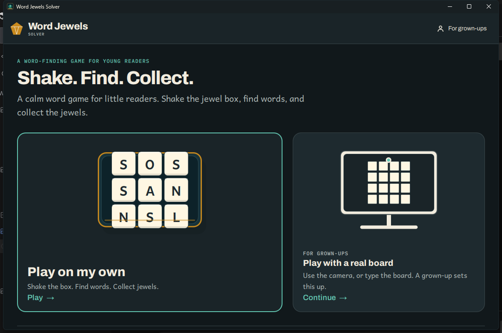

## Solo Play

The box is a 2D object, with its lid, jewel and compartments. The play board is
flat 2D for reading and tracing; the 3D scene is kept for the shake and the drop
and is not the board the child reads. Sizes, Shake and "How it works" are
labelled in the same panel; the words, hint and history share a card system.

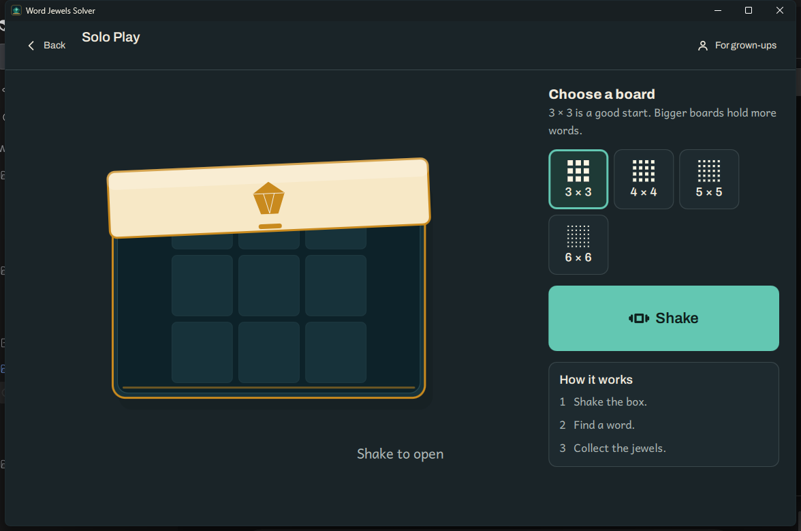

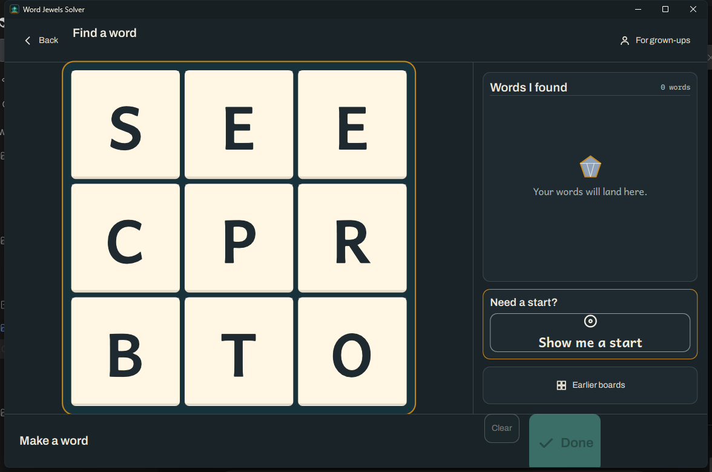

The shake is not a second visual language. The 3D dice now use the same cream
face, dark-teal edge, Andika letter and slate/gold jewel as the locked tiles; the
box uses the tray's teal and gold. When the dice settle, the 3D scene cross-fades
under the flat board and the board settles up a fraction instead of cutting.

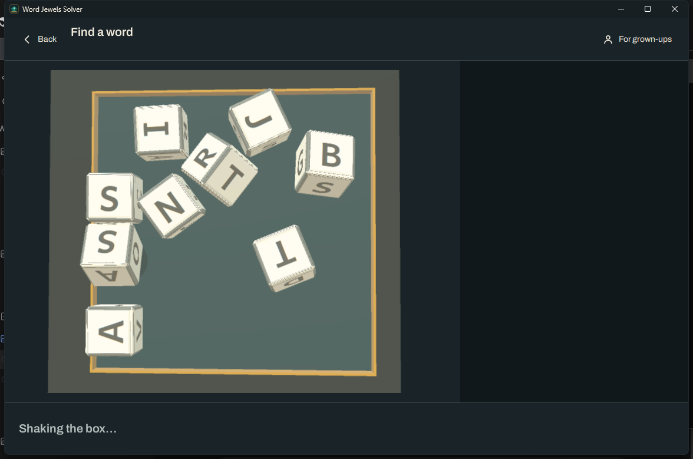

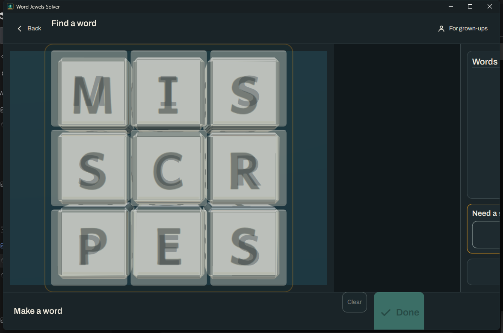

## The parent area

The same warm paper, teal and gold language continues through the gate, dashboard,
settings and About. The gate is a compact card; the dashboard opens with the real
board; settings are grouped; the privacy statement is a first-class card.

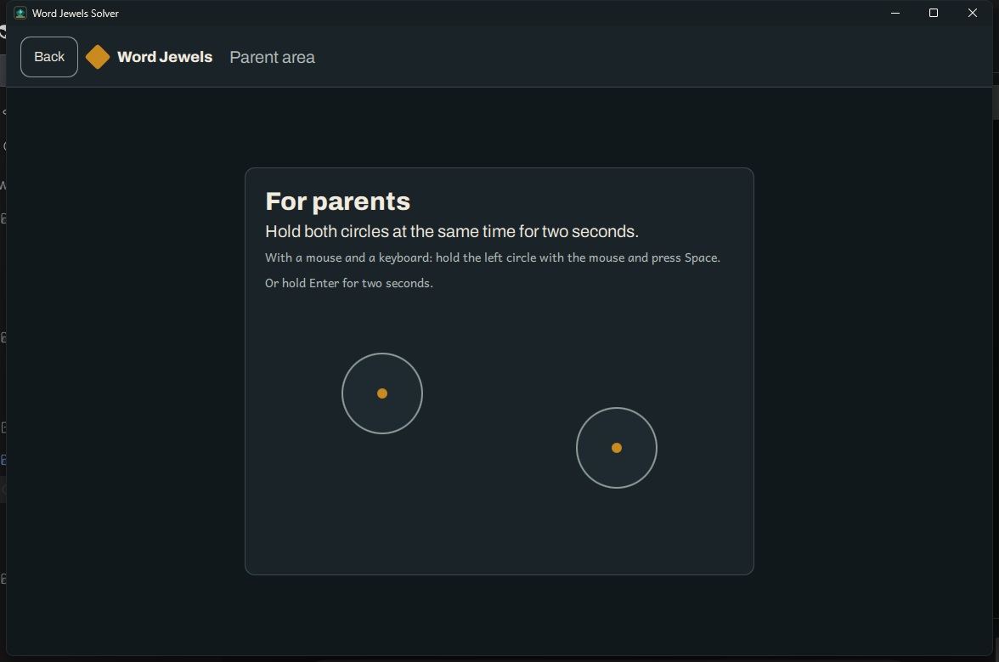

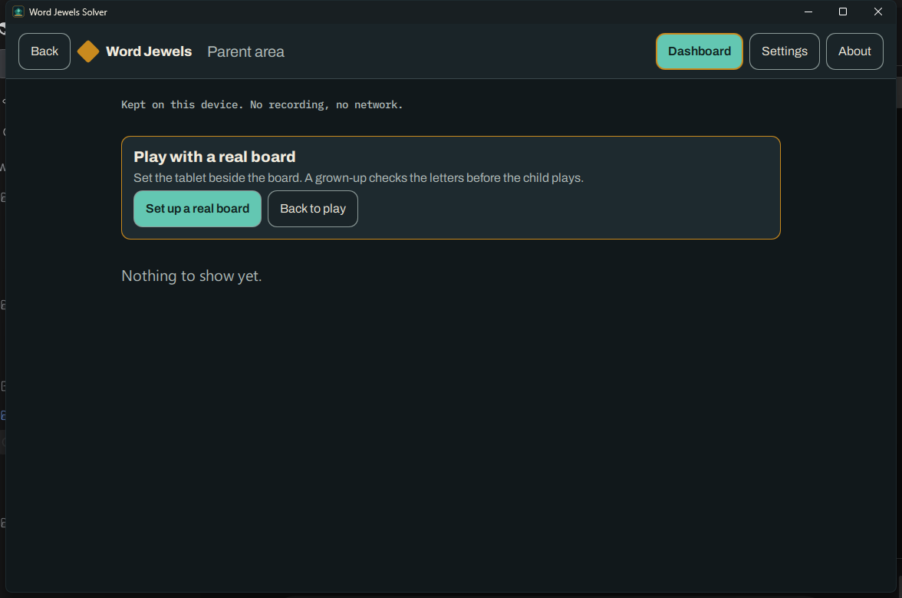

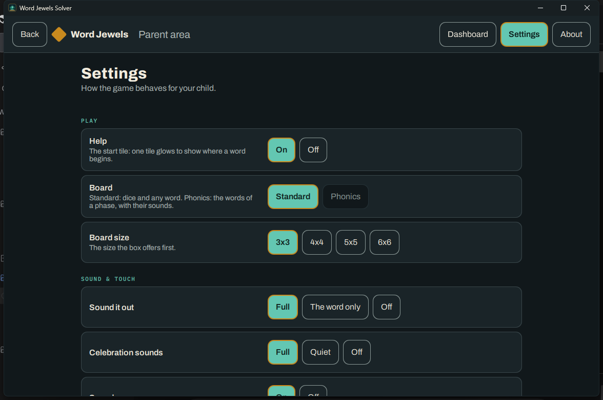

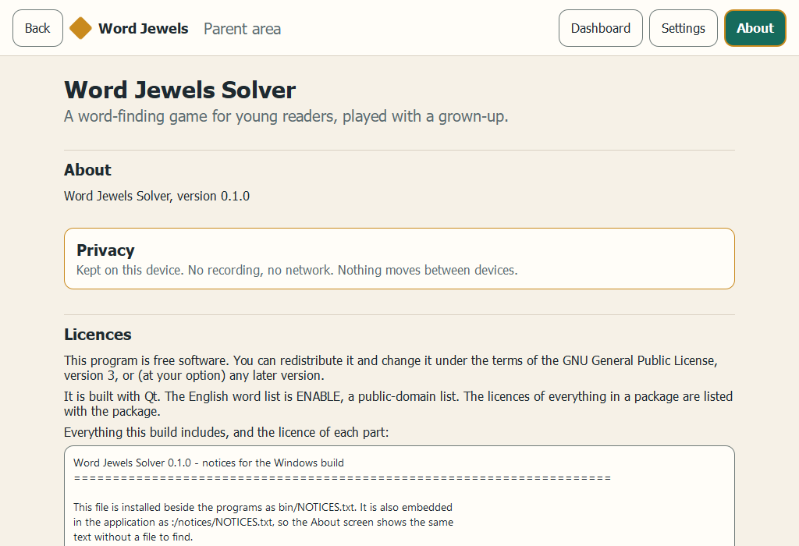

## Scan and the real board

The scanner and assistant now use the same app bar, type and cards. The scanner
keeps its three-step Place → Check → Play path; the assistant keeps the board and
the words it finds.

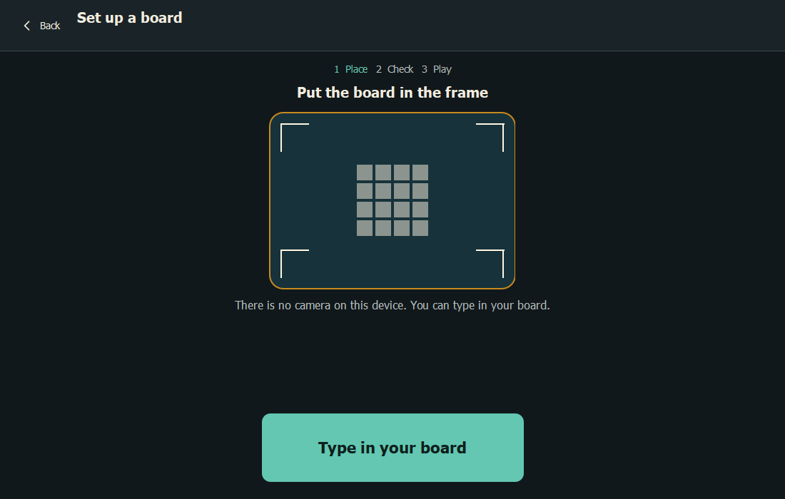

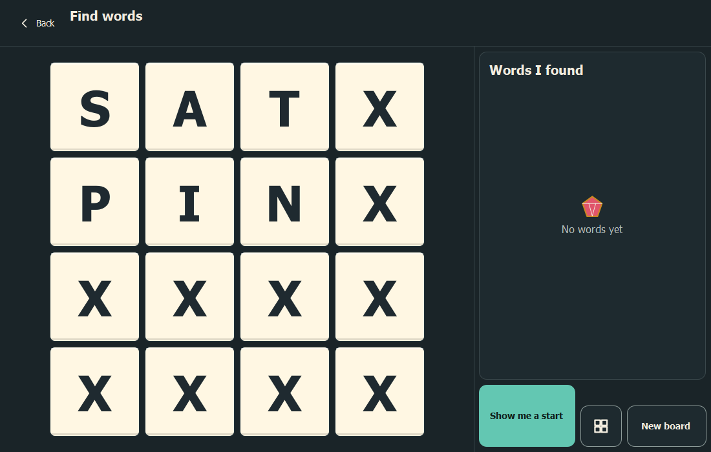

## Verification

- `WordJewelsSolver` builds and runs from `build/windows-msvc-app`.
- The full `ctest` suite passes; the Qt Quick suites report 82 passed, and the
  parent and scan preview checks pass.
- `app.qml_lint`, `parent.wording`, `i18n.catalogues`, the catalogue-completeness
  check, `platform.isolation`, `notices.sections` and `package.config` pass.
- Fonts are bundled and recorded in the notices; the eight translation
  catalogues carry the new strings.

## Notes

- The shake and landing screenshots are from a release build; the debug/ASAN
  build takes much longer to initialise the 3D scene, which is why the transient
  state is captured here from release.
- The new interface copy is in all eight catalogues. The bulk was translated
  mechanically and the most visible strings were corrected by hand; it still
  needs a native-speaker pass before release.
