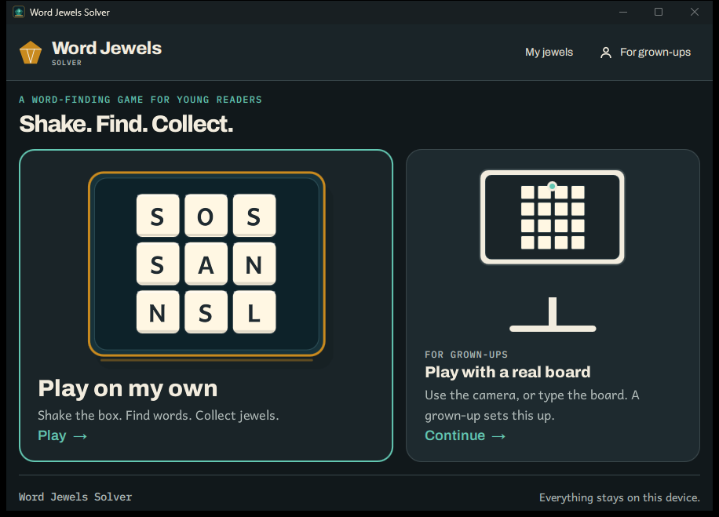
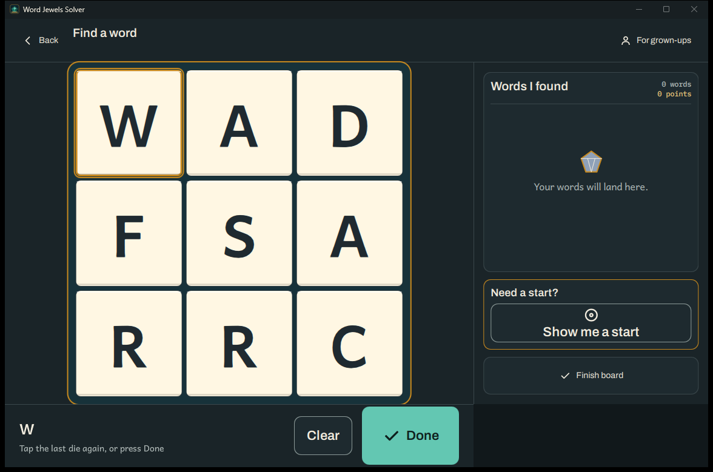
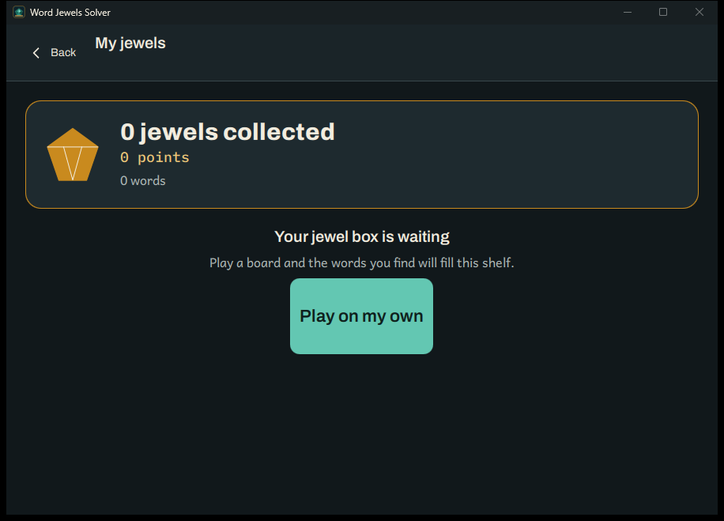
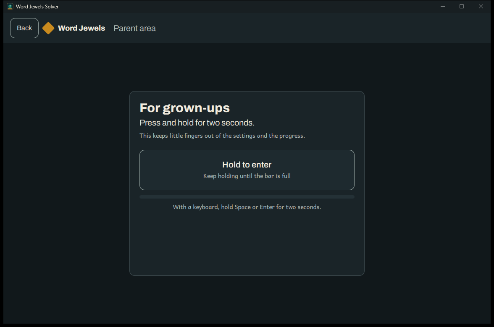

# Follow-up pass: the first child's-eye review

This is the record of the second pass over the Jewel Box overhaul, after the
first running build was played screen by screen. It is not a replacement for
[the audit](index.md) or [the implementation record](after/README.md); it says
what the build got wrong in use and what changed.

## What was wrong

| Screen | What the first build did |
| --- | --- |
| Home | The tray's gold border and reflection ran through the bottom row of dice. At 900 by 620 the cards were cut off below the window and the privacy line was missing. The two cards' margins and the footer did not line up. |
| Solo box | The box always showed nine compartments, whatever size was chosen. "Shake to open" sat at the centre of the window rather than under the box. The panel's cards ran past the bottom at the minimum height. |
| Solo play | The path was a 1-2-3 badge on each die; the line the child drew was hidden under the opaque dice. The bottom bar held a full-width Clear and a 96 dp Done that did not share a baseline. The panel ended above the bar, so Done sat under the panel. |
| The game | A standard board holds tens to hundreds of dictionary words, so "all words found" almost never happened; the clear screen and resting screen were unreachable in ordinary play. Words had stars but no points, history was buried in the play panel, and there was nothing to open from home. |
| Hints | One press lit one tile, and the next press did nothing new. |
| Parent area | The gate wanted two far-apart circles held at once, or a mouse on one and Space on the other. A save failure said only "Progress could not be saved" and offered no next step. |
| Real board | The camera frame's bottom brackets were upside down. A typed board still offered Turn and Read again. A new board's Back went to the parent area instead of the board just left. |
| 3D dice | The blue sky probe and the lit material turned the cream dice grey-green; the settled camera did not register with the flat board. |

## What changed

### Layout and the jewel box

Home and Solo are now sized from the room below the app bar. The home cards lose
height, the hero loses its lede at the minimum height, and the footer is a
`RowLayout` with a flexible gap rather than a fixed 320 px spacer. The Solo box
panel scrolls if a larger text size ever makes it taller than the window, but
its ordinary content fits at 900 by 620. The action bar belongs to the board
area, Clear and Done share a centre line, and Done is 96 dp inside a 104 dp bar.

`JewelBox` sizes the dice from the well, not just the tray width, so no row can
hang over the gold edge. The decorative reflection is outside the tray. Its
`boardSize` property changes the compartments with the choice on the right.



### Tracing and points

`FlatBoard` draws, in order: the tray, the die faces, the gold ribbon (a gold
casing around a dark core), the letters, the start rings and the pointer. The
path is visible while the child draws and the letters stay readable. The
numbered badges are removed.

A word earns:

```text
points = base(letters) + Scrabble letter values + long-word bonus
base   = 10, 20, 35, 55, 80, 110 for 3..8 letters, then 110 + 20 a letter
bonus  = 10 for each letter past five
```

So CAT is 15, RATE 24, SPLASH 76 and QUARTZ 89. Stars stay the tier's reward
(1, 2 and 5 for spark, power and mega). The tray header shows the word count and
the running points, each row shows its own `+points`, and the summary shows the
board's points and stars. "Rare letters" is the honest wording: the repository
has no word-frequency list, and letter value is not the same thing as how common
a word is.

### A board ends

The standard board can be finished deliberately with **Finish board** in the
panel. The board is saved, and the summary says "Board finished!", with the
words, points and stars. **Play again** deals a new board; **Home** returns to
the collection. The old clear summary still appears when every viable word has
been found, which is the ordinary ending for a phonics board.



### My jewels

A child-facing screen reached from the app bar's **My jewels** entry. It shows
lifetime stars, points, words and longest word; this week's stars, new words and
longest word; a shelf of the words found (tap one to hear it); and the boards
still kept, newest first, as `BoardThumb` pictures with their stars and words.
It is a record about this device, not a rank against another child. The play
panel no longer carries the history card.



### Help

| Press | What the child sees |
| --- | --- |
| 1 | The start tile's pulsing gold ring. "Show me two letters." |
| 2 | The first two tiles of the same word, still no word shown. "Hide the hint." |
| 3 | The rings are put away; the next press starts at rung 1. |

The library hands out the path of the lit word (`GameSession::lit_path`), and the
model exposes only up to two tile indices. The word itself is never given to the
QML. A find of the lit word clears the rings; a different find leaves them for
the child to use or hide.

### Parent gate and saving

`GateScreen` is one large **Hold to enter** target, 96 dp high, with a progress
bar. It presses the gate's two hidden spots on the person's behalf, so the two
second hold, the release-to-cancel and the accessibility action are the same
logic as before. A keyboard user holds Space or Enter. The gate card explains
why it exists.



The store now opens under Qt's per-user application data directory, the same
directory the app already uses for its cache, instead of a second bare
`LOCALAPPDATA` folder. When a write still fails, the dashboard names the likely
cause and offers **Retry**; a failed retry says progress may not last after the
app closes.

### Real board

The camera frame's bottom brackets now put the horizontal stroke at the bottom.
The check screen says **Start playing**, and its secondary action is **Start
over** for a typed board and **Scan again** for a camera board. **Turn** appears
only for a camera-read board. **Try camera again** re-enumerates the camera;
when Qt still cannot see a device, the screen says so and keeps **Type in your
board** as the way on. Back from a new board returns to the board that was left,
not to the parent area.

### Dice and the 3D scene

`tools/data/make_dice.ps1` now draws the dice from a fixed Scrabble-style English
letter table rather than the dictionary's own counts, with every die carrying a
vowel, six distinct faces and at most one of J K Q V X Z. The 3D faces use the
flat dice's cream, edge, ink and Andika face; the probe is off by default; the
settled camera is orthographic and one scene unit is one pixel; the box shell
fades and a 2D tray takes its place, so the cross-fade lands on the flat board's
own geometry.

## Deliberately not done

- **No countdown or visible clock.** A timer is a pull, and the design's rule is
  "nothing pulls": a board should end because it is finished or the child stops,
  not because time ran out. The elapsed time is not stored, so a report of time
  played could not be honest. If a clock is ever wanted, the least harmful form
  is a parent-set, default-off count-up in the parent area, which is a settings
  change and a new store key.
  *Later: the clock was added in exactly that form, plus a parent-set
  count-down that ends the round at zero; see "The second follow-up pass".*
- **No leaderboard against other children.** The collection is the local record;
  the only comparison is with the child's own earlier boards.
- **No "words you missed" list.** A standard board keeps no list of its words,
  and a list of misses is a loss cue.
- **No claim that the camera is integrated.** Qt 6.12 on the review machine
  reports no video input even though Windows sees a Logitech StreamCam; the retry
  is honest, and the typed board remains the reliable path.
  *Later: the missing video input was the build tree's Low mandatory-integrity
  label, which Windows' camera access refuses; raising the label to Medium makes
  Qt enumerate the StreamCam (docs/building.md, "A camera reports no video
  input").*

## The second follow-up pass (October 2026)

What the first child's-eye build still got wrong, and what changed:

| Where | What changed |
| --- | --- |
| Settings | The board's clock: **Timer** with Off, Count up and Count down, and a **Time on the board** row of whole minutes for a count-down (new store keys `timer` and `timer_minutes`, both defaulted, so an old file reads Off). The Board row says why Phonics is not offered when the build has no phase data. The **Help** row is a level now: Off, **A start tile** (the first press lights it, the next hides it) or **Two letters** (the design's two rungs); the store's old `help=0/1` files read as Off / Two letters. |
| Solo play | The right-hand column fills the window's full height: the Clear and Done actions and the board's clock live at its foot, and the board and the panel no longer shift when a path starts. The clock counts up while the board is open (shown in the panel and on the finish summary) or counts down and ends the round with the finish summary at zero. Back from a round in progress leaves it in progress: the next visit finds the same board, because the session is saved on every find. The Done button remains the way a word made by taps (or the keyboard and a screen reader) is handed in; a traced word hands itself in when the finger lifts. |
| Help | A find made from the lit start answers the question: the rings are put away (whatever word was found, the lit one or another from the same start), and the card says whether more of the board's words begin with the tiles that were lit ("3 more words start with these letters.", or "No more words start with these letters." when none do). A find away from the lit start leaves the help where it was; the next press starts a fresh question. The count is the library's (`wjs::words_starting_with`), a number and never a word. The parent chooses how much of this is available: the Settings' Help row is a level (Off, A start tile, Two letters), applied at once; turning it off takes the rings and the card away too. |
| Finish summary | The board-finished card is rebuilt for the child: the stars and points are the headline (a gold jewel and large type), the words are a scrolling list with one jewel each inside the card, and Play again leads the two actions so both stay put however many words were found. The card is clipped and responsive, the title speaks to one word ("You found the word!") instead of "all 1 words", a count-down finish says the time ran out and that everything found is kept, an empty board is said gently, and the summary takes the focus and speaks the reward when it opens. The words' header carries the count ("Your words (7)"), and the focus stays inside the card: the flat board behind the scrim neither takes the keyboard nor speaks to a screen reader, and Tab walks between Play again and Home and nowhere else (the item-level `KeyNavigation` form; a parent-level trap proved unreliable against the window's own Tab chain). |
| First show | The lag on a screen's or window's first showing is attacked three ways. **Ahead-of-time compilation**: the application's QML module is built with `ENABLE_TYPE_COMPILER` (qmltc), so the kit's frequent types — the buttons, icons, jewels, the box, the resting screen, the thumbnails — are C++ classes with their bindings compiled; first instantiation is no longer interpreted. The screens that qmltc of the shared aqtinstall kit cannot take — cross-module bases (Main, SoloScreen), `LayoutMirroring` (whose compiled private class the kit's QtQuick DLL does not export), missing private headers (Timer, Connections), and the translated wording singletons (compiled `qsTr()` would be captured once and never retranslate) — are skipped per file and keep their bindings bytecode-compiled; the parent, scan and scene modules stay dynamic for the same kit reasons. The shared kit's private headers and qmltc runtime are linked by hand in `cmake/FindQt6.cmake` because the kit ships them without their CMake packages. **Deferred loading**: the navigation loader is asynchronous so switching screens does not stall a frame, and the 3D scene moved behind an asynchronous Loader — it is made when Solo Play is first shown (the closed box, while the child reads it) and kept for the run, so the first shake pays no scene-graph or shader cost; its `active` is a monotonic flag because the derived state booleans re-evaluate non-atomically and once destroyed the scene mid-shake (measured in the box suites). **Shaders**: Qt Quick 3D's persistent shader caches (low-level pipelines and the material cache) are on by default and warm across runs, so the scene's first-cost happens once per machine, now paid during the box rather than on the shake. Measured: the debug smoke's first frame went from 14 676 ms to 7 848 ms; the release smoke reports **582 ms** for the same launch (inside the 2 s launch budget), and the first-ever windowed frame report (release, `WJS_PERF_FRAME_TIMING=1`) is `mean 16.69 ms, p50 19.72, max 22.36, over 33 ms 0` — 60 Hz held, with the p50 landing on Windows' timer quantisation rather than on render cost, which is recorded in docs/design/performance.md for the author to decide against. |
| Home | **My boards** opens Solo Play's earlier-boards sheet from the first screen, so the history is one press from home and not buried in the play panel. |
| Parent area | The About page has one privacy section (the summary card was the duplicate), shows the build's release, commit, branch and target, and links to a separate **Licences** page that carries the full notices in their own scroll. Screen titles in the app bar sit on the bar's middle line, not its top edge. The dashboard is two parts with a boundary between them: the one thing a parent came here to do (**Play with a real board**) stands alone at the top, and everything about the child's play — the week, the sounds, the vault, the best — is under a **How the play is going** heading below it, with the week now a card like the sounds' rows; the privacy line closes the page instead of opening it. |
| Camera | Qt 6.12 reports no video input on a machine whose build tree carries a Low mandatory-integrity label: Windows allows only Medium and above to open a camera. Raising the label (`icacls <build> /setintegritylevel "(OI)(CI)M" /T`) makes the StreamCam appear (docs/building.md). The application's own behaviour is unchanged: a camera it cannot see is said so, and the typed board remains the way on. |


## Verification

- `wjs_quick_tests`: 8 suites, all passing (`quick.box`, `home`, `kit`, `panel`,
  `parent`, `rtl`, `scan`, `theme`).
- `wjs_unit_tests` (full): 309,335 assertions in 495 cases pass.
- `wjs_app_tests` (full): 2,233 assertions in 186 cases pass, one case skipped
  for the font check on this machine.
- `wjs_scan_tests`: 79 passed, 5 skipped (the debug performance cases).
- Release `wjs_perf_tests`: 895 assertions in 28 cases pass after the dice
  digest, standard-session digest and word-total pins were updated.
- `app.qml_lint`, `i18n.catalogues`, `parent.wording`,
  `parent.wording.selftest`, `parent.screens`, `scan.screens`,
  `notices.sections` and `package.config` pass.
- The catalogue update has the new source strings in all eight catalogues. The
  mechanical fallback fills the untranslated ones with the English source until
  a native-speaker pass; the app test's completeness gate is satisfied without
  pretending they are reviewed translations.

The remaining visual risk is the 3D scene on a device with a real GPU and the
cross-fade on a strong dark theme; the debug build's first warm-up frames are
slow, and a release build is the one to look at on the target tablet.
