# Word Jewels Solver — Human Factors and Design Overhaul Audit

**Audit date:** 19 October 2026  
**Build reviewed:** Windows desktop build, Qt Quick 6.12, current `develop` tree, debug app build, Qt Quick 3D scene active  
**Screens captured:** 1116 × 739 window on a 1200 × 1920 portrait display, light and dark themes  
**Code reviewed:** 42 QML files, 6,777 lines of QML, the application and parent controllers, the design and product documents, and the sibling products CountdownSolver and ICL Forge  
**Audience:** the product owner, the design lead, and the engineers who will implement the overhaul

> **Visual brief:** [HTML](visual-brief.html) · [PDF](visual-brief.pdf) — a shorter, designed version of this audit with the key exhibits and proposed screen direction.

> **Implementation record:** [Jewel Box screens](after/README.md) — the overhauled screens as built, with the verification record.

> **Verdict.** The engine, the privacy architecture and the accessibility intentions are strong. The product surface is still a prototype. This is not a palette problem, and it will not be fixed by rounding a few corners. It needs a design system, an information architecture that separates what a child does from what a grown-up does, a content and feedback layer, and a board that reads as one designed object rather than a 3D scene pasted beside three empty rectangles.

---

## How to read this document

This is an expert review, not a child study. It combines:

- a heuristic evaluation against Nielsen's ten usability heuristics and Norman's principles of affordance, signifier, mapping, feedback and conceptual model;
- a human-factors review for the actual users — a five- or six-year-old who is still learning to read, and an adult who is co-playing, setting up, or reviewing progress;
- a WCAG 2.2 AA review of the implemented screens;
- a visual and interaction comparison with CountdownSolver and ICL Forge, the two house products the application is being measured against;
- a code review of the QML that produces the screens, so that each finding has a cause and not only a symptom.

The recommendations are written to be buildable in this codebase. Where a statement is a prediction rather than an observation, it says so. Nothing here replaces testing with real children and parents; section 9 is the plan for that.

## Contents

1. [Executive summary](#1-executive-summary)
2. [Method, evidence and limits](#2-method-evidence-and-limits)
3. [The first thirty seconds](#3-the-first-thirty-seconds)
4. [Screen-by-screen findings](#4-screen-by-screen-findings)
5. [Cross-cutting analysis](#5-cross-cutting-analysis)
6. [Comparison with CountdownSolver and ICL Forge](#6-comparison-with-countdownsolver-and-icl-forge)
7. [The design overhaul](#7-the-design-overhaul)
8. [Roadmap](#8-roadmap)
9. [Validation plan](#9-validation-plan)
10. [Appendices](#10-appendices)
11. [Closing: what to decide next](#11-closing-what-to-decide-next)

---

## 1. Executive summary

### 1.1 The one-sentence diagnosis

**WordJewelsSolver currently looks and behaves like an engineering prototype of a good game, not like a finished product from the same house as CountdownSolver and ICL Forge.**

The game underneath is real. The board is real. The solver is fast. The privacy model is unusually thoughtful. The scan-and-confirm flow is the most product-ready part of the application. But the surface a child and a parent actually meet has no product identity, no visual hierarchy, almost no visible language, and no consistent design system. It is sparse where it should be informative, and busy where it should be calm.

### 1.2 Seven findings, in severity order

| # | Finding | Severity | The evidence in one line |
| --- | --- | --- | --- |
| 1 | **There is no product identity or design system.** No wordmark, no app icon, no bundled typeface, no single theme, no shared app bar. | Critical | The Windows title bar shows a generic document icon and the OS name; `Home.qml` contains no brand; `ParentTheme.qml` duplicates `Theme.qml` with a different radius. |
| 2 | **The home screen is a wordless, mis-targeted mode picker.** Two huge, unlabelled pictures ask a pre-reader to choose between a game and an adult scanning workflow. | Critical | `Home.qml` renders two picture buttons with no visible text; the accessible names "Play on my own" and "Play with the family" are never shown. |
| 3 | **The Solo board and the panel are visually and conceptually disconnected.** The box with its lid is invisible on the review machine; the board sits on a slate 3D deck that ignores the theme; the panel is three blank cards. | Critical | The annotated Solo screenshots; `BoardScene.qml` hard-codes `#2C4C61` and `#1F3646`; `PlayingPanel.qml` has no tray title or empty state. |
| 4 | **The core loop has no visible reward, progress or end state.** A found word adds a small list row; clearing the board produces a glow and then a hidden hold-to-play screen. | High | `PlayingPanel.qml` has no score, count or celebration; `SoloScreen.qml` moves to rest after 3 s; the product brief asks for stars, jewels and praise. |
| 5 | **Child controls are icon-only and often silent.** Abstract glyphs — four grids, a ring-and-dot, a person, a gem with a tick — are asked to carry the whole interface. | High | 29 `AppButton` instances; only three set the `speaks` property; the home, Solo box and playing panel are almost entirely icon-only. |
| 6 | **The parent area is a second product with its own visual language and an implementation-ordered settings list.** | High | `ParentTheme.qml` and `PButton.qml` use 12 px rounded buttons and chips; the child kit uses square outlines; `SettingsScreen.qml` is one unbroken 15-row list. |
| 7 | **The application is not productised.** Fixed 1100 × 700 window, no centred startup, no loading state, no icon, no bundled font, no window-state persistence, and a fragile 3D presentation. | High | `Main.qml` lines 34–39; no `.ico`/`.icns` anywhere in the repository; `Theme.qml` names Andika but no Andika file is bundled. |

### 1.3 What is already good, and should not be thrown away

This is not a rewrite of the game. The following are assets:

- **The core loop is sound.** Shake a box, roll a board, trace or tap a word, collect a jewel, clear the board, rest. That is a coherent five-year-old game.
- **The physical metaphor is strong on paper.** A box with a lid, dice, a tray and jewels is a better idea than a generic grid app.
- **The accessibility intent is better than most children's apps.** 64 dp child targets, 96 dp primary actions, reduced motion, no timers, no penalties, keyboard paths, screen-reader names, and a no-audio-input privacy rule.
- **The scan-and-confirm flow is genuinely well designed.** "Is this your board?", doubtful tiles, a letter picker, and "Yes, play" as the only way to confirm is exactly the right pattern for a camera-based helper.
- **The parent gate is clever and accessible in principle.** Two simultaneous holds, a progress bar, a screen-reader route, and no security theatre.
- **The wording files are centralised and translated.** The child-facing phrases ("Show me a start", "Words I found", "Play again") are good words. The problem is that most of them are not on screen.
- **The privacy model is a differentiator.** No network, no recording, no export, local-only progress. That should be visible to parents as a feature, not buried in an About page.

### 1.4 The recommended direction in one page

**Concept: a jewel box on the table.**

A warm, tactile, calm child's desk toy, designed with the same editorial discipline as the house's desktop products. The board is the hero: a real tray with cream letter dice, a lid, and a place for the jewels a child collects. The chrome is flat, typographic and quiet; the play is physical and rewarding. The child never has to decode an abstract icon; the adult never has to decode a developer's settings model.

The direction has four moves:

1. **Make it one product.** One wordmark, one app icon, one type system, one palette, one button and card language across home, Solo, the scanner and the parent area. The parent area may be denser, but it is the same product.
2. **Separate the child's job from the grown-up's job.** The home is for playing. Scanning a real board, choosing a board type, changing sound and reading progress are grown-up jobs behind the parent entry. A child should never land in a 16-letter typing form by choosing a picture.
3. **Make the board the stage.** Frame it, title it, light it, and let it settle into a crisp, flat, readable grid for play. Use 3D for the shake and the drop, not for the letters a child has to read. Give the panel titled cards with empty states and a visible action zone.
4. **Close the feedback loop.** Every word produces a jewel, a spoken word and a short praise line. Every board ends with "You found all N words", the jewels, and a clear way to play again or go home. No hidden hold gestures, no automatic transition without closure.

The rest of this document explains why, screen by screen, and then specifies the system, the screens, the content, the roadmap and the validation plan.

---

## 2. Method, evidence and limits

### 2.1 What was reviewed

| Source | What it contributed |
| --- | --- |
| The running application | Screenshots of home, Solo box, Solo playing, a selected path, scan ready, scan check, the letter picker, the parent gate, the dashboard and settings, in light and dark themes. |
| The QML | The structure, tokens, component variants, accessible names, visible strings and hard-coded values behind each screen. |
| The product requirements | The intended users, the two modes, the child-centric requirements, the privacy constraints and the MVP scope. |
| The design documents | The intended flows, panel, resting screen, gate, tokens and known placeholders. |
| CountdownSolver | A house product with a wordmark, a sidebar, a clear page hierarchy, labelled controls, one accent and a calm card language. |
| ICL Forge | A house product with a wordmark, an editorial numbered-section layout, mono labels, one accent, explanatory notes and a dense but legible hierarchy. |
| Cubeulator's design notes | The sibling project the product requirements name as the model for targets, motion, no-pressure loops and the single accent. |

### 2.2 Frameworks used

- **Nielsen's ten usability heuristics** for the interaction review: visibility of system status, match to the real world, user control, consistency, error prevention, recognition over recall, flexibility, aesthetic and minimalist design, error recovery, and help.
- **Norman's principles** for the conceptual model: what is an affordance, what is a signifier, what feedback confirms an action, and whether the mapping between a control and its effect is obvious.
- **WCAG 2.2 AA** for accessibility: target size, contrast, keyboard, focus, motion, text scaling, status messages and name/role/value.
- **Cognitive load** for the child's task: extraneous load from decoding the interface, divided attention between the board and the panel, working memory for a word path, and the germane load of actually finding and learning a word.
- **Developmental fit** for a five- or six-year-old: emergent reading, limited working memory, developing fine motor control, short attention, a need for immediate and specific feedback, and a reliance on adults for setup and recovery.

### 2.3 Limits

- **No children or parents were tested.** Every statement about a child's likely behaviour is an expert prediction, labelled as such. Section 9 is the test plan that would replace prediction with evidence.
- **The 3D artefacts may be environment-specific.** The review machine rendered the board with heavy black seams, uneven perspective and a flat, invisible box. That may be a driver, remote-display or debug-build artefact. It is still a risk: the core metaphor must not depend on a fragile 3D path. The report says "on the review machine" where that matters.
- **The build was a debug build.** Startup timing and frame cost are indicative, not release numbers.
- **No camera, tablet, sensor or haptic hardware was available.** The scan flow was reviewed on its no-camera path and in the preview harness; the tablet experience is untested.
- **The translations are mechanical and unreviewed.** The audit judges the English source and the visible copy; it does not judge translation quality in the other seven languages.
- **The parent dashboard's "progress could not be saved" banner in the screenshots is an artefact of how the review launched the app** (a non-interactive service without the user's environment). It is not reported as a product defect. The wording of that failure state is still reviewed, because a real device can fail to save.

---

## 3. The first thirty seconds

### 3.1 What the child sees

The application opens on a dark, nearly empty window. There is no logo, no app name, no tagline, no illustration of a character or a jewel, and no sentence. The only text is the Windows title bar, which says "Word Jewels Solver" in a system font beside a generic document icon. Two large outlined rectangles float in the middle of the window. The left one contains a picture of a 3 × 3 grid of blank cream squares. The right one contains a picture of what looks like a monitor on a stand, with a 3 × 3 grid inside it. A small person icon sits alone in the top-right corner.

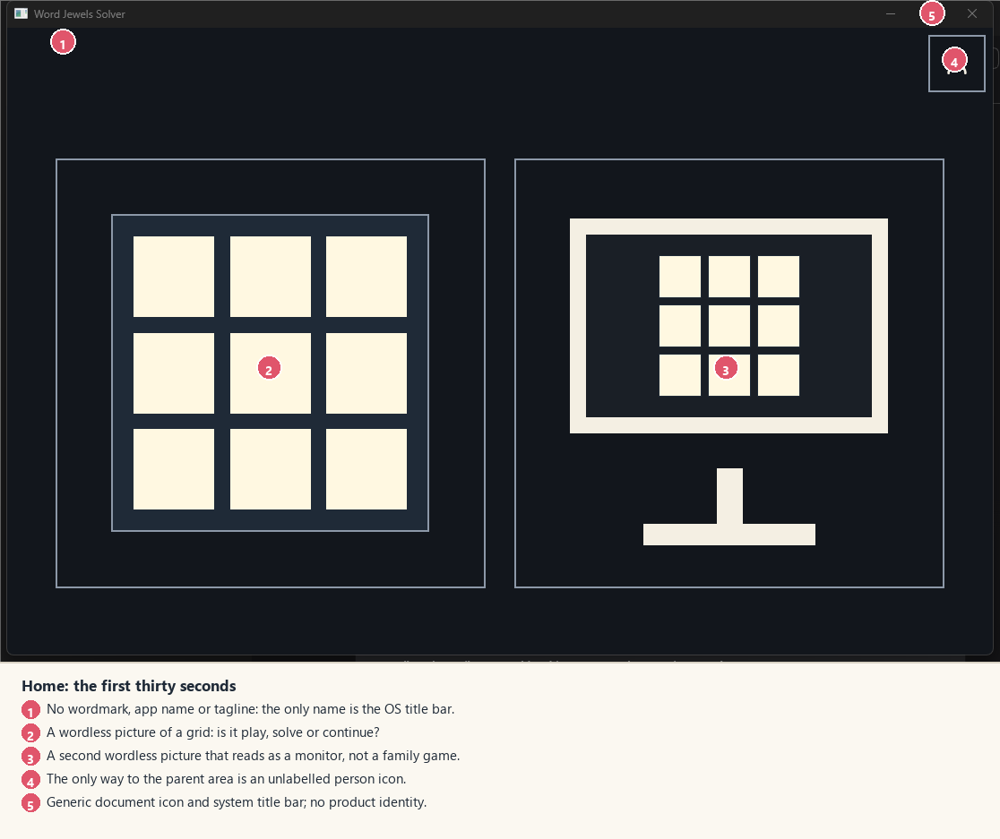

*Exhibit 1. The first screen. The numbers are explained under the image; the full-size original is `img/home-dark.png`.*

A five-year-old sees two pictures with no verbs. The left picture could be "play", "solve", "the board", or "continue". The right picture could be "watch", "settings", or "a computer". There is no play triangle, no arrow, no character, no hand, no label, and no indication that the pictures are buttons. There is no primary action and no secondary action; both cards have the same weight. The only way to the grown-up area is an unlabelled person icon that a child is likely to ignore and an adult may not notice.

The first thirty seconds fail the most basic recognition test: **the screen does not say what the application is or what to do next.** The design document calls this "no first-run carousel; the pictures are the instruction." The pictures are not an instruction. They are two nouns.

### 3.2 What the parent sees

A parent who starts the app to play with a five-year-old gets the same screen. They can guess that the left picture is Solo Play, because the product is a word game. They may not guess that the right picture is the Family Companion, because it looks like a monitor. They have no visible way to reach settings, sound, language, board size or progress except the small person icon. If they tap the right picture, they are taken to a camera screen that says there is no camera and offers a 16-cell typing form — a task for an adult, presented as a child's mode.

The parent's first five minutes are therefore a scavenger hunt: find the parent area, pass a gate, discover a dashboard that says "Nothing to show yet", and scroll through a 15-row settings list to find the sound. The product's strongest differentiator — a safe, private, well-designed learning aid — is invisible.

### 3.3 The "five-year-old test"

A useful heuristic for this age group is to ask four questions of every screen:

1. **Can I tell what this is for without reading?**
2. **Can I tell what to touch next?**
3. **Can I tell what happened when I touched it?**
4. **Can I get back or stop without help?**

| Screen | 1. What is it for? | 2. What next? | 3. What happened? | 4. Back/stop? | Verdict |
| --- | --- | --- | --- | --- | --- |
| Home | No | No | No | Only via an icon | Fails |
| Solo box | No (the box is invisible) | The blue bar might be a button | No | Back arrow is visible | Fails |
| Solo playing | Partly (letters suggest a word game) | Trace or tap is not shown | A yellow tile and a line appear; no word | Back arrow is visible | Partly |
| Word found | No visible word until the list updates | No visible Done until the path is pending | A small jewel appears | No clear/cancel | Partly |
| Cleared / resting | The sleeping square is not explained | A hold control with no label | No "you found all the words" | Back arrow | Fails |
| Scan ready | Yes, the frame and sentence are clear | One wide button at the bottom | Clear | Back arrow | Passes |
| Check | Yes, "Is this your board?" | Tap a cell; "Yes, play" | Clear | "Read again" and back arrow | Passes |
| Parent gate | Yes, "For parents" | Hold both circles, with instructions | Progress fill | Back | Passes for an adult |

The scan-and-check flow passes because it uses words, a clear question and a labelled primary action. The child-facing Solo flow fails because it has removed the words without replacing them with literal pictures, voice labels or demonstration.

---

## 4. Screen-by-screen findings

### 4.1 Home and startup

**Purpose:** choose a mode, or reach the grown-up area.

**What works**

- The two large cards are generous touch targets and scale with the window.
- The press-and-slide-off cancellation in `AppButton` is a good touch pattern.
- The accessible names exist and are well written: "Play on my own", "Play with the family", "For grown-ups".
- There is no first-run carousel, no modal, no permission prompt and no text to read. That is the right instinct for a child.
- The parent entry is visually quiet, so it does not compete with play.

**What fails**

1. **No identity.** There is no wordmark, no app name, no tagline, no illustration, no version. The only identity is the OS title bar and a generic document icon. The app could be any prototype. This is the single largest reason it "doesn't feel like a good application".
2. **No visible labels.** The two most important choices in the product are wordless. The names exist only in `HomeWording.qml` and are spoken only when the card is pressed. A child who cannot read still needs a spoken label; a parent who can read needs a visible one. The current screen gives neither until after the decision.
3. **The pictures do not signify their actions.** The left card is a board, not a box with a lid; it does not say "shake" or "play". The right card is a monitor on a stand, not a family, a camera, or a real board; it does not say "scan" or "grown-up". The mapping from picture to action is arbitrary.
4. **The two modes are not the same kind of choice.** Solo Play is a child's game. The Family Companion is an adult-led scanning workflow. Presenting them as two equal child-facing cards confuses the roles. A child can choose the adult workflow and land in a typing form; an adult may not realise the left card is the child's game.
5. **No primary action.** Both cards have equal weight, and the parent icon competes from the corner. There is no visual path through the screen. The eye has nowhere to land.
6. **No startup state.** The window appears when the dictionary and the entire Solo 3D scene have been prepared. On the review machine the first window took several seconds, and the first Solo screen was a blank slate for several more. There is no splash, no wordmark, no progress, no "getting the dice ready" moment. The app looks broken before it looks alive.
7. **The window is not placed or sized for the device.** `Main.qml` hard-codes 1100 × 700. On a 1200 × 1920 portrait display it opens at the top-left as a landscape window with a native title bar, leaving most of the screen unused. It does not centre, does not remember its size, and does not go full-screen on a tablet. This is part of why startup feels odd.
8. **The title bar does not match the app.** On the review machine the native title bar was a dark maroon while the app was dark blue or cream. The app icon was a generic page. The frame and the content look like two different products.

**Severity:** Critical. This is the first screen and the mode decision.

**Direction**

- Put a real lockup at the top: **Word Jewels** in Archivo ExtraBold, with a small **SOLVER** in IBM Plex Mono, and a faceted jewel icon. The lockup is the anchor the rest of the app lacks.
- Make the home a **play** screen, not a menu of implementation modes. One primary card, "Play on my own", with a picture of a closed jewel box, a short label, and a play chevron. A secondary card, "Play with a real board", labelled "A grown-up sets this up", which opens the parent gate or a short hand-off screen.
- Add a visible **For grown-ups** label beside the person icon. The icon alone is not a signifier for a parent under stress.
- Add a short tagline that explains the loop: "Shake. Find. Collect." or "Find every word."
- Show the app immediately with a styled background and the wordmark, then load the dictionary and the 3D scene behind it. The home should be usable before the Solo scene exists.
- Centre the window on first launch, size it to the available screen (with a sensible maximum), and remember the last size and position. On a tablet, start full-screen.

### 4.2 Solo box: the box that isn't there

**Purpose:** choose a board size and shake the box to start.

**What works**

- The primary action is large and in the expected place (the panel's place, not over the board).
- The board sizes are offered only when they fit at a usable tile size.
- Space also shakes on desktop, and the device can be shaken on a tablet.
- The back arrow, history and parent entries are present.

**What fails**

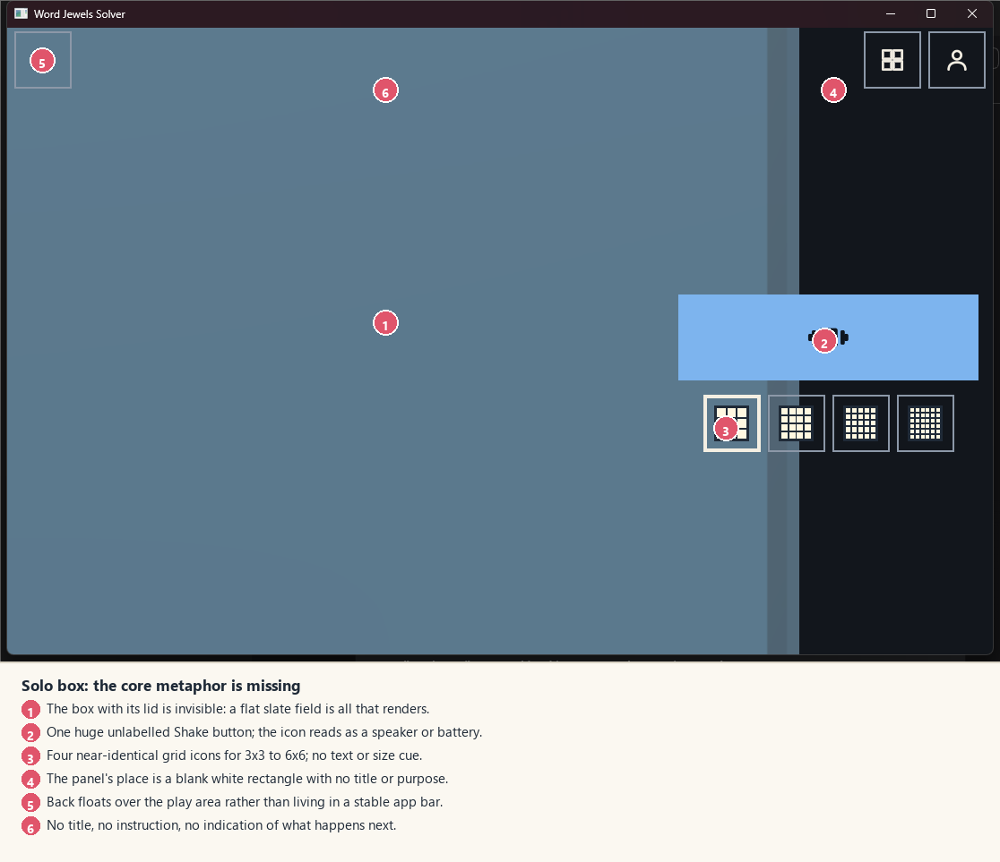

*Exhibit 2. The Solo box. The box with its lid is not visible on the review machine; the board area is a flat slate field.*

1. **The core metaphor is missing.** The design says "the box with its lid on, centred." On the review machine, the entire board area is a flat slate-blue field. There is no box, no lid, no rim, no shadow, no "closed" read. The child cannot see what they are about to shake.
2. **The Shake control is a banner, not a button.** A 96 dp high, half-panel-wide blue rectangle with a tiny 48 px icon in the middle. The icon — a box with lines either side — reads as a speaker, a battery, or a vibration symbol. There is no word "Shake" and no hand or motion cue. A child may not know it is tappable, and a parent may not know what it does.
3. **The four size choices are indistinguishable.** They are 64 px squares, each with a 40 px picture of a grid. At that size, 3 × 3, 4 × 4, 5 × 5 and 6 × 6 differ by a few pixels of line density. There is no "3 × 3" label, no selected-size summary, and no explanation of which size is right for the child. The selected state is a heavier border, which is hard to see at a glance.
4. **The panel's place is a blank white rectangle.** In the box state the panel slot is empty; the right third of the screen is a white (or black) field with no title, no illustration, no instruction, no "choose a board" text. It reads as a rendering error.
5. **The back button floats over the board.** It is a square outline at the top-left of the play area, outside any app bar. It is usable, but it does not belong to a shell; it looks like a debug control.
6. **No title, no instruction, no flow cue.** The screen does not say "Solo Play", "Choose a board", or "Shake to start". The only words are on the OS title bar. The child has to infer the entire flow from three abstract controls.
7. **No feedback on press until the dice move.** The button changes colour, but there is no rattle, no lid lift, no "here we go" moment until the 3D scene starts. If the scene is slow or fails, the child presses again.

**Severity:** Critical. This is the moment the game should begin, and it is the emptiest screen in the app.

**Direction**

- Make the closed box a real object: a 2D or 3D tray with a lid, a rim, a shadow, and a label. If the 3D box cannot render reliably, use a 2D illustration and keep the 3D for the shake transition. The closed state must never be a flat field.
- Replace the four bare grid icons with a **labelled segmented control**: "3 × 3", "4 × 4", "5 × 5", "6 × 6", each with a small board preview and a selected state that is a filled pill plus a check. Add a one-line hint: "3 × 3 is a good start."
- Make Shake a real primary button: a hand/box icon, the word **Shake**, and a short line "or shake the tablet". Put it at the bottom of the stage, in the thumb zone.
- Put the screen in an app bar: back, **Solo Play**, parent. The panel slot in the box state should hold a small "How it works" card — "Shake the box. Find words. Collect jewels." — not a blank rectangle.
- Add a short press animation on the box itself: a wobble, a rattle, the lid lifting. The child should see the cause and effect before the dice appear.

### 4.3 Solo playing: the board and the panel

**Purpose:** find words by tracing or tapping neighbouring dice; collect them in the tray; use a hint or history.

**What works**

- The dice letters are large and legible. At 3 × 3 they are easy to discriminate, even with the rendering artefacts.
- The tracing/tapping model is sound, and the path lights tiles as they join.
- The panel has the right conceptual parts: words found, a hint, and history.
- The layout uses the window: the board gets the leading two-thirds, the panel the trailing third. On a tablet this is a sensible split.
- The background is quiet; the board is the brightest object.

**What fails**

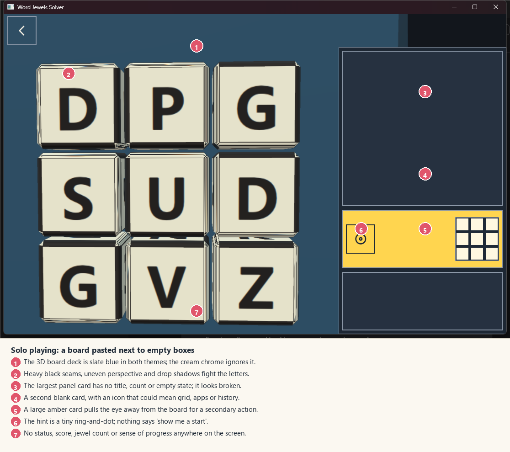

*Exhibit 3. Solo playing. The board is readable, but it is visually a separate product from the panel.*

1. **The board is a different visual world.** The 3D deck is slate blue (`#2C4C61`/`#1F3646` in `BoardScene.qml`) in both themes. The chrome around it is cream or near-black. The board's dice are `#F4E9CC`, not the theme's `#FFF8E1`; the scene has its own teal jewels (`#2E9F92`, `#63D6C7`) while the UI's jewels are coral, teal, purple, amber and blue. The board does not use a single theme token. It looks like a window into another application.
2. **The 3D rendering fights the letters.** On the review machine the dice have heavy black seams, uneven perspective, large drop shadows and highlight lines. The letters are still readable, but the visual noise is high, and the grid is not perfectly aligned. For a child learning letter shapes, this is the opposite of clarity.
3. **The largest panel card is blank.** The "Words I found" card has no title, no count, no empty state and no illustration. It is a large empty rectangle with a border. A child sees a broken panel; a parent sees an unfinished app.
4. **The second card is an icon with no meaning.** It contains a four-square glyph that could mean "grid", "apps", "history" or "more". The accessible name is "Earlier boards", but nothing visible says that. The card is also blank when there is no history.
5. **The amber hint card dominates the screen.** A full-width `#FFD54F` rectangle is the brightest and most saturated thing in the interface. It pulls the eye away from the board for a secondary action. The hint is useful, but it should be a quiet card with a gold accent on the control and the start-tile ring, not a warning-coloured block.
6. **The hint is a tiny ring-and-dot.** It does not look like a start tile, a lightbulb, a question mark, or a hand. It is the least self-explanatory icon in the app. The small board thumbnail beside it is the only clue, and it is only shown when the panel is "roomy."
7. **No status, progress or reward.** There is no "3 words found", no jewel count, no star, no "best", no "you're doing it" line. The only evidence of success is a new row in the blank list. The product brief asks for a cascade of praise, a spoken word, and stars or jewels. The built screen is almost silent.
8. **The panel and the board do not share a grid.** The board starts at the window edge with a floating back button; the panel starts below a white notch at the top; the cards have different heights and borders. There is no gutter, no shared title line, no alignment. The screen reads as two panes collaged together.

**Severity:** Critical. This is where the child spends the most time.

**Direction**

- **Settle to a flat board for play.** Keep the 3D shake and drop as theatre, then cross-fade to a crisp, orthographic board with the dice on a shared tray. Use the theme's die, ink, edge and tray tokens. If the 3D board must remain, make it top-down, remove the heavy seams and shadows, and align the trace layer exactly to the rendered faces. The child's reading and the hit targets must take priority over the 3D effect.
- **Frame the board as one stage.** A tray with a header ("Find a word", the board size, maybe a jewel count), a shared margin, and a bottom action zone. The panel is an attached drawer with the same card language, not a separate column.
- **Give the panel three titled cards:** "Words I found" with a count and an empty state ("Your words will land here"); "Need a start?" with a labelled button and a thumbnail; "Earlier boards" with a labelled button and, when there is room, thumbnails. Remove the full-card amber fill; use gold for the hint ring and the control's accent only.
- **Add a visible action zone for Done/Clear.** When a path is pending, show the word being built in large type and two buttons: **Clear** and **Done**. Tapping the last tile again should also submit. The Done control must not appear in the hint card.
- **Show progress without pressure.** A small row of jewels or a "3 words" chip is enough. Do not add a timer, a streak, or a count of words left. The product's no-pressure rule is right; the mistake is equating no pressure with no feedback.

### 4.4 Selecting a word: the path and the Done control

**Purpose:** make a word by tracing or tapping, see the path, submit or clear it.

**What works**

- The tile lights as it joins, and the path is visible.
- The tap-in-order alternative means a child does not have to trace.
- A tile cannot be used twice; a non-neighbour is ignored rather than treated as an error.
- The `Done` action exists and is reachable.

**What fails**

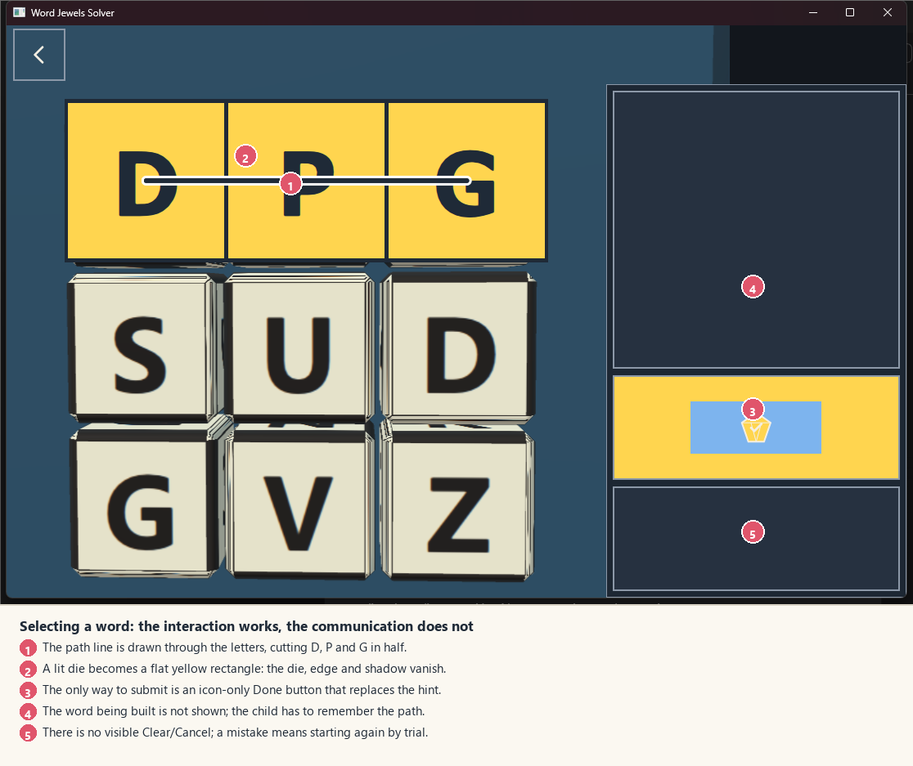

*Exhibit 4. A selected path. The line cuts through the letters; the only way to submit is an unlabelled gem in the hint card.*

1. **The path line is drawn through the letters.** In the screenshot, a thick white line crosses D, P and G at mid-height. It cuts the glyphs in half. The design's path core is dark on a die (good contrast), but the white casing on a cream die is 1.06:1 — effectively invisible — and the line's placement is over the content. The path should be behind the letters, or a border/ribbon around the tiles, not a line through the reading surface.
2. **A lit die becomes a flat yellow rectangle.** The die's edge, bevel and shadow disappear; the tile becomes a solid `#FFD54F` block with a dark letter. The transition is jarring, and it breaks the physical metaphor. The lit state should preserve the die shape and add a gold rim, a glow, or a raised edge — not replace the object.
3. **The word being built is not shown.** The child has to remember the path. For a five-year-old with limited working memory, that is extraneous load. Show the letters as a word chip above the board or in the action zone ("D · P · G").
4. **The only way to submit is an unlabelled gem.** The hint card turns into a blue button with a faceted jewel and a tick. There is no word "Done"; the accessible name is not visible; the button is in the place where the hint used to be. A child who has just traced a word may not look there, and may not connect a gem with "finish".
5. **There is no visible Clear or Cancel.** If the child makes a mistake, they can slide back or lift outside the board, but there is no explicit way to start over. The design says "lifting outside cancels with no penalty"; that is a hidden gesture. Add a visible **Clear** in the action zone.
6. **The selected state is colour-led.** The yellow fill is strong, but the design's own rule says state should not be colour alone. The path and the fill are the only cues; there is no shape change, no check, no number, no spoken letter sequence. A colour-blind child or a child looking at a glare-filled tablet may lose the path.

**Severity:** High. The interaction is close, but the communication undermines it.

**Direction**

- Draw the path **behind the letters** as a thick rounded ribbon connecting tile centres, or as a chain of gold borders around the selected tiles. Keep the letters fully visible.
- Keep the die's shape and shadow when lit; add a gold rim and a subtle scale, not a flat fill.
- Show the current word in a large chip in the action zone, with each letter appearing as it is selected. This also gives the parent a chance to help.
- Make the action zone persistent: **Clear** (secondary) and **Done** (primary, with a check and the word "Done"). Tapping the last tile again also submits.
- Add a spoken letter sound or letter name as each tile joins, with the parent's Sound setting respected. The product brief asks for this; the placeholder sounds currently do not carry it.
- Use shape as well as colour for the path: a numbered order badge on each tile (1, 2, 3...) is a simple, child-friendly cue that also supports screen readers.

### 4.5 Cleared and resting: the ending that isn't an ending

**Purpose:** celebrate the last word, then offer a calm way to stop or play again.

**What works**

- The design's intent is humane: no timer, no streak, no pull to continue, a calm screen that encourages putting the device down.
- The resting screen is visually quiet and does not use numbers or scores.
- The hold-to-play control is a deliberate brake, not a gate.
- Reduced motion is respected.

**What fails**

1. **There is no visible clear state.** When the last word is found, the board glows once and after about three seconds the screen changes. There is no "You found all 4 words!", no count, no jewel summary, no praise. A child may not understand why the board disappeared.
2. **The transition interrupts.** The three-second hold is owned by the app, not the child. A child who is still looking at the last word, or showing a parent, is moved on. The design says the board ends by being cleared; it should let the child finish the moment.
3. **The resting screen's control is hidden.** It is a `HoldButton` with no visible label: an outline at the foot of the screen that fills a ring when held. A five-year-old is unlikely to discover a press-and-hold control with no word. A parent may not either. The design calls it "a brake, not a gate"; in practice it is a gate because it is undiscoverable.
4. **The sleeping box is abstract.** A square with a lid line and two closed eyes. It could be a box, a face, a battery, or a loading placeholder. The design says "for example the closed box and the mascot asleep"; the mascot does not exist. The art is a placeholder and it reads as one.
5. **There is no way to see what was collected.** The board's words and jewels are saved to history, but the child cannot see the collection at the end. The product brief's "word vault" and sticker book are deferred; the MVP does not need the full vault, but a simple "these are the words you found" summary would close the loop.
6. **The back control is the only way home.** The resting screen has a back arrow at the top-left; the hold control plays again. There is no visible "Home" action, and the child may not know that the arrow leaves the game.

**Severity:** High. The ending is the emotional payoff of the loop.

**Direction**

- Replace the automatic three-second transition with a **clear summary**: "You found all 4 words!" with the four jewels and the words, a **Play again** button, and a **Home** link. Let the child or parent choose. If the app is left idle, it can fade to the calm resting screen after a longer, non-punitive pause, but the summary should be the first state.
- Make **Play again** a normal, labelled button, with the hold interaction as an optional parent brake or a secondary control, not the only route.
- Make the resting screen a real, warm illustration: the closed jewel box, a sleeping mascot, a quiet "Time for a rest." line. It should look designed, not like a grey square with eyes.
- Show the collected words/jewels in the summary. No score, no streak, no "best"; just "these are the words you found."
- Keep the no-pressure rule: no countdown, no reminder, no auto-play. The summary is closure, not a push.

### 4.6 Scan ready: the clearest screen in the app

**Purpose:** put a real board in the camera frame and capture it, or type it in.

**What works**

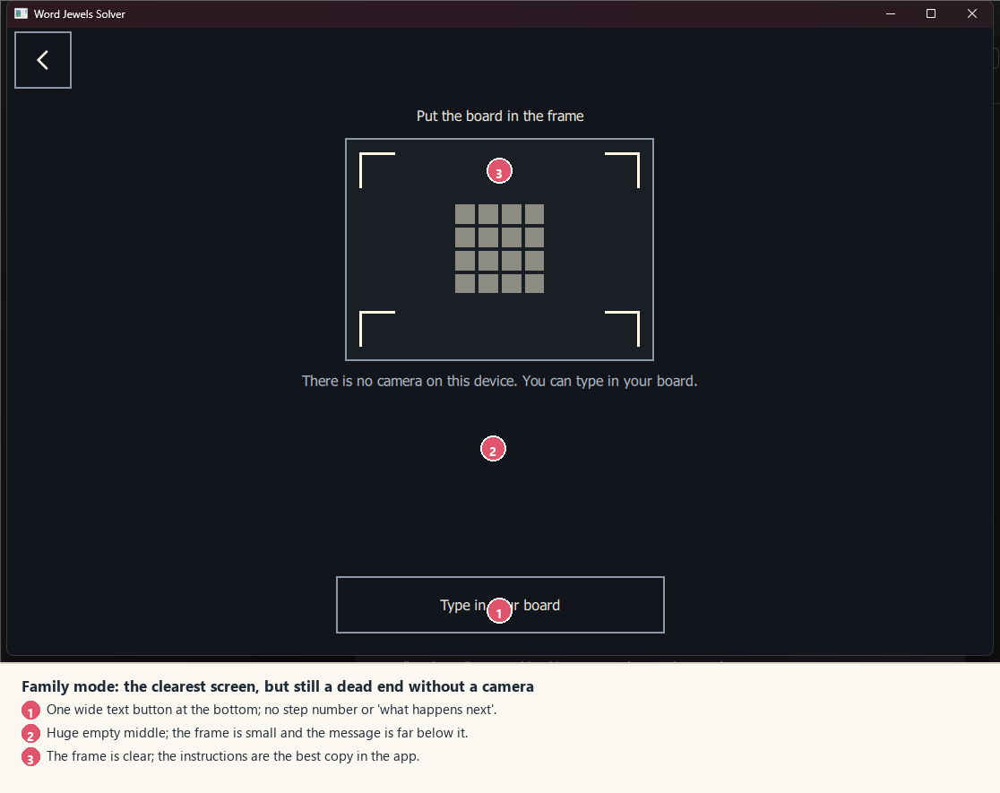

*Exhibit 5. Scan ready. This is the best-written screen in the application; it is also a grown-up workflow presented as a child's mode.*

- "Put the board in the frame" is a complete instruction in five words.
- The frame, the corner brackets and the faint 4 × 4 board picture explain the task without a diagram.
- "There is no camera on this device. You can type in your board." is honest, calm and gives a way on. It does not blame the user.
- The primary action is a wide, labelled button at the foot of the screen.
- The screen has a real back control and a clear title.

**What fails**

1. **It is a grown-up's job in a child's mode.** A five-year-old cannot position a Boggle board, capture it, check 16 letters and type corrections. Yet the home presents this as a mode a child can choose. The screen's copy is adult-level ("There is no camera on this device"), and the only alternative is a 16-cell typing form.
2. **No step context.** The user does not know this is step 1 of 3, what comes after Capture, or how long it will take. The screen is a single act with no visible arc.
3. **The layout is vertically sparse.** The title is at 124 px, the frame at 151–393 px, the message at 423 px, and the button at 649 px. There is a 226 px gap between the message and the button. The eye has to travel a long way to find the action.
4. **The frame is small relative to the window.** At 1116 px wide, the viewfinder is 340 px wide (about 30%). A real board in a camera frame would be small; the parent has to hold the tablet close. The frame could be 45–55% of the width, with the instructions beside it rather than above it.
5. **The no-camera state offers only typing.** A parent without a camera (the current desktop build) is asked to type 16 letters on a desktop keyboard. That is acceptable as a fallback, but it should be framed as a parent tool, with a sample board for demonstration and a clear "this build has no camera" note in the parent area.
6. **The "Type in your board" button is a secondary outline at the bottom.** It is the only way on in the no-camera state, but it is visually subordinate to a Capture button that is not even shown. It should become the primary action when there is no camera.

**Severity:** Medium for an adult; High for the product's role model, because the child can reach it.

**Direction**

- Frame the flow as a **three-step grown-up task**: 1 Place, 2 Check, 3 Play. A small stepper at the top, one card for the camera, one primary action, one secondary action.
- Put the scan flow behind the parent entry, or label the home card "Play with a real board — a grown-up sets this up" and open the gate first.
- In the no-camera state, make "Type the board" the primary action, add "Use a sample board" for demos, and explain that the camera is not available in this build.
- Use the horizontal space: camera frame on the leading side, instructions and actions on the trailing side on a wide window; stack on a tall one.

### 4.7 Check screen and letter picker

**Purpose:** confirm the scanned or typed board, correct doubtful letters, choose the size, and start play.

**What works**

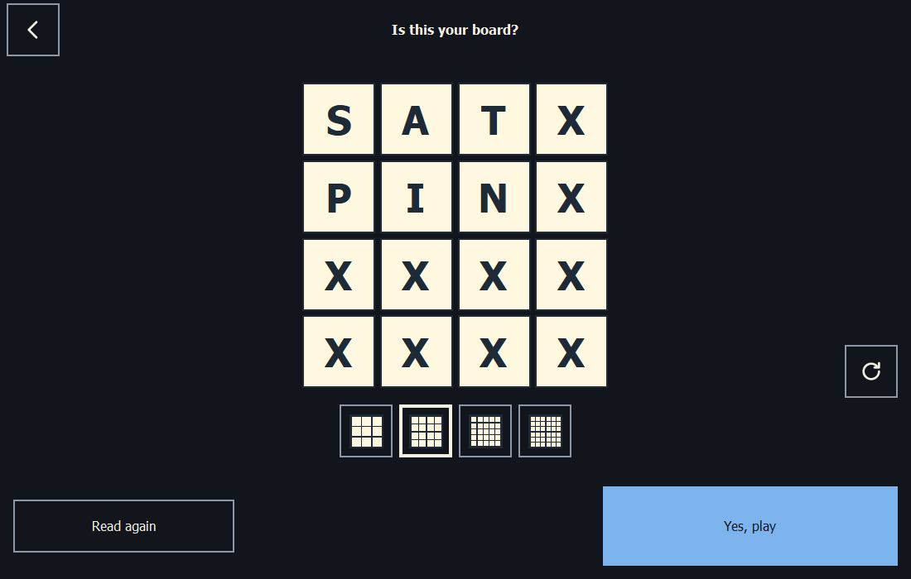

*Exhibit 6. Check. The question and the primary action are clear; the size choice and the empty cells are not.*

- "Is this your board?" is exactly the right question.
- The replica is upright and matches the physical board's reading order; it does not mirror in RTL.
- A doubtful tile is ringed and marked with "?", and the hint explains it.
- Tapping a tile opens a large letter picker with A–Z, Qu, suggestions and a custom field. This is a well-designed correction flow.
- "Yes, play" is the only way to confirm, and it is a large primary button.
- The incomplete-board message is clear and non-blaming.
- The "Turn the board" control is a useful idea for a camera-read board.

**What fails**

1. **Empty cells have no placeholder.** A blank cream square with a thin outline looks like a rendering failure, not "tap to add a letter". A faint "?" or "Tap" inside each empty cell would make the affordance obvious.
2. **The size icons are unlabelled.** Four 64 px squares with 3 × 3 to 6 × 6 grids; the same problem as Solo box. The adult has to count cells to know which is which.
3. **"Read again" is semantically wrong when typing.** The top-left back arrow and the "Read again" button both call `scan.readAgain()`, which returns to the camera/ready screen. When the user typed the board, there is no camera to read again; "Start over" or "Clear board" would be accurate. The back arrow should go back, and the secondary action should say what it does.
4. **No step or progress.** The user does not know that this is step 2 of 3, or whether all 16 cells are filled. A small "16 of 16 letters" line and a step indicator would help.
5. **The letter picker is not a real modal.** It is a `Rectangle` with `visible` and a scrim, not a `Popup` or `Dialog`. It does not declare a focus trap, an initial focus, or an Escape handler. The shell's Escape handler is still active, so pressing Esc while the picker is open is likely to leave the check screen (via `ScanScreen.back()`), discarding the correction. Tab focus can move to controls behind the scrim. This is an accessibility and error-prevention risk; confirm with a keyboard test.
6. **The picker card is enormous.** At 1116 × 739 it covers almost the entire content area; the board behind is barely visible. A modal should feel like a layer, not a replacement screen. The alphabet buttons are good; the card's height could shrink to fit its content.
7. **"Use these" is ambiguous.** It means "use these custom letters". "Use these letters" is clearer. The custom field has no visible label or placeholder; a parent may not know what to type.
8. **No visible "Clear" in the picker.** If a tile is wrong or a custom field has a typo, there is no quick reset. The close X is there, but clearing is a separate action.

**Severity:** Medium. This flow is close to shippable; the modal/focus issues are the main risks.

**Direction**

- Add a stepper: "1 Place · 2 Check · 3 Play", with "2 Check" active.
- Put a faint letter or "?" in each empty cell; add a "16 of 16 letters" progress line.
- Label the size selector with words, not only grids: "3 × 3", "4 × 4", etc., in a segmented control.
- Change the secondary action to "Start over" (typing) or "Scan again" (camera); make the back arrow navigate back rather than re-read.
- Convert the picker to a real modal `Popup`/`Dialog` with a focus trap, initial focus, Escape to close, and a "Clear" action. Keep the scrim and the large alphabet.
- Put a label on the custom field ("Other letters") and use "Use these letters" as the button.

### 4.8 Assist: the family companion

**Purpose:** help a child find words on a real board that has been scanned and confirmed.

**What works**

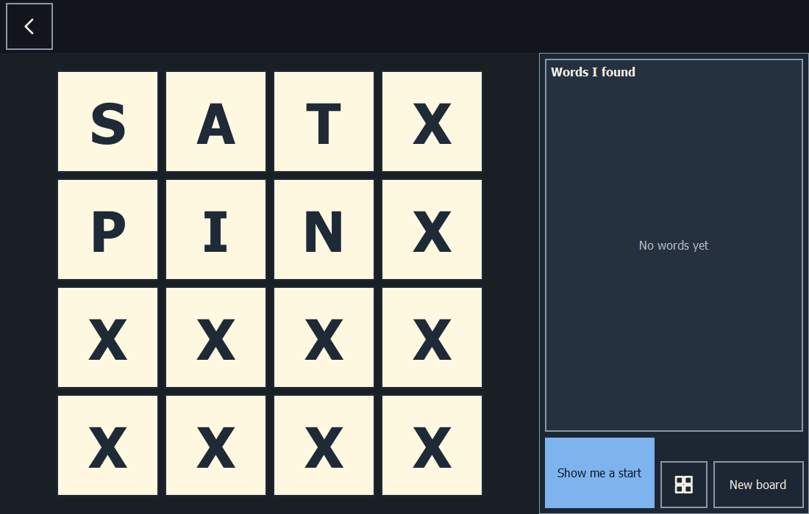

*Exhibit 7. Assist. This screen already has the panel title and empty state that Solo is missing.*

- The panel has a visible **"Words I found"** title and a **"No words yet"** empty state. This is the model Solo should follow.
- **"Show me a start"** is a large, labelled primary action. It is the one help level, and it is visible.
- **"New board"** is a labelled secondary action, and **Earlier boards** is available.
- The board is a 2D replica, which is appropriate for matching a physical board.
- The screen does not pretend to be a scoreboard; it is a helper.

**What fails**

1. **The board and panel use a different visual language from Solo.** Assist is 2D cream-on-cream; Solo is 3D slate. The same game has two board treatments and two panel treatments. A child moving between modes has to relearn the object.
2. **The 2D board has low separation.** Cream tiles on a cream `Theme.boardArea`, with thin outlines, do not have the object quality of the Solo dice. The board looks like a wireframe rather than a replica of a physical board.
3. **No instruction for the child.** The screen assumes the child knows to look at the real board and tap the same letters. A one-line prompt ("Find a word on the board. Tap its letters.") and a spoken cue when the screen opens would help.
4. **The hint is still only a start tile.** The product brief's "nudge, not a spoiler" example is "Can you find a 3-letter animal starting with C?" The MVP deliberately reduced this to the start tile, but the screen does not even say the word length or category. A small clue ("3 letters · starts with C") would make the help feel purposeful.
5. **The family context is invisible.** The app is supposed to help a child compete fairly with adults and teenagers. There is no turn-taking, no "your turn", no "ask the table", no shared score. The screen is a solo word finder with a scanned board. That may be the MVP's scope, but the mode's name and framing promise more.
6. **The new-board action is buried.** It is a small outlined button at the bottom-right, next to the history icon. A parent who wants a new round has to find it; the primary help button dominates the action row.

**Severity:** Medium. The flow works; the product idea is under-expressed.

**Direction**

- Use the same board stage and panel components as Solo. The board can be 2D, but it should use the same die, tray, edge and type tokens; the panel should use the same titled cards.
- Add a one-line child prompt and a spoken cue on entry.
- Extend the hint card with a short clue: the word length and the first letter, not the word. Keep it behind the parent's Help setting.
- Make **New board** a visible secondary action in the app bar or the action zone, not a small button at the bottom.
- If the family mode is meant to be co-play, add a "pass the tablet" or "ask the table" prompt; if it is a helper only, say so in the parent area and in the mode label.

### 4.9 The parent area: gate, dashboard, settings, about

The parent area is a separate top-level screen with a top bar, three tabs and a gate. It is the most text-complete part of the app. It is also visually a different product: 12 px rounded buttons and chips, a white bar, and a light/dark palette that does not match the square, outline-only child kit.

#### 4.9.1 The gate

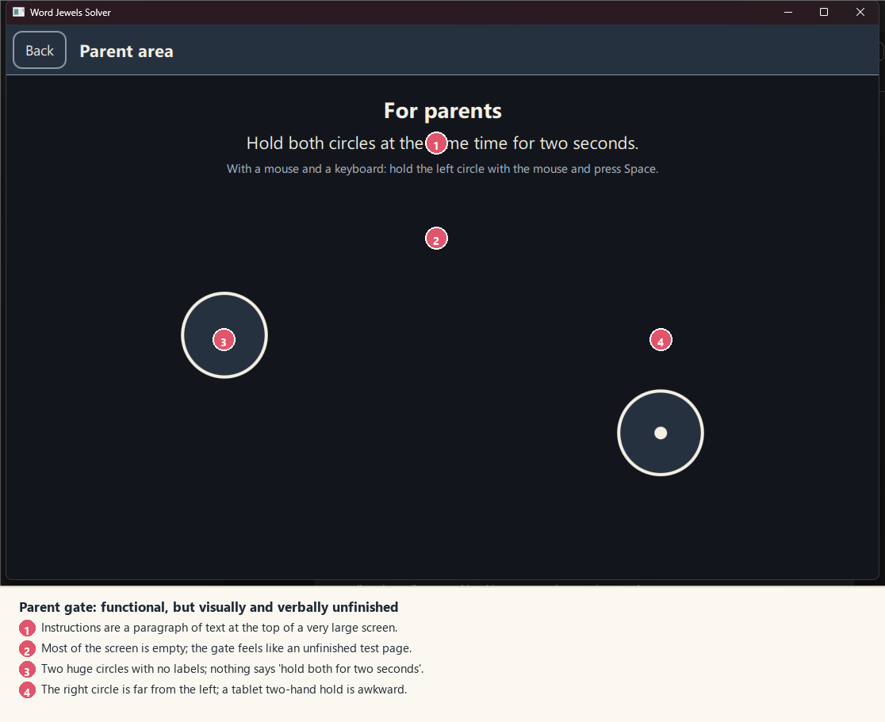

*Exhibit 8. The parent gate. The mechanic is good; the screen is mostly empty.*

**What works**

- The two-circle hold is a good child-resistance pattern: it is not a quiz, it does not rely on reading, and it is quick for an adult.
- The instruction is explicit, including the mouse-and-Space alternative.
- The progress disc and bar give feedback.
- A screen-reader user has an activation route.
- The gate re-locks when the parent area is left.

**What fails**

1. **The screen is mostly empty.** The title and instructions occupy the top 160 px; the circles sit at 428 px; the bottom 300 px is blank. It feels like a test page, not a designed parent entry.
2. **The circles are far apart.** At 1116 px wide, the centres are 551 px apart. On a tablet, holding both with two hands is awkward; a parent may need to put the device down. A compact card with two circles 120–160 px apart would be easier.
3. **The circles have no labels.** The instruction says "Hold both circles", but the circles are unmarked. A small "hold" glyph or a number 1/2 would help; a progress ring around each circle would make the hold legible before it starts.
4. **The gate is not keyboard-only accessible.** `GateScreen.qml` handles Space for the second circle, but the first circle is only read through `MultiPointTouchArea` (mouse or touch). A keyboard-only parent without a screen reader has no way to hold the first circle. The screen-reader action is a separate route, not a keyboard route. This is a WCAG 2.1.1 gap.
5. **The wording does not adapt to the device.** "With a mouse and a keyboard..." is shown on a tablet; the touch instruction and the keyboard instruction are both present, and the parent has to work out which applies.
6. **The parent area's top bar and the gate's title repeat the same idea.** "Parent area" in the bar, "For parents" in the content. Choose one.

**Severity:** Medium. It works for most adults; the accessibility gap and the empty layout are the issues.

**Direction**

- Make the gate a compact card on the parent page: title "For grown-ups", one sentence, two circles 140 px apart with progress rings, and a single "Hold both circles for 2 seconds" instruction.
- Add a keyboard-only route: Space holds both circles after a clear prompt, or Enter/Space on a focused "Open parent area" button with a hold. Ensure it is not a child-accessible single press.
- Adapt the instruction to the input device: touch on tablet, mouse/Space on desktop; show one, not both.
- Keep the screen-reader activation route.

#### 4.9.2 The dashboard

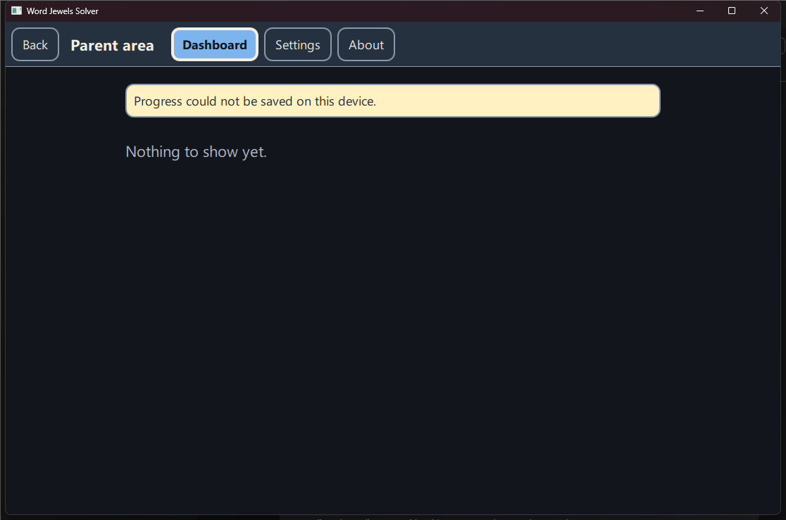

*Exhibit 9. The dashboard with no data. The save warning is an artefact of the review launch; the empty state is not.*

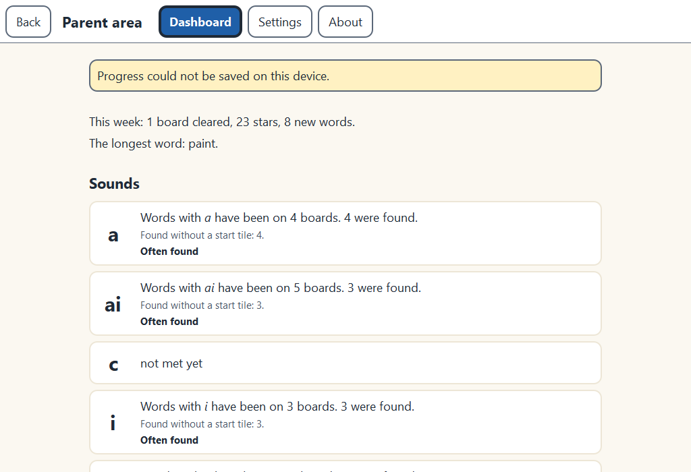

*Exhibit 9b. The dashboard with demo data, from the preview harness. The save banner is a harness artefact; the report cards are the designed content. It shows that the dashboard is comprehensive once it has data, but it is table-like and leads with sounds rather than with the one thing to praise.*

**What works**

- The dashboard is written as observations, not assessments. The wording test forbids "weak", "mastered", "missed", "grade", "score", "streak" and similar.
- When there is data, it shows the week's boards, stars and new words, the sounds met, the vault and the best per size. That is a thoughtful parent report.
- It computes on the device and keeps the data local.
- The privacy copy on the About page is excellent: what is kept, what is never done, and that nothing moves between devices.

**What fails**

1. **The empty state is a dead end.** "Nothing to show yet." gives a parent no explanation of what will appear, when, or what to do. There is no illustration, no "play a board" action, no "set up the app" link. A first-run parent sees a blank page and a warning.
2. **The save warning is technical and not actionable.** "Progress could not be saved on this device." is accurate, but it does not say what to do. Add a "Try again" action, a "Where progress is kept" link, or a plain sentence about storage. (The banner in the screenshot is a review artefact; the copy is still the copy a real failure shows.)
3. **The page has no hierarchy when empty.** A warning banner and one line of text; the rest is blank. The parent cannot tell whether the app is broken or simply unused.
4. **The privacy story is buried.** The strongest trust feature is on the About tab, not at the point where a parent first wonders what the app records. A one-line "Kept on this device. No recording, no network." on the dashboard or gate would answer the question before it is asked.
5. **The dashboard is only reachable after a gate and a tab.** That is correct for privacy, but the empty state should still explain the value.

**Severity:** Medium. It is a content/onboarding problem more than a layout problem.

**Direction**

- Replace the empty state with a welcome card: "This is where your child's words will appear. Play a board, or set up the app first." Two actions: **Play a board** (returns to home) and **Set up** (opens Settings).
- Add a one-line privacy reassurance at the top: "Everything stays on this device. No recording, no network."
- If saving fails, use a plain, actionable banner: "Progress can't be saved on this device. Check that the app can write to your user folder, then try again." with **Try again** and **Where progress is kept**.
- When there is data, lead with a "What to praise" card: the child's newest words, a sound they met, a board they cleared. The current report is comprehensive but table-like; a parent needs the one thing to say at dinner.

#### 4.9.3 Settings

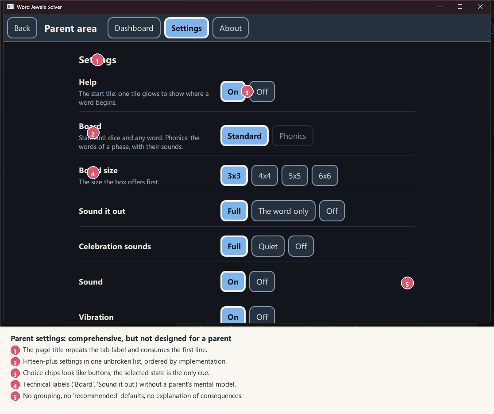

*Exhibit 10. Settings. Every row has a hint; the list has no parent-shaped order.*

**What works**

- Every setting has a short description, and the descriptions are in plain language.
- The choice targets are large and the selected state is clear.
- Destructive resets are two-step and explain what stays and what goes.
- The language list names each language in its own script.
- The colour scheme, motion and text size settings are real and useful.

**What fails**

1. **One unbroken list.** Fifteen-plus rows in the order the implementation grew: Help, Board, Phase, Focus sounds, Board size, Sound it out, Celebration sounds, Sound, Vibration, Shake, Motion, Colour scheme, Text size, School font, Language, Reset. A parent looking for "turn the sound off" has to scan past board type and phonics. A parent looking for "make the text bigger" has to scroll past sound and motion.
2. **The page title repeats the tab.** "Settings" appears in the tab and again as the section title, consuming the first line of an already long page.
3. **The choices look like buttons, not a segmented control.** The selected chip is a filled blue rounded chip; the unselected chips are outlined rounded chips. The group has no shared container or label beyond the row title. For a parent, it reads as a row of independent buttons.
4. **Technical labels.** "Board" (standard/phonics), "Phase", "Focus sounds", "Sound it out", "Text size 1 / 1.25 / 1.5" are implementation or domain terms. "Text size" should be "Normal / Larger / Largest", not multipliers. "Board" should be "Letter dice / Phonics words" with a one-line explanation.
5. **No recommended defaults.** There is no "Recommended" marker, no "This is the default" note, no "Most families use..." guidance. A parent has to guess.
6. **No grouping or disclosure.** Everything is visible at once. The page is long, and the most important settings (sound, text size, language) are mixed with the least (phase, school font).
7. **No save status.** Settings auto-save, but the screen does not say so. A parent may wonder whether a change stuck. A small "Saved" line or a done action would help.
8. **The reset section is at the bottom of the same list.** It is visually a section, but it sits inside the same scroll as the play settings. A separate "Data" area with a clear warning would be safer.

**Severity:** High for parent usability. It is comprehensive but not designed.

**Direction**

- Group into five sections, with the most-used first:
  1. **Play** — board type, board size, help.
  2. **Sound & touch** — sound, celebration sounds, sound it out, vibration, shake.
  3. **Appearance** — colour scheme, text size, motion, school font.
  4. **Language** — interface language.
  5. **Data** — reset boards/finds, reset stars/stickers, where progress is kept.
- Use a two-column layout on wide screens: section navigation on the leading side, the rows on the trailing side. On a tablet, use collapsible sections.
- Replace multiplier labels with words: "Normal", "Larger", "Largest"; "Letter dice (standard)", "Phonics words"; "Full", "Word only", "Off".
- Mark the recommended default; add a "Reset this section" action where it makes sense.
- Show "Saved automatically" or a small check when a change is applied.

#### 4.9.4 About

**What works**

- The About page includes the version, the licence notice, the full notices in a scroll box, and a privacy section.
- The privacy copy is specific and reassuring: what is kept, what is never done, and that nothing moves between devices.
- It is plain text with no external links, which matches the no-network model.

**What fails**

- It is a wall of text with three sections and a 360 px licence scroll box. The privacy section, which is the most important to a parent, is at the bottom.
- There is no wordmark, no icon, no "Made by Iain Chesworth Labs" lockup, no support/contact line, no "What this app is for" line.
- The page is visually the same as Settings: sections and paragraphs, no identity.

**Severity:** Low–Medium. It is a trust page; it should feel designed.

**Direction**

- Lead with the wordmark and a one-line description: "A word-finding game for young readers, played with a grown-up."
- Put **Privacy** first, in a short card with three bullets: "Kept on this device", "No recording, no network", "Nothing moves between devices." The long licence text can stay below.
- Add the version, the maker, and a "What's new" line. No external links.

### 4.10 Responsive layout and the window

The application splits the window by shape, not by device: two-thirds board and one-third panel when wide; two-thirds board and one-third panel when tall (`solo_layout.cpp` lines 28–55). The rule is sensible. The problems are around it:

- **The default window is landscape.** `Main.qml` sets 1100 × 700 and a minimum of 320 × 320. On a 1200 × 1920 portrait display, it opens at the top-left as a landscape window, not centred and not full-screen. The app is designed for a tablet, but it starts like a desktop utility.
- **No window-state persistence.** Size and position are not remembered. A parent who resizes the window for a child has to do it again next time.
- **The split has no gutter.** The board area and the panel share an edge; the panel's card borders touch the board's deck. There is no visual separation, no shared margin, and no alignment between the board's top and the panel's first card.
- **The panel is a fixed third.** On a 1116 px window the panel is 372 px, which is enough for a 3 × 3 panel but tight for a 6 × 6 board's word list and hint. On a tall window, the panel is a third of the height, which can be too short for the word list. The design says "roomy" at 300 dp on both sides; the layout does not change the panel's proportion, only its internal arrangement.
- **The board is sized by the shorter side.** At a very wide window the board is limited by height, leaving large empty side margins; at a tall window it is limited by width, leaving large empty vertical margins. The stage could use the extra space for the tray, the title and the action zone, rather than centring a square in a void.
- **The title bar is OS-native.** It does not follow the light/dark theme or the app's colour. On the review machine it was a dark maroon in both themes. Either use a custom app bar / DWM dark-mode integration, or accept the native frame but make the content meet it with a matching header.

**Direction**

- Centre the window on first launch, size it to `min(1200 × 800, available)`, and remember its geometry. On a tablet, start full-screen; on a desktop, allow a resizable window with a sensible minimum (900 × 620, not 320 × 320).
- Put the board and panel inside a single stage with a 24 px gutter and shared top alignment. The stage's header holds the screen title, board size and status; the panel is an attached drawer, not a separate column.
- On wide screens, let the board take 65–70% and the panel 30–35%, with a min/max. On tall screens, give the panel 40% and make it scroll; the board should not be a square floating in a tall void.
- Use the extra space for the tray's rim, a title, a word/status line, and the action zone. The board should feel placed on a table, not cropped into a rectangle.

---

## 5. Cross-cutting analysis

### 5.1 Identity and design system

The application has tokens, but it does not have a design system. A design system is more than a `Theme.qml`: it is a shared vocabulary of type, colour, shape, spacing, components, content and behaviour, used by every screen. The current code has three vocabularies:

| Layer | What it uses | Where |
| --- | --- | --- |
| Child kit | `Theme.qml`: square outlines, no radius, blue accent, amber hint, Andika named but not bundled, 64/96 targets | Home, Solo, Scan, Assist |
| Parent kit | `ParentTheme.qml`: 12 px radius, blue rounded buttons, white cards, fixed type sizes, a separate note colour | Gate, Dashboard, Settings, About |
| 3D scene | Hard-coded cream, dark edge, teal jewels, slate box, its own lighting | `BoardScene.qml`, `FaceAtlas.qml`, `Die.qml` |

The parent kit's own comment says "when the two are one these screens change `ParentTheme.` to `Theme.` and nothing else" (`ParentTheme.qml` lines 4–10). They are not one. The 3D scene does not use `Theme` at all. The result is a child app, a parent app and a board that look like three different products.

**The evidence in numbers**

- 42 QML files, 6,777 lines; 29 `AppButton` instances and 7 `PButton` instances, two button systems.
- `AppButton` draws a flat, square, border-only control (`AppButton.qml` lines 68–76). `PButton` draws a 12 px rounded, filled button (`PButton.qml` lines 52–68). The same action looks different depending on which module it is in.
- `Theme.qml` names `Andika` as the font family, but no Andika file is bundled and no `@font-face`/`QFontDatabase` registration exists. The child UI falls back to the platform font. The parent area does not set a family at all.
- `FaceAtlas.qml` draws the dice letters with no `font.family` at all (lines 81–87); the most important text in the product uses the platform default. It also hard-codes `faceColor #F4E9CC`, `edgeColor #2B2622`, `inkColor #1F1B18`, and the jewel teal palette.
- `BoardScene.qml` hard-codes the box floor `#2C4C61` (line 661), the rim `#1F3646` (line 697), and a translucent lid (line 743). None of these are theme tokens; none change with light/dark.
- The current `Theme.qml` has 30+ colour tokens; the 3D scene uses 8 colours that are not among them. The path casing `#FFFFFF` on a die `#FFF8E1` is 1.06:1, a ratio the design's contrast table does not list because it only measures the casing on the tray.
- The app has no app icon: no `.ico`, `.icns`, `.desktop`, `RC_ICONS`, or `QIcon` anywhere in the repository. The Windows title bar shows a generic document icon.
- The app has no wordmark or lockup. The only name is the window title.

**What a design system needs**

1. **One source of truth.** A single `Theme.qml` for colour, type, spacing, radius, motion and elevation. Parent screens use the same tokens, with a denser size scale if needed. No `ParentTheme`.
2. **A type system with roles.** Display, title, heading, body, label, caption, mono label, learning text. The same roles in every screen; no fixed 15/18/22/28 in one module and 16/24 in another.
3. **One accent and one reward colour.** The accent is the brand/action colour; the reward colour is reserved for jewels, hints and celebration. The amber hint card should not be a third surface colour.
4. **One shape language.** A radius scale, not 0 in one module and 12 in another. For a child app, a soft-modernist 8–12 px is appropriate; for parent cards, the same 12 px. Pills only for status chips.
5. **One control set.** One `AppButton` with variants (primary, secondary, ghost, picture, danger), one `Card`, one `AppBar`, one `Dialog`, one `EmptyState`, one `SegmentedControl`. The parent area does not need its own button.
6. **One icon system with labels.** Line icons are fine, but every child control carries a visible word and a spoken label; every parent control carries a visible label and a tooltip where needed.
7. **Tokens for the 3D scene.** The board's tray, die, edge, ink, jewel and lighting colours come from the theme; the scene reads light/dark and changes with it. If the scene cannot use QML tokens directly, pass them in as properties.
8. **A documentation page.** A living style guide with the tokens, components, states and content rules, so the next screen does not invent a fourth vocabulary.

### 5.2 Information architecture, roles and navigation

The deepest product problem is not visual. It is that the app does not decide **who is doing what**.

- **Solo Play** is a child's game. The child chooses it, shakes, finds words, collects jewels, and stops.
- **The Family Companion** is an adult-led setup: place a real board, capture it, check 16 letters, confirm, then hand the tablet to the child. The child cannot do steps 1–3.
- **The parent area** is an adult's space: gate, dashboard, settings, about.

The home currently presents Solo and Family as two equal child choices, and hides the parent area behind an unlabelled icon. That is upside down. The adult workflow is front and centre; the adult's settings and progress are hidden. A child can choose a mode that requires an adult and end up in a typing form. A parent may never find the dashboard.

**Recommended model**

- **Home is for the child.** A large **Play** card, a wordmark, and a clearly labelled **For grown-ups** entry. If the family mode is offered on home, it is a secondary card labelled "Play with a real board — a grown-up sets this up", and it opens the gate or a short hand-off screen, not the typing form.
- **The parent area is the adult's home.** It contains the scanner flow ("Set up a real board"), the dashboard, settings and about. A parent who wants to set up the family game goes there; the child never accidentally lands in it.
- **Alternatively, keep two home cards but make the roles explicit.** Left: "Play on my own" (child). Right: "Play with a real board" with a small "Grown-up" badge and a gate. This preserves the two-mode home and fixes the dead end. It is a smaller change; it still leaves the parent area behind a small icon.
- **Whichever model is chosen, the home must say what the app is.** A wordmark plus one line ("Shake the box. Find words. Collect jewels.") is enough.

**Navigation rules**

- Every screen has a stable app bar: back (leading), title or step (centre), parent entry (trailing, where appropriate).
- Back goes where the person came from. From Solo playing, back puts the lid on (and saves); from the box, back goes home. That is the design's rule and it is fine, but the app bar's title should say "Solo Play" so the two-step exit is understandable.
- From the check screen, back should go back to the previous step, not perform "read again". If the user typed the board, "Start over" is a separate secondary action.
- The parent area's tabs are pages, not steps. Back leaves the parent area; Esc does the same. Keep that.
- Do not use a back arrow for an action that is not "back". The current check screen's arrow re-reads the board; that is a semantic mismatch.

**Mode naming**

The visible names should be verbs a child and parent understand:

| Internal | Visible |
| --- | --- |
| Solo Play / Mode B | **Play on my own** |
| Family Companion / Mode A | **Play with a real board** (with "A grown-up sets this up") |
| Parent area | **For grown-ups** |
| scan.ready | **Set up the board** |
| scan.check | **Check the board** |
| assist.playing | **Find words** |
| Solo box | **Shake the box** |
| Solo playing | **Find a word** |
| Solo resting | **Time for a rest** |

The current child-facing wording is already good ("Show me a start", "Words I found", "Earlier boards"); the problem is that most of it is not visible.

### 5.3 Interaction, feedback and error prevention

**What works**

- The tap-in-order alternative means a child does not have to trace.
- A tile cannot be used twice; a non-neighbour is ignored; a wrong path fades rather than scolds.
- The scan flow prevents solving until an adult confirms the board.
- Destructive resets are two-step and explain what is kept.
- The parent gate is a hold, not a quiz; it does not rely on reading.
- The app has no timers, no streaks, no penalties, no push notifications.

**What fails**

1. **Recognition over recall is inverted.** The home, the box, the panel and the parent entry all rely on icons the user has to learn. The accessible names are invisible. A five-year-old cannot hold a legend in working memory; an adult should not have to.
2. **The Done action is in the wrong place.** It appears in the hint card, replacing the hint, only when a path is pending. The child has to notice a change in a secondary card to finish the primary task. Put the action in a stable action zone near the board.
3. **The path is hidden knowledge.** The word being built is not shown. The child has to remember the letters; the parent cannot see what the child is attempting. Show the word chip.
4. **Invalid-word feedback is silence.** A wrong path fades; a real word not on the board gets a soft tick; nothing says why. For a child, silence is ambiguous. A gentle, non-scolding line ("Not this time — try another.") and a spoken cue would help. The design's "an error is not scolded" is right; silence is not the only alternative.
5. **The clear state is missing.** The app moves on after three seconds with no summary. The child does not get closure; the parent does not see what was found.
6. **The resting control is hidden.** A hold-only control with no label is a discoverability failure. Make "Play again" visible and use the hold as an optional brake.
7. **The parent's settings auto-save silently.** There is no "Saved" confirmation. A parent may change a setting twice because they are not sure it stuck.
8. **The save-failure message is not actionable.** "Progress could not be saved on this device." needs a next step.
9. **The picker is not a real modal.** Focus can escape; Esc can leave the screen. This is an error-prevention and accessibility bug.
10. **The gate has no keyboard-only route.** A keyboard user without a screen reader cannot hold the first circle.

**Error-prevention principles for the overhaul**

- Every destructive action has a clear consequence and a way back.
- Every modal traps focus, closes on Escape, and returns focus to the control that opened it.
- Every icon-only control has a visible label or a spoken label, ideally both.
- Every empty state says what will appear and offers the action that fills it.
- Every failure state says what happened, why, and what to do next.
- No action requires a hidden gesture. Gestures are shortcuts, not the only route.

### 5.4 Cognitive load and developmental fit

A five- or six-year-old is an **emergent reader**: they may know some letters and sounds, they are learning left-to-right direction, they rely on pictures and spoken language, and they have a short working memory. They are also developing fine motor control and self-regulation. The app's design intentions acknowledge this (64 dp targets, no timers, no penalties, big pictures), but the execution assumes a much more sophisticated user.

| What the child can do | What the UI assumes | The gap |
| --- | --- | --- |
| Recognise a picture of a box, a hand, a jewel, a play triangle | Recognise four abstract grid icons, a ring-and-dot, a four-square glyph, a person, a gem-with-tick | The icons are symbols, not pictures. |
| Follow one spoken instruction | Infer the flow from three unlabelled controls | No instruction is spoken on the box screen. |
| Remember 2–4 items | Remember what each icon means, what the current path spells, where Done went | The interface adds extraneous memory load. |
| Use a whole hand to tap a large target | Hit a 64 px target whose visible icon is 40 px | The target is large; the signifier is small. |
| Understand "I found a word" from immediate feedback | See a tiny list row and a small jewel | The feedback is too quiet and too far from the action. |
| Stop when tired | Discover a hold-only control or a floating back arrow | Stopping is hidden. |
| Ask an adult for help | The adult has no visible labels or instructions either | The co-play layer is missing. |

**A human-factors lens**

| Principle | What it predicts | Where this UI violates it |
| --- | --- | --- |
| **Fitts's law** | Time to hit a target grows with distance and shrinks with width; the effective target is the visible signifier, not the hit box. | The gate's circles are 551 px apart on the review window; the Done control moves from the hint card to a new place; the Shake button is huge but its icon is 48 px; the four size icons are 40 px pictures inside 64 px boxes. |
| **Hick's law** | Decision time grows with the number of equally weighted choices. | The box screen offers eight undifferentiated controls (back, history, parent, four sizes, Shake); the home offers two equal mode cards plus a corner icon; the settings page offers 15+ visible choices in one list. |
| **Gestalt: proximity and similarity** | Items that are close and alike are read as a group; a strong colour or shape becomes the figure. | The board and panel share an edge with no gutter, so they do not read as one stage; the four size grids are too similar to discriminate; the amber hint card becomes the figure instead of the board. |
| **Working memory** | A young child can hold about 3–4 chunks; extraneous chunks crowd out the task. | The current word is not displayed; the child has to remember the path and the meaning of four icons; the parent has to remember which of 15 settings controls sound. |
| **Motor control** | Simultaneous, sustained and precise actions are harder for small hands. | The gate needs two simultaneous holds far apart; the resting screen needs a one-second hold with no label; the path needs a precise trace through small hit circles. |
| **Feedback and error recovery** | An action needs an immediate, specific, non-punishing consequence. | A found word gets a small list row; an invalid word gets silence; the clear state disappears after 3 s; a save failure gives no next step. |
| **Recognition over recall** | Recognition is faster and more reliable than recall, especially for pre-readers. | The home, box and panel ask the child to recall icon meanings; the parent must recall where settings live; the labels exist only in the accessible names. |

**Cognitive load**

- **Extraneous load:** decoding icons, remembering mode names, finding Done, understanding the blank cards, ignoring the amber card and the 3D noise.
- **Intrinsic load:** finding a word on a grid, holding the path in memory, reading the letters.
- **Germane load:** learning the word, hearing its sounds, connecting the letters to the spoken word.

The current UI adds extraneous load and subtracts germane load. The overhaul should remove the former and amplify the latter: fewer icons, more labels, a visible word chip, spoken letters, a clear hint, and a celebration that names the word.

**Motivation**

The product brief's gamification is deliberately light: no timers, no streaks, no pressure. That is right. But "no pressure" has been implemented as "no feedback". A child needs to know they succeeded, to see the collection grow, and to feel the board end. The jewel is the perfect object for that: it is the brand, the reward and the collection. Right now it is a small list icon.

### 5.5 Content and language

**What works**

- The child wording is warm and concrete: "Show me a start", "Words I found", "Earlier boards", "Play again".
- The camera errors are calm and non-blaming.
- The parent dashboard avoids assessment language; the wording test enforces it.
- The privacy copy is specific and strong.
- The language list names each language in its own script.

**What fails**

1. **Most child wording is invisible.** The good sentences live in `SoloWording.qml` as accessible names; the screen shows icons. The accessible names are for screen readers, not for sighted pre-readers.
2. **The parent copy mixes plain language with implementation terms.** "Board", "Phase", "Focus sounds", "Sound it out", "Text size 1/1.25/1.5" require domain knowledge. The hints help, but the labels should carry the meaning.
3. **The empty states are terse.** "Nothing to show yet." and a blank card do not tell the user what will happen.
4. **The failure state is technical.** "Progress could not be saved on this device." is accurate but not actionable.
5. **The app name is inconsistent.** The OS title says "Word Jewels Solver"; the repo and package say "WordJewelsSolver"; the About says "Word Jewels Solver"; the home says nothing. Pick one public name and one lockup.
6. **The tone shifts between child and parent.** Child: warm, short, spoken. Parent: formal, dense, implementation-shaped. The parent is not a different species; use the same plain, calm voice, with more detail.
7. **The translations are mechanical.** The English source is good; the other seven languages are unreviewed. A child's UI with a mistranslated label is worse than an English UI. Plan a reviewer pass before release.

**Content principles**

- **Short sentences, one idea each.** "Shake the box." "Find a word." "You found 4 words."
- **Verbs first.** "Play", "Shake", "Find", "Check", "Start over".
- **Name the object.** "Box", "dice", "word", "jewel", "board", "start tile".
- **Praise specifically.** "You found CAT." "That's a new word." "You found all 4 words."
- **Never scold.** "Not this time — try another." "That's a real word, but not on this board."
- **Parent copy explains the why.** "The start tile shows where a word begins; it does not give the word away."
- **No jargon in labels.** Put the technical term in the hint if it is needed at all.

### 5.6 Accessibility

The app's accessibility intentions are stronger than most children's apps. The review found a mix of real strengths and specific gaps.

| Criterion | Status | Evidence / gap |
| --- | --- | --- |
| 1.1.1 Non-text content | Partial | Every icon has an `Accessible.name`, but the visible icons are abstract; the board's 2D layer is the alternative to the 3D scene. |
| 1.3.1 Info and relationships | Partial | Lists and headings exist; the Solo panel cards have no visible titles; the picker is a plain `Rectangle`, not a dialog. |
| 1.4.1 Use of colour | Pass | Lit tiles use a heavier edge; start tile uses a ring; checkable choices use a heavier edge. |
| 1.4.3 Contrast (text) | Pass | The current text pairs meet 4.5:1; the docs' measured values are credible. |
| 1.4.11 Non-text contrast | Partial | The path casing on a die is 1.06:1; thin card borders on cream are low contrast; the empty cells have almost no edge. |
| 1.4.4 Resize text | Partial | 1/1.25/1.5 settings; the system's text size is not read; layouts at 1.5/2.0 are untested. |
| 2.1.1 Keyboard | Partial | The gate needs a mouse/touch for the first circle; a keyboard-only adult without a screen reader cannot unlock. |
| 2.4.3 Focus order | Untested | The picker does not trap focus; the board's 2D layer and the panel are separate focus scopes. |
| 2.4.7 Focus visible | Pass | `AppButton` and `PButton` draw focus rings; verify icon-only controls. |
| 2.5.1 Pointer gestures | Pass | Tap-in-order is always available; tracing is optional. |
| 2.5.4 Motion actuation | Pass | The Shake button and Space are alternatives; shake detection can be off. |
| 2.5.7 Dragging | Pass | Tap and trace are alternatives; no drag-only action. |
| 2.5.8 Target size | Pass | 64 dp child, 96 dp primary, 48 dp parent. |
| 2.2.1 / 2.2.2 Timing / pause | Pass | No timers or limits; the 3 s clear transition is short but not a time limit. |
| 2.3.3 Animation from interactions | Pass | Reduced motion is implemented. |
| 4.1.2 Name, role, value | Partial | Names and roles exist; the visible labels do not; the picker's role is unclear. |
| 4.1.3 Status messages | Partial | The found-word list updates, but there is no live announcement; the spoken word is the feedback. |
| 3.3.1 Error identification | Partial | Camera errors are clear; an invalid word is silent; the save error is technical. |
| 3.3.3 Error suggestion | Partial | Camera errors suggest typing; an invalid word suggests nothing; the save error suggests nothing. |

**What to fix first**

1. **Give every child control a visible label and a spoken label.** Add a `label` property to `AppButton`, render it under the icon for child sizes, and set `speaks` for every child control. This is a small code change with a large usability gain.
2. **Make the picker a real modal.** Use `Popup`/`Dialog`, trap focus, set initial focus, close on Escape, return focus. Add a keyboard test.
3. **Fix the gate's keyboard route.** Add a keyboard-only way to hold both circles, or a focused "Open parent area" control with a hold. Test with a keyboard and a screen reader.
4. **Fix the path contrast and z-order.** Put the path behind the letters or use tile borders; measure the path against every surface it crosses; ensure 3:1 minimum.
5. **Add live announcements.** When a word is found, announce "CAT, found" politely; when the board is cleared, announce the summary. The `Accessible` API supports this; confirm with NVDA.
6. **Test at 200% text and 320 px width.** The app claims 0.85–2.0 scaling; verify no clipping in the panel, the picker, the settings and the app bar.

### 5.7 Motion, sound and touch

**What works**

- Reduced motion is a first-class setting, not an afterthought.
- There are no loops over five seconds; the celebration is confined.
- The sound cues are short and mapped to events; there is no music.
- Haptics are paired with sound and a visual change; the desktops no-op gracefully.
- The parent can turn sound, celebration sounds, sound-it-out and vibration off independently.
- The shake has a button, Space and a drag alternative; motion is never the only route.

**What fails**

1. **The sound assets are placeholders.** The phoneme clips and recorded cheers do not exist; the sound-it-out sequence is silent. The product's learning promise is not delivered by the current audio. This is a content/asset gap, not a UI one, but it affects the experience.
2. **The 3D scene is fragile.** On the review machine the closed box was invisible and the dice had heavy seams. The scene is the core metaphor; it needs a robust 2D fallback and a visual QA pass on the target devices.
3. **The shake button does not feel like a shake.** A flat blue bar with a tiny icon; the animation happens elsewhere. The feedback is disconnected from the control.
4. **The clear celebration is a single glow.** No word, no count, no jewel summary, no spoken praise. The product brief asks for a cascade; the MVP can be quieter, but it needs a visible payoff.
5. **The resting transition is automatic.** The child does not control it; reduced motion cuts rather than fades, but the timing still belongs to the app.
6. **The "Sound it out" setting is not visibly connected to the found-word feedback.** A parent may turn it on and hear nothing, because the phoneme clips are silent; the UI does not explain the placeholder state.

**Direction**

- Keep the no-pressure motion: 120 ms feedback, 200 ms panels, 280 ms screens, one celebration per word, one larger celebration for a clear.
- Use 3D for the shake/drop; settle to a flat board for play. This reduces motion sickness, improves legibility and removes the fragile 3D dependency from the core loop.
- Put the sound and haptic feedback on the object that moves: the box rattles, the die clicks, the jewel chimes.
- Record the phonemes and cheers before calling the learning loop complete; until then, label the sound-it-out feature as "coming soon" in the parent area or ship a silent-but-honest build.
- Add a visual equivalent for every sound: the word chip, the jewel, the start ring, the clear summary.

### 5.8 Platform and productisation

The app is not yet packaged as a product a family would install.

| Area | Current state | What a product needs |
| --- | --- | --- |
| App icon | None; Windows shows a generic document icon | A 16/24/32/48/256 px `.ico`, `.icns`, PNG set, and the installer icon. |
| Wordmark | None in the app; the title bar says "Word Jewels Solver" | A lockup in the app bar, About, installer and store. |
| Window | Fixed 1100 × 700, top-left, no persistence | Centre, size to screen, remember geometry, full-screen on tablet. |
| Startup | Dictionary + 3D scene before first paint; no splash | Instant branded shell; load behind it; a "getting the dice ready" state. |
| Type | Andika named, not bundled; parent area uses the system font | Bundle Andika (OFL) and use it for learning text; Archivo/Plex for UI. |
| Theme | Two theme objects + hard-coded 3D colours | One token set; light/dark tested; 3D reads the tokens. |
| Persistence | Store works; no window state; no save status | Save settings/window state; show "Saved"; actionable failure. |
| Localization | Eight catalogues, mechanical translations | Reviewer pass; RTL and CJK layout tests; no text in images. |
| Packaging | ZIP/NSIS configured; no icon/store assets | Icon, screenshots, description, privacy statement, installer. |
| Diagnostics | Debug build with ASAN; QML warnings in preview | A release build that starts clean, no QML warnings, no blank 3D. |
| Help | No help screen; parent hints only | A short "How to play" card for the adult, and a spoken cue for the child. |

**Startup performance**

The app constructs the Solo screen and its 3D scene at startup, behind home (`Main.qml` lines 185–211; `SoloScreen.qml` `Component.onCompleted` calls `relayout()` and creates the scene). On the review machine the window took several seconds to appear and the Solo box was blank for several more. A release build will be faster, but the architecture deliberately puts the heaviest scene on the critical path. The home should be the first thing painted; the Solo scene can be created when the child chooses Solo, with a short "getting the dice ready" state. If the scene is pre-warmed, do it after the first frame, not before the window.

**The first-run question**

The product deliberately has no first-run carousel. That is right for the child. But the parent needs a first-run moment: a single card in the parent area that says what the app does, where progress is kept, and how to set up a real board. It can be one screen, not a carousel, and it can be dismissed. The current app has no such moment; the parent lands on a blank dashboard.

---

## 6. Comparison with CountdownSolver and ICL Forge

### 6.1 The house DNA

CountdownSolver and ICL Forge do not look the same. Countdown is warm, calm and card-based, with a teal accent and 12 px corners. Forge is editorial, dense and square, with a red accent and numbered sections. They are two expressions of the same discipline:

- **A wordmark and an icon.** Countdown has the "C" mark and "Countdown SOLVER" lockup in the sidebar. Forge has the "Forge" wordmark, the product name, and a strong header.
- **A type system with roles.** Countdown uses IBM Plex Sans for UI and IBM Plex Mono for labels, numbers and metadata. Forge uses Archivo for display and UI, IBM Plex Mono for labels and numbers, and a clear size/weight hierarchy.
- **One accent.** Countdown's teal is the only accent; Forge's signal red is the only accent. Both reserve other colours for data or state, not decoration.
- **Labelled controls.** Every button, tab, field and choice says what it is. Icons supplement labels; they do not replace them.
- **A clear page hierarchy.** A page title, a subtitle or lede, section labels, and a primary action. The user always knows where they are and what the page is for.
- **A flat, ruled surface language.** Countdown uses 12 px cards with 1 px borders; Forge uses zero-radius panels, thin rules and mono section numbers. Neither uses gratuitous gradients, glass, or decorative shadows.
- **A real empty or first-run state.** Countdown's result card says what is missing and what to do. Forge has a first-run screen, explanatory notes, and a command bar that says what will happen.
- **Productisation.** Both have an icon, version, packaging, settings, dark/light themes, keyboard support and tests. They feel installable.

WordJewelsSolver has the opposite profile: strong engineering, weak product surface. It has no wordmark, no icon, no bundled typeface, no consistent accent (blue + amber + teal + cream + five jewel colours), no single control set (square child buttons vs rounded parent buttons), and no shared page hierarchy (home is wordless, Solo is wordless, the parent area is text-dense).

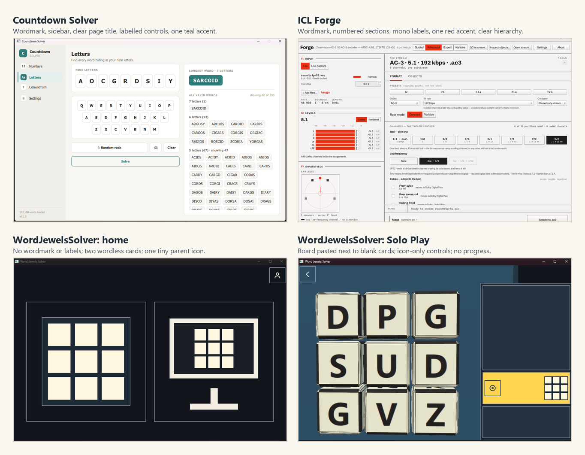

*Exhibit 11. CountdownSolver and ICL Forge at the top; WordJewelsSolver home and Solo Play at the bottom. The gap is not "adult vs child"; it is "productised vs prototype".*

### 6.2 Side-by-side

| Dimension | CountdownSolver | ICL Forge | WordJewelsSolver |
| --- | --- | --- | --- |
| **Identity** | "C" mark + "Countdown SOLVER" wordmark in the sidebar; app icon; version and word count in the footer | "Forge" wordmark + product name + icon; first-run; About | No wordmark, no icon, no lockup; the OS title bar is the only name |
| **Type** | IBM Plex Sans + IBM Plex Mono; 22 px page title, 14 px subtitle, 11 px mono section labels | Archivo + IBM Plex Mono; display, title, body, label, mono data roles | Andika named but not bundled; parent area uses the platform font; dice letters use the platform default; no consistent hierarchy |
| **Accent** | Teal `#2F7D7B` / `#54B8B0` | Signal red `#EC3013` / `#FF5C40` | Blue `#1F5FA8` / `#7DB4EE`, plus amber `#FFD54F`, plus teal 3D jewels, plus five jewel colours |
| **Surfaces** | Warm neutrals; 12 px cards; 9 px controls; 1 px borders | Paper/ink; zero radius; thin rules; no shadows | Cream/near-black chrome; 0 px child buttons; 12 px parent buttons; slate 3D board; white parent cards |
| **Layout** | Persistent 214 px sidebar + page header + two-column content | 340 px rail + stream + command bar; 1280 × 900 | Full-window home; 2/3 board + 1/3 panel; top bar only in the parent area |
| **Density** | High, but labelled and grouped | High, but labelled and numbered | Sparse where it needs information, dense where it needs calm |
| **Labels** | Every control has text | Every control has text; explanations where needed | Child controls are icon-only; parent controls are labelled |
| **Empty states** | Prompts what is missing and what to do | Explanations, first-run, command bar | Blank cards; "Nothing to show yet." |
| **Feedback** | Results, counts, badges, status | Meters, runs, status, explanations | A small list row and a jewel; no score, count or clear summary |
| **Onboarding** | No carousel; the sidebar and page copy carry the model | First-run screen and explanatory notes | No first-run; the pictures are not self-explanatory |
| **Productisation** | Icon, version, word count, dark theme, packaging | Icon, version, preferences, docs, packaging | No icon, no version in the app, no window persistence, no font bundling |

### 6.3 What to borrow, and what not to borrow

**Borrow from Countdown**

- The wordmark + sidebar discipline, adapted to a single top app bar.
- The page title + subtitle pattern: one line that says what the screen is for.
- The labelled control language: every control says what it does.
- The empty-state prompts: "Choose 6 more numbers" is a model for "Your words will land here" and "Play a board to see your week."
- The calm card surface and the single teal-like accent.

**Borrow from Forge**

- The editorial hierarchy: a strong wordmark, a lede, numbered or labelled sections, mono metadata.
- The explanatory note: a short sentence under a control that says what it does and what it will change.
- The primary command bar at the bottom of the work area: one clear action, with the rest secondary.
- The first-run screen as a model for a one-card parent welcome.
- The discipline of one accent and no decoration without meaning.

**Do not borrow**

- Forge's 1280 × 900 minimum and three-column density; a child's app must work on a tablet and at 200% text.
- Countdown's sidebar; a five-year-old does not need a navigation rail, and it eats the play area.
- The adult tone. The child's copy should be shorter, warmer and spoken.
- The zero-radius severity of Forge. A child's app can be soft without being bubbly; 8–12 px is the right compromise.
- The dark, high-contrast tech aesthetic. WordJewels should be warm and tactile, not a studio console.

### 6.4 The gap is product design, not "childish vs professional"

A common misreading of this comparison is that WordJewels looks different because it is for children. That is not the issue. Countdown and Forge are for adults, but their principles — a wordmark, a type system, one accent, labelled controls, clear hierarchy, real empty states — apply equally to a child's app. The child version should be **warmer, larger, more tactile and more spoken**, not **wordless, unlabelled and unfinished**.

The current app has the opposite of the house pattern: it is most abstract where the user is least able to decode abstraction (the child), and most technical where the user needs clarity (the parent).

---

## 7. The design overhaul

### 7.1 North star

**A jewel box on the table.**

A warm, tactile, calm object that a child can open, shake and fill with words. The interface around it is flat, typographic and quiet, like the house's desktop products; the board itself is physical, lit and rewarding. The child always knows what to touch and what happened. The adult always knows what the app is doing and where the settings are.

The design should feel:

- **warm**, not clinical;
- **tactile**, not flat and abstract;
- **playful**, not childish or noisy;
- **legible**, not decorative;
- **calm**, not empty;
- **of the house**, not a separate product.

Three directions were considered before recommending one:

| Direction | What it is | Why it is, or is not, the recommendation |
| --- | --- | --- |
| **A. Jewel Box** (recommended) | Warm paper, deep tray, cream dice, emerald accent, gold reward, Archivo + Andika + Plex Mono, 12 px soft-modernist, flat chrome around a tactile board. | Keeps the house discipline while giving the child a warm, physical object. It bridges Countdown's teal warmth and Forge's editorial structure without cloning either. |
| **B. Modernist Play** | Forge-like zero radius, a red accent, dense editorial sections, Archivo + Plex Mono, a flat board. | The strongest match to Forge, but colder and more adult; a five-year-old is less likely to read it as a toy. It could work as a parent-only direction. |
| **C. Soft Play** | Rounded pastel cards, a bubbly display face, large illustrations, lots of colour. | Child-friendly, but generic; it would look less like Iain Chesworth Labs and more like a mass-market children's app. The jewel metaphor would be lost in candy colours. |

The recommendation is **A**, with **B** available if the house decides that a stricter shared visual language matters more than warmth. **C** is the direction to avoid: it fixes "childish" by becoming childish, not by becoming designed.

### 7.2 Principles

1. **One obvious next step.** Every screen has one primary action, labelled and reachable. The secondary actions are quieter and fewer.
2. **Show, say, spell.** A picture, a word and a voice. A child should never have to decode an icon that has no label and no spoken name. A parent should never have to guess what a picture means.
3. **The board is the hero.** Frame it, title it, light it, and let it be the largest, clearest object on the screen. The interface around it is a frame, not a competitor.
4. **A jewel for every win.** Every found word produces a visible, collectible jewel and a short, specific praise. The collection grows; the child sees it. No score, no streak, no pressure.
5. **Calm, not empty.** Space is deliberate. Every card has a title, a purpose and an empty state. Empty is not a design.
6. **Same house, child-sized.** One design system, one voice, one set of components. The parent area is denser, not a different product.
7. **Grown-up jobs are behind the gate.** Scanning, typing, settings and progress are adult workflows. The child's home is play.
8. **Test with small hands and short attention.** Large targets, spoken labels, reduced motion, no timers, and a usability test with real children and parents before the design is called done.

### 7.3 Identity

#### Name and lockup

- **Child-facing name:** **Word Jewels**.
- **Product/parent name:** **Word Jewels Solver** (the OS title, About, installer, store).
- **Lockup:** **Word Jewels** in Archivo ExtraBold, with **SOLVER** in IBM Plex Mono, letter-spaced, beneath or to the right, in the muted ink. The lockup is the same in the app bar, the About page, the installer and the store.
- **Tagline:** **Shake. Find. Collect.** for the child/home; **A word-finding game for young readers, played with a grown-up.** for the parent/About.
- **Name consistency:** replace "WordJewelsSolver" in user-facing text with "Word Jewels Solver"; keep the repository/package identifier as is.

#### Icon

- A faceted jewel seen from above, sitting in a shallow tray, flat, two tones plus the accent. The shape must read at 16 px: a bright table, two dark facets, a gold rim. No grid, no tiny letters, no 3D render.
- Use the same geometry as the `Jewel` component and the board's dead-jewel face, so the icon cannot drift from the game.
- Deliver `.ico` (16/24/32/48/256), `.icns`, PNGs, and the installer icon.

#### Voice

- **Child:** short, warm, specific, spoken. "Shake the box." "Find a word." "You found CAT." "You found all 4 words." "Time for a rest."
- **Parent:** plain, calm, explanatory. "The start tile shows where a word begins; it does not give the word away." "Everything stays on this device."
- **Never:** scold, grade, compare, count down, or use implementation jargon in a label.

### 7.4 Type

The current app names Andika but never bundles it; the parent area uses the platform font; the dice use the platform default. The overhaul should make type a first-class part of the product.

| Role | Face | Size / weight | Use |
| --- | --- | --- | --- |
| **Display** | Archivo ExtraBold | 40/44, tracking −0.02 em | Wordmark, home hero, clear summary |
| **Title** | Archivo SemiBold | 28/34 | Screen titles, parent page titles |
| **Heading** | Archivo SemiBold | 20/26 | Card titles, section headings |
| **Body** | Archivo Regular | 16/24 | Parent copy, instructions, settings |
| **Child label** | Andika Bold | 22/28 | "Shake", "Done", "Words I found", panel titles |
| **Learning word** | Andika Regular/Bold | 24/32 (word tray), 0.55 × tile (dice) | Found words, hints, board letters |
| **Label / mono** | IBM Plex Mono Medium | 12/16, uppercase, 0.08 em | Board size, counts, version, parent metadata |
| **Caption** | Archivo Regular | 13/18 | Hints, secondary text, timestamps |

**Rules**

- Bundle **Andika** (SIL OFL) for all learning text and dice letters; it is designed for beginning readers and distinguishes I/l/1. Read its licence file, include it in the notices, and run the glyph check in `docs/design/application.md` before release.
- Bundle **Archivo** (OFL) and **IBM Plex Mono** (OFL) for the UI and parent metadata. These are the house faces; they make the app feel like a sibling of Forge/Cubeulator and Countdown.
- Use a modular scale: 12, 14, 16, 20, 24, 32, 40, 48. Line heights 1.4–1.5 for body, 1.15–1.25 for display.
- Use rem/scale tokens, not fixed pixel sizes. The parent area's fixed 15/18/22/28 sizes should become the same scale.
- Child labels are larger than parent labels: 22–24 px, not 16. A five-year-old should not have to read 16 px text.
- Board letters are **Andika Bold uppercase**, with a glyph check for I/l/1, O/0, b/d/p/q, M/W. The dice are the content; their type must be the best type in the app.
- No text in images; all labels are live text for translation and scaling.

### 7.5 Colour

The current palette is not bad in isolation; it is incoherent in use. The light palette is warm cream and blue; the dark palette is blue-black and pale blue; the board is slate and cream; the hint is amber; the jewels are five colours; the 3D jewels are teal. There is no single accent and no single surface family.

The proposed palette is a **warm paper + deep jewel tray + emerald accent + gold reward**. It bridges Countdown's teal warmth and the "jewel box" idea without copying either sibling.

#### Light

| Token | Value | Use | Contrast |
| --- | --- | --- | --- |
| `paper` | `#F6F1E7` | Window background | — |
| `surface` | `#FFFDF8` | Cards, app bar | — |
| `ink` | `#1E2A30` | Primary text | 13.05:1 on paper |
| `muted` | `#5C6B70` | Secondary text | 4.92:1 on paper |
| `line` | `#D9D1C2` | Borders, rules | 1.3:1 on paper (decorative) |
| `accent` | `#166B5C` | Primary actions, active state, brand shapes | 5.67:1 on paper; white on accent 6.38:1 |
| `accentSoft` | `#DDEDE8` | Selected chips, quiet accent surfaces | — |
| `gold` | `#C98A1E` | Reward, hint ring, jewel rim; shapes only | Use `goldInk #7A4E08` for text (6.39:1) |
| `goldSoft` | `#F7E8C6` | Hint card background, celebration wash | — |
| `tray` | `#17323A` | Board tray, closed box | — |
| `die` | `#FFF7E3` | Dice face | Die ink 13.73:1; die on tray 12.66:1 |
| `dieInk` | `#1F2A30` | Dice letters | 13.73:1 on die |
| `dieEdge` | `#20323A` | Die edge | 11.8:1 on die (shape, not text) |
| `danger` | `#A33A2B` | Destructive action, error text | 6.0:1 on paper |

#### Dark

| Token | Value | Use | Contrast |
| --- | --- | --- | --- |
| `paper` | `#11181B` | Window background | — |
| `surface` | `#1A2428` | Cards, app bar | — |
| `ink` | `#F2ECDE` | Primary text | 15.23:1 on paper |
| `muted` | `#B3BDBB` | Secondary text | 9.33:1 on paper |
| `line` | `#3A474B` | Borders, rules | 2.0:1 on paper (decorative) |
| `accent` | `#63C7B2` | Primary actions, active state | 8.84:1 on paper; dark ink on accent 8.40:1 |
| `accentSoft` | `#1E3A36` | Selected chips, quiet accent surfaces | — |
| `gold` | `#EFB65A` | Reward, hint ring, jewel rim | 9.83:1 on paper; use dark ink on gold |
| `goldSoft` | `#3A2E1A` | Hint card background, celebration wash | — |
| `tray` | `#0D2229` | Board tray, closed box | — |
| `die` | `#F5EBD2` | Dice face | Die ink 12.36:1; die on tray 13.85:1 |
| `dieInk` | `#1F2A30` | Dice letters | 12.36:1 on die |
| `dieEdge` | `#2A3B40` | Die edge | — |

#### Rules

- **One accent for the product.** Emerald is the action/brand colour. Gold is reserved for reward, hint and celebration. No other colour is used for chrome.
- **Jewel colours are for jewels only.** A five-colour jewel set (coral, sapphire, amethyst, amber, emerald) can live in the collection and the found-word rows. They never colour a button, a card, a nav item or a title.
- **The board is the same object in both themes.** The tray gets slightly darker in dark mode; the dice stay cream, because they are physical dice. The board is allowed to be the one warm, constant object in a dark room.
- **State is never colour alone.** Selected = filled + heavier edge + check. Lit die = gold rim + scale + order badge. Start tile = ring + pulse. Hint = ring + label. Error = icon + text, not red alone.
- **Contrast gates.** Text 4.5:1, large text 3:1, non-text 3:1; the path must be 3:1 against every surface it crosses. The current path casing on a die is 1.06:1; it must be fixed, not documented around.
- **The 3D scene reads the tokens.** Pass `tray`, `die`, `dieInk`, `dieEdge` and `gold` into `BoardScene`/`FaceAtlas`; do not hard-code `#2C4C61`, `#F4E9CC`, `#2E9F92`. The board must change with the theme.

### 7.6 Shape, spacing and elevation

| Token | Value | Use |
| --- | --- | --- |
| `radius-xs` | 4 | Small badges, chips |
| `radius-sm` | 8 | Inputs, small controls |
| `radius-md` | 12 | Cards, dice, buttons |
| `radius-lg` | 20 | Dialogs, sheets |
| `radius-full` | 999 | Status pills only |
| `space-1` | 4 | Hairline gaps |
| `space-2` | 8 | Inner padding, icon gaps |
| `space-3` | 12 | Control padding |
| `space-4` | 16 | Card padding |
| `space-6` | 24 | Section gaps, gutters |
| `space-8` | 32 | Screen margins |
| `space-12` | 48 | Major section breaks |
| `space-16` | 64 | Hero spacing |

- **No mixed radii.** The child and parent areas use the same 12 px card/control radius. The 3D dice use 12 px equivalents on the face texture. The only 0-radius surface is a full-bleed bar or a rule.
- **One shadow.** The board tray gets a soft, warm shadow (0 12px 32px rgba(23,50,58,0.18)) to lift it off the paper. Cards are flat with a 1 px line. Dialogs get a stronger shadow and a scrim. No glass, no gradient, no glow except the reward.
- **8 pt grid.** All spacing and sizes are multiples of 4/8; the board's tile/gap rule remains, but the stage and panel use the grid.

### 7.7 Components

The overhaul should consolidate around a small kit. The current app has 29 `AppButton` instances and 7 `PButton` instances; the new kit should have one button and fewer variants.

| Component | Purpose | Key states |
| --- | --- | --- |
| **AppBar** | Wordmark, back, title, parent entry | home, child screen, parent screen, modal |
| **ModeCard** | A large picture + label + subtitle + chevron | default, hover, pressed, disabled, locked |
| **BoardStage** | Tray, header, board, action zone | closed box, shaking, dropping, playing, cleared |
| **Die** | A cream tile with an Andika letter | resting, selected, hinted, found, disabled |
| **Jewel** | A faceted reward | spark, power, mega; in tray, in summary, in vault |
| **WordTray** | "Words I found" card | empty, list, full, scroll |
| **HintCard** | "Need a start?" card | default, hint shown, no help |
| **ActionBar** | Current word + Clear/Done; Shake; Play again | hidden, pending word, primary, secondary |
| **EmptyState** | Icon + title + sentence + action | first run, no words, no history, no data, error |
| **SegmentedControl** | Board size, sound choices, text size | selected, unselected, disabled |
| **Dialog** | Letter picker, reset confirmation | open, focus trap, Escape, return focus |
| **ParentSection** | Settings group | collapsed, expanded, saved, error |
| **StatCard** | Dashboard summary | value, label, no data |

**Component rules**

- Every button has a `label` and an optional `icon`; child buttons render both, with the label at 22 px. Icon-only is allowed only for a back arrow, a close X, or a parent utility, and even then the accessible name and a tooltip are mandatory.
- Every button has `speaks` (the spoken label) and `Accessible.name`; every child button speaks on press, not only on a screen reader.
- Every card has a title and an empty state. A card without a title is a bug.
- Every dialog traps focus, sets initial focus, closes on Escape, and returns focus to its opener.
- Every screen has an AppBar; no floating back arrows over the play area.
- Every primary action is at least 96 dp high on a child screen and at least 56 dp on a parent screen.
- Every state uses shape + text + colour, never colour alone.

### 7.8 Screen redesigns

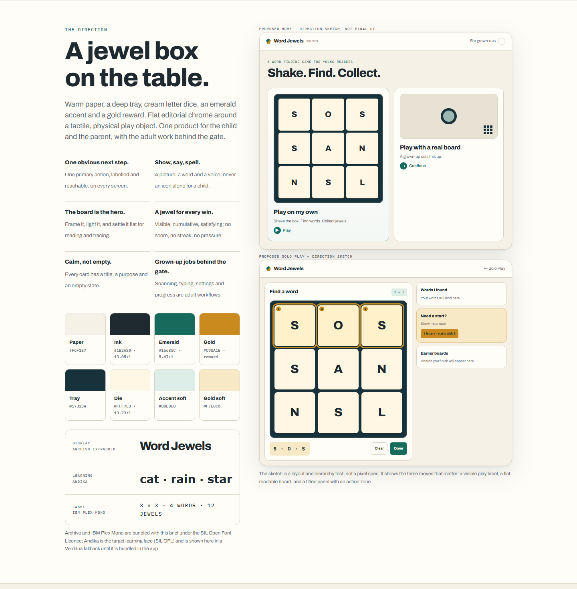

*The proposed direction: a warm, tactile jewel box for the child, with a flat board and a titled panel; the adult work stays behind the gate. This is a direction sketch, not a pixel specification.*

#### 7.8.1 Home

**Before:** two wordless picture cards, a tiny person icon, no identity, no primary action.

**After:**

- **App bar:** wordmark **Word Jewels** on the leading side; **For grown-ups** text + person icon on the trailing side. Height 72.
- **Hero:** "Shake. Find. Collect." in Archivo Display, 40 px; a one-line lede in body.
- **Primary card:** **Play on my own**. A large illustration of the closed jewel box (cream dice, deep tray, gold rim), the label in Andika 28, a play chevron, and a spoken label on press. The card fills the leading two-thirds on wide screens; full width on tall.
- **Secondary card:** **Play with a real board**. A camera/board illustration, the label, and a small "A grown-up sets this up" caption. It opens the gate or the parent scanner, not the typing form.
- **Optional:** a small "Continue" card if a board is in progress; not a daily streak, not a reminder.
- **Focus:** the primary card is focused on entry; the parent entry is last in the tab order.
- **Responsive:** two cards side by side on wide screens, stacked on tall; the primary card is always first and largest.
- **First paint:** the wordmark and cards appear immediately; the dictionary and 3D scene load behind a subtle "Getting the dice ready" line on the Solo card, not a blank window.

**Why:** the child sees a verb, a picture and one obvious action; the parent sees a labelled way in; the app has an identity in the first frame.

#### 7.8.2 Solo box

**Before:** a flat slate field, a giant unlabelled Shake bar, four indistinguishable size icons, a blank panel.

**After:**

- **App bar:** back, **Solo Play**, For grown-ups.
- **Stage:** a closed jewel box, centred, with a lid, a rim, a soft shadow, and a small "Shake to open" line. The box is a 2D illustration or a robust 3D render; if 3D fails, the 2D fallback is used automatically.
- **Board size:** a segmented control labelled **Board size** with "3 × 3", "4 × 4", "5 × 5", "6 × 6", each with a mini preview. The recommended 3 × 3 has a "Good start" badge. Only sizes that fit are shown.
- **Primary action:** **Shake** button, 96 dp, with a hand/box icon and the word; a small "or shake the tablet" line on touch devices.
- **Panel/place:** a "How it works" card with three short lines: "Shake the box.", "Find a word.", "Collect jewels." No blank rectangle.
- **Feedback:** the box wobbles and rattles on press; the lid lifts; the dice fall; the stage cross-fades to the flat board.

**Why:** the child sees the object, the verb and the size; the box metaphor is visible before the first shake.

#### 7.8.3 Solo playing

**Before:** a 3D slate board, heavy seams, blank panel cards, an amber hint card, an icon-only Done, no progress.

**After:**

- **App bar:** back, **Solo Play**, For grown-ups.
- **Stage (leading 2/3):**
  - A framed tray with a header: **Find a word** on the leading side, a board-size chip and a small jewel count on the trailing side.
  - A flat, orthographic board: cream dice, Andika Bold letters, a 2 px top highlight and a 3 px bottom edge; no perspective, no black seams, no drop shadows on the letters.
  - The path is a gold ribbon **behind** the letters or a chain of gold borders around the selected dice; each selected die keeps its shape and gets a 1–3 order badge.
  - The start hint is a pulsing gold ring around one die plus a short line in the panel: "This word starts here."
  - The action zone below the board: the current word in a large word chip (D · P · G), **Clear** (secondary) and **Done** (primary, 96 dp). Tapping the last die again also submits.
- **Panel (trailing 1/3):**
  - **Words I found** card: title, count ("3 words"), a scrollable list of jewel + word, tap to hear; empty state "Your words will land here."
  - **Need a start?** card: a labelled 96 dp button **Show me a start**, a small board thumbnail with the start ring, and a one-line clue ("3 letters · starts with C") when the hint is shown. Gold accent on the ring and the button icon, not a full amber card.
  - **Earlier boards** card: a labelled button, plus 2–3 thumbnails when there is room; empty state "Boards you finish will appear here."
  - A small **jewel shelf** at the top or bottom of the panel: the collected jewels for this board, so the child sees the collection grow.
- **Feedback:** on a found word, the selected dice flash gold in order, the word flies to the tray as a jewel, the word is spoken, and a one-line praise appears ("CAT! You found a word."). On a real-but-not-today word, a neutral line ("That's a real word — not on this board."). On a non-word, a gentle "Not this time — try another." No buzzers, no red.
- **Clear:** the last jewel lands; the stage shows a **clear card** over the board: "You found all 4 words!" with the four jewels and words, **Play again** and **Home**. No automatic transition. If the app is left idle for a long time, it can fade to the calm resting screen, but the child chooses.
- **Resting:** a warm illustration of the closed box and a sleeping mascot; "Time for a rest."; a visible **Play again** button with a hold ring; a **Home** link. The hold is a brake, not the only control.

**Why:** the board becomes readable and physical; the panel becomes informative; the loop becomes visible and rewarding; the child controls the ending.

#### 7.8.4 Scan, check and assist

**Before:** a grown-up workflow presented as a child mode; a clear but sparse scan screen; a good picker that is not a modal; an assist screen with a different board treatment.

**After:**

- **Entry:** "Play with a real board" on home opens a short hand-off: "This mode uses the camera. A grown-up sets it up." with **Continue** and **Back**. The parent gate or the parent area can also open it.
- **Scan:** a three-step header (1 Place · 2 Check · 3 Play), a card with the camera frame (45–55% width on wide screens), and a side column with the instruction and actions. No camera: **Type the board** is primary, **Use a sample board** secondary, plus a plain explanation.
- **Check:** title **Check the board**, instruction "Tap any tile to fix a letter." The grid uses the same flat die component as Solo; empty cells show a faint "?"; a "16 of 16 letters" line; a labelled size segmented control; **Start over** (typing) or **Scan again** (camera) as secondary; **Start playing** as primary.
- **Picker:** a real modal `Dialog` with a scrim, focus trap, initial focus, Escape to close, A–Z, Qu, suggestions, an "Other letters" field and **Use these letters**. **Clear** closes the keyboard and empties the field. Focus returns to the tile that opened it.
- **Assist:** the same BoardStage and panel as Solo. The board is a 2D replica of the real board but uses the same die, tray and type tokens. The panel has **Words I found** with an empty state, **Show me a start** with a clue, **New board** in the app bar, and **Earlier boards**. A one-line prompt on entry: "Find a word on the board. Tap its letters."
- **Family context:** if the mode is co-play, add a short "Your turn" or "Ask the table" line; if it is a helper, say so in the parent area. Do not promise a scoreboard the app does not have.

**Why:** the adult workflow becomes clearly adult; the child never lands in a typing form; the same board and panel components carry across modes; the picker becomes safe and accessible.

#### 7.8.5 Parent area

**Before:** a full-screen gate with two far-apart circles; a blank dashboard; a 15-row settings list; a text-wall About page; rounded parent buttons that do not match the child kit.

**After:**

- **Gate:** a compact card on the parent page: **For grown-ups**, one sentence, two circles 140 px apart with progress rings, and a keyboard-only route. The app bar says **Parent area**; no duplicate title. The card sits on a calm paper background with the wordmark small in the bar.
- **Dashboard:** a welcome card when empty; then **What to praise** (the newest words, a sound met, a board cleared), **This week** (boards, stars, new words, longest word), **Sounds**, **The vault**, **Best**. A one-line privacy reassurance at the top: "Everything stays on this device. No recording, no network." The save status is a small "Saved" line; a failure is an actionable banner with **Try again**.
- **Settings:** five groups (Play, Sound & touch, Appearance, Language, Data), collapsible on a tablet, two-column on a wide screen. Labels in plain words, hints under them, recommended defaults marked. A "Saved automatically" line. The reset actions live in a separate **Data** section with a clear warning and a two-step confirmation.
- **About:** wordmark, one-line description, **Privacy** first (kept on this device, no recording, no network, nothing moves between devices), then version, maker, licences and the full notices in a scroll box.
- **Style:** the same Archivo/Plex Mono/Andika roles, the same 12 px cards and 1 px lines, the same emerald accent. Parent controls are 56 dp, child controls 96; the visual language is one product.

**Why:** the parent area becomes trustworthy, navigable and consistent with the child's app; the gate becomes a designed entry rather than an empty test page.

### 7.9 Content design

**Child-facing copy**

| Context | Copy |
| --- | --- |
| Home hero | **Shake. Find. Collect.** |
| Home primary | **Play on my own** |
| Home secondary | **Play with a real board** — *A grown-up sets this up.* |
| Solo box | **Shake the box** — *or shake the tablet* |
| Board size | **Board size** — 3 × 3, 4 × 4, 5 × 5, 6 × 6; *3 × 3 is a good start.* |
| Playing header | **Find a word** |
| Panel tray | **Words I found** — *Your words will land here.* |
| Hint | **Need a start?** — **Show me a start** — *3 letters · starts with C.* |
| Done | **Done** / **Clear** — current word above |
| Found | **CAT! You found a word.** |
| Real but not today | **That's a real word — not on this board.** |
| Not a word | **Not this time — try another.** |
| Clear | **You found all 4 words!** — **Play again** / **Home** |
| Rest | **Time for a rest.** — **Play again** |
| Scan | **Set up the board** — *Put the board in the frame.* — **Capture** / **Type the board** |
| Check | **Check the board** — *Tap any tile to fix a letter.* — **Start playing** / **Start over** |
| Assist | **Find words** — *Find a word on the board. Tap its letters.* |

**Parent-facing copy**

| Context | Copy |
| --- | --- |
| Gate | **For grown-ups** — *Hold both circles for two seconds.* (desktop: *Hold the left circle with the mouse and press Space.*) |
| Dashboard empty | **This is where your child's words will appear.** — *Play a board, or set up the app first.* — **Play a board** / **Set up** |
| Privacy | **Kept on this device. No recording, no network.** |
| Save failure | **Progress can't be saved on this device.** — *Check that the app can write to your user folder, then try again.* — **Try again** |
| Settings group | **Sound & touch** — *What your child hears and feels.* |
| Help | **Help** — *The start tile shows where a word begins. It does not give the word away.* |
| Board | **Board** — *Letter dice (standard)* / *Phonics words* |
| Text size | **Text size** — *Normal / Larger / Largest* |
| Data | **Data** — *Progress is kept on this device. Clearing it cannot be undone.* |

**Rules**

- One idea per sentence; verbs first.
- No jargon in labels; put the explanation in the hint.
- No assessment language about a child; describe what happened, not what it means.
- No "failed", "wrong", "behind", "weak", "mastered".
- Every empty state says what will appear and offers the action that fills it.
- Every error says what happened, why, and what to do next.

### 7.10 Motion, sound and touch

- **Motion tokens:** 120 ms feedback, 200 ms panel, 280 ms screen, 380 ms board move; reduced motion cuts or cross-fades.
- **Shake/drop:** 3D theatre, 0.7–3 s, rattle + settle, then a 200 ms cross-fade to the flat board. The cross-fade is the key: it preserves the fun and removes the 3D from the reading task.
- **Word found:** a 300–450 ms gold flash along the path, the jewel flies to the tray, the word is spoken, a praise line fades in. No screen shake for ordinary words; reserve a bigger celebration for a Mega word or a clear.
- **Clear:** a single warm glow, the clear card, the jewels, the words. No confetti loop; no more than 3 flashes per second.
- **Rest:** a 600 ms fade to a still screen; nothing loops; no sound.
- **Haptics:** light tick on a tile, medium tap on a word, double tap on a clear; all paired with sound and a visual change.
- **Sound:** record the phonemes and cheers before calling the learning loop complete. The placeholder WAVs are honest placeholders; the UI should not pretend the sound-it-out feature is finished. Add a visible "Sound it out: coming soon" note in the parent area if the clips are not ready, or ship a silent-but-labelled build.
- **Reduced motion:** keep the cause-and-effect (box opens, dice appear) but remove the tumble and the flight; cross-fade the jewel into the tray; no particles.
- **No sound-only information:** every sound has a visual equivalent; every spoken word appears on screen.

### 7.11 Accessibility acceptance criteria

The overhaul is not done until these are true:

1. **Targets:** 96 dp primary, 64 dp child, 56 dp parent; 8 dp minimum gap between child targets.
2. **Labels:** every interactive control has a visible label; icon-only is limited to back/close/parent utility and still has an accessible name and a tooltip. Every child control has a spoken label on press.
3. **Keyboard:** every function is reachable without a pointer, including the parent gate; focus is visible; focus order follows the visual order; dialogs trap and restore focus.
4. **Screen reader:** every screen has a name and role; the board is a grid of named tiles; found words are announced politely; the clear summary is announced; the picker is a dialog.
5. **Contrast:** text 4.5:1; large text 3:1; non-text 3:1; the path is at least 3:1 on every surface it crosses.
6. **Text scaling:** 200% without clipping or loss of function; test 1.5 and 2.0 in the panel, picker, settings and app bar.
7. **Motion:** reduced motion is honored everywhere; no more than 3 flashes per second; no loop over 5 seconds.
8. **Timing:** no timers or time limits; the clear summary is not auto-advanced before the child can read it.
9. **Language:** all chrome is translated; the board is English; RTL mirrors the chrome and not the board; CJK glyphs render at the sizes in use.
10. **No audio-only information; no colour-only state; no gesture-only action.**
11. **Tested:** NVDA on Windows, TalkBack/VoiceOver on a tablet, keyboard-only, 200% text, reduced motion, and five children/parents.

### 7.12 Responsive behaviour

| Window | Layout |
| --- | --- |
| **Wide (≥ 900 × 620)** | App bar 72; board stage leading 65–70%; panel trailing 30–35%; 24 px gutter; action zone below the board; two home cards side by side. |
| **Tall (portrait tablet)** | App bar 72; board stage top 60%; panel bottom 40% and scrollable; action zone pinned below the board; home cards stacked with the primary first. |
| **Narrow (phone/small window)** | Single column; board fills width; panel below; action zone sticky at the foot; panel cards collapse to one; the app bar keeps the back and parent entries. |
| **Large text (1.5–2.0)** | The panel scrolls; the board shrinks to its minimum; labels wrap; the app bar grows; no clipping; the picker scrolls. |
| **Full-screen tablet** | Same as tall/wide by orientation; window starts full-screen; no OS title bar mismatch; the app bar becomes the title. |

The current `solo_layout.cpp` rule (two-thirds/one-third by shape) is a good start. The overhaul adds a gutter, a shared stage, a panel that can scroll, and a board that uses the available space rather than centring a square in a void.

### 7.13 The minimum lovable slice

If the full overhaul is too much to start, build this slice first; it removes most of the "prototype" feeling:

1. **Identity:** wordmark + app icon + Archivo/Plex Mono/Andika bundle + one theme + app bar.
2. **Home:** wordmark, "Shake. Find. Collect.", one primary Play card with a visible label, one secondary real-board card with "A grown-up sets this up", a visible For grown-ups label.
3. **Solo box:** a visible closed box (2D fallback if 3D fails), labelled size segmented control, a labelled Shake button, a "How it works" card.
4. **Solo play:** a flat board with crisp Andika letters, a titled "Words I found" card with an empty state, a labelled "Show me a start" card, a persistent action zone with the current word + Clear + Done.
5. **Feedback:** a jewel drop, a spoken word, a praise line, a clear summary with "You found all N words" and visible Play again/Home.
6. **Parent:** a compact gate card, a dashboard welcome card, grouped settings, privacy first in About.
7. **Platform:** centred window, loading state, save status, no blank 3D.

This slice is enough to test the core hypothesis with children: **can a five-year-old start, make a word, understand what happened, and stop, with an adult nearby but not doing it for them?**

---

## 8. Roadmap

The sequence below is ordered by **user risk**, not by engineering convenience. The first phase removes the "prototype" signals and makes a child test possible. The second builds the design system and the core loop. The third makes the family and parent workflows real. The fourth validates and polishes.

Effort is indicative for a small team with design and engineering working together; it is not a schedule promise. The design work and the engineering work overlap deliberately.

### Phase 0 — Stop the prototype look (3–5 days)

**Goal:** a child and a parent can use the current app without the interface actively confusing them, and the app no longer looks unfinished at first sight.

| Work | Details | Exit criterion |
| --- | --- | --- |
| **Identity v0** | Wordmark "Word Jewels" + "SOLVER" in Archivo/Plex Mono; a simple jewel icon; replace the generic Windows icon; app bar on home. | The first screen has a name and an icon. |
| **Home labels** | Visible "Play on my own", "Play with the family" (or "with a real board"), "For grown-ups"; spoken labels on press. | A parent can tell which card is which without guessing. |
| **Mode roles** | The family card says "A grown-up sets this up" and opens the gate or a hand-off, not the typing form. | A child cannot land in a 16-cell typing form by choosing a picture. |
| **Panel labels** | "Words I found" title + empty state; "Need a start?" title + label; "Earlier boards" title + label; "Done"/"Clear" labels. | The Solo panel has no untitled card. |
| **Visible action zone** | Current word chip + Clear + Done below the board; Done no longer replaces the hint. | A child can see what they are building and how to submit. |
| **Path fix** | Draw the path behind the letters or as tile borders; remove the white casing on the die; keep the letters legible. | The path does not cut through any letter. |
| **Remove the amber card** | Use a quiet hint card with a gold accent; reserve amber/gold for the start ring and reward. | The hint no longer competes with the board. |
| **Clear summary** | "You found all N words!" with the jewels, Play again and Home; no automatic 3 s transition. | The child gets closure. |
| **Parent welcome** | Dashboard empty state explains what will appear and offers Play a board / Set up. | A first-run parent is not looking at a blank page. |
| **Settings grouping v0** | Group the existing rows into Play, Sound & touch, Appearance, Language, Data. | A parent can find sound and text size without scanning the whole list. |
| **Window and startup** | Centre the window; add a styled first paint and a "Getting the dice ready" state; create the Solo scene after home. | The window is centred and the first screen is not blank. |
| **2D board fallback** | If the 3D scene does not render within a short deadline, show the flat board; never a blank slate. | No screen is a flat field with no object. |
| **Clean build** | No QML warnings, no font-fallback warning, no stuck smoke run. | The app starts clean on the review machine. |

**Do not** add new features, new modes, confetti, a scoreboard, or a settings search in Phase 0. The goal is clarity, not scope.

### Phase 1 — One design system and the core child loop (2–3 weeks)

**Goal:** home, Solo box, Solo play, the clear/rest state and the parent entry share one visual language; the board is readable and the loop is rewarding.

| Work | Details | Exit criterion |
| --- | --- | --- |
| **Tokens and type** | One `Theme.qml`; merge `ParentTheme`; Archivo/Andika/Plex Mono bundled; type roles and scale; 12 px radius; emerald/gold palette; 3D tokens. | Every screen uses the same tokens; no hard-coded 3D colours. |
| **Components** | `AppBar`, `ModeCard`, `BoardStage`, `Die`, `Jewel`, `WordTray`, `HintCard`, `ActionBar`, `EmptyState`, `SegmentedControl`, `Dialog`, `ParentSection`. | The same button/card/dialog appears in child and parent areas. |
| **Home redesign** | Wordmark, hero, primary Play card, secondary real-board card, For grown-ups. | A child can start without help; a parent can find the adult entry. |
| **Solo box redesign** | Closed box, labelled size control, labelled Shake, how-it-works card. | The box metaphor is visible before the first shake. |
| **Board settle-to-flat** | 3D shake/drop; 200 ms cross-fade to a flat board; exact trace alignment; Andika letters; no seams/shadows. | A child can read every letter and hit every tile. |
| **Panel redesign** | Titled cards, empty states, jewel shelf, hint clue, history. | The panel explains itself when empty and when full. |
| **Reward loop** | Jewel flight, spoken word, praise line, clear summary, visible Play again. | A found word and a cleared board are both unmistakable. |
| **Parent gate v1** | Compact gate card, progress rings, keyboard route, adaptive instruction. | A parent can enter with touch, mouse, keyboard or screen reader. |
| **Dashboard v1** | Welcome card, privacy line, What to praise, This week, Sounds, Vault, Best. | A parent can see what to praise and what was played. |
| **Settings v1** | Five groups, plain labels, recommended defaults, saved status, Data section. | A parent can change sound, text size or language in under a minute. |

**Exit test:** five children aged 5–6, with a parent nearby; four can start a board and make a word with no more than one prompt; four can explain what Shake and Done do; three can complete a board and say what happened.

### Phase 2 — Family mode, parent depth and content (3–4 weeks)

**Goal:** the scanner and family mode feel like a designed adult workflow; the parent area is trustworthy and useful; the content and audio are real.

| Work | Details | Exit criterion |
| --- | --- | --- |
| **Scan stepper** | 1 Place, 2 Check, 3 Play; camera card; no-camera primary "Type the board"; sample board. | A parent can set up a real board (or a typed one) without guessing. |
| **Check screen** | Tile placeholders, labelled size control, progress, Start over/Scan again vs Start playing. | A parent can correct a board and start play. |
| **Picker dialog** | Real modal, focus trap, Escape, initial focus, Clear, "Use these letters". | A keyboard user can correct a tile and return to it. |
| **Assist redesign** | Same stage/panel as Solo; visible prompt; clue in the hint; New board in the app bar. | The family screen feels like the same product as Solo. |
| **Parent onboarding** | One card: what the app does, privacy, how to set up a real board; dismissible. | A first-run parent knows what to do. |
| **Content and voice** | Child labels, praise, hints, parent hints; reviewer pass on the wording; record phonemes/cheers. | The child hears the word and the praise; the parent reads plain language. |
| **Accessibility pass** | Live announcements, picker focus, gate keyboard, 200% text, contrast, screen reader. | No critical WCAG 2.2 AA failures on the main flows. |
| **Localization pass** | Review the eight catalogues; RTL/CJK layout; no text in images. | The app is usable in all eight languages. |

**Exit test:** five parents can set up the family mode, find the settings and explain the privacy model; an accessibility specialist can complete the child and parent flows with a keyboard and a screen reader.

### Phase 3 — Validation and release polish (2 weeks)

**Goal:** the app looks and behaves like a product a family would install; the team has evidence, not opinions.

| Work | Details | Exit criterion |
| --- | --- | --- |
| **Usability study** | 5 children + 5 parents; tasks; measures; iterate. | The success criteria in section 9 are met or the failures are understood. |
| **Visual QA** | Screenshots of every screen/state at 100/125/150% text, light/dark, wide/tall. | No clipping, no misalignment, no fallback fonts. |
| **Performance** | First paint, home usable, Solo scene ready, frame time on the lowest target. | Home visible < 1 s; Solo ready < 2 s on the target; no blank 3D. |
| **Packaging** | Icon, installer, version, notices, store screenshots, description, privacy statement. | A package installs, launches, and looks like the product. |
| **Release checks** | No QML warnings, no ASAN errors, no network/audio capture, no profiler, tests green. | The release candidate passes the same checks as the house apps. |

### Dependencies and risks

| Risk | Impact | Mitigation |
| --- | --- | --- |
| The 3D scene is unreliable on the target GPU/tablet. | The core metaphor is invisible; the board is unreadable. | Ship the 2D board as the play surface; keep 3D as an optional shake animation; test on the target. |
| Andika's licence or glyphs do not pass review. | The learning type is not child-appropriate. | Read the OFL; run the glyph check; fall back to another OFL child face (e.g. a clear humanist sans) if needed. |
| No camera on the target. | The family mode is a dead end. | Make typing/sample board the primary no-camera path; label the camera as a future capability. |
| The translations are unreviewed. | A child sees wrong words. | Reviewer pass before release; English fallback; no text in images. |
| The phoneme/cheer recordings are not ready. | The learning loop is silent. | Ship a silent-but-honest build, or label the feature "coming soon"; do not pretend. |
| Design ownership is unclear. | The app drifts back to ad-hoc screens. | Name a design lead; keep a living style guide; review every new screen against it. |
| Scope creep (worlds, vault, school fonts, scoreboard). | The MVP slips. | Keep the MVP's no-pressure, one-help, 3 × 3/4 × 4 scope; add features after the core loop is validated. |

### Definition of done for the overhaul

- **Identity:** wordmark, icon, type, palette and app bar are consistent on every screen.
- **Child flow:** a five-year-old can start, shake, make a word, understand the result, clear a board and stop, with an adult nearby but not doing it for them.
- **Parent flow:** a parent can find the gate, set up a real board, change sound/text size, and understand what was played and what is private.
- **Visual:** no blank cards, no untitled panels, no floating back arrows, no 3D seams, no amber block, no generic icon, no fallback font.
- **Accessibility:** no critical WCAG 2.2 AA failures; keyboard, screen reader, 200% text, reduced motion and touch tested.
- **Evidence:** the success criteria in section 9 are met by at least four of five children and four of five parents.

---

## 9. Validation plan

### 9.1 Research questions

1. Can a five- or six-year-old start a game without an adult's help?
2. Do they understand what the Shake control does before they press it?
3. Can they make a word, and do they know when it has been accepted?
4. Do they understand what the jewels and the "Words I found" tray mean?
5. Can they stop or go home without help?
6. Do they enjoy the loop enough to play again, without a pull?
7. Can a parent find the gate, the settings and the dashboard without instruction?
8. Can a parent set up a real board (or type one) and explain what the app keeps private?
9. Do the visual and spoken labels work for a pre-reader and for a parent?
10. Where do children and parents hesitate, mis-tap, or ask for help?

### 9.2 Participants

- **Children:** five or six children aged 5–6, with a parent or guardian present; mixed reading confidence; at least one child who is not yet reading.
- **Parents:** five parents of children in that age band; mixed familiarity with tablets and word games.
- **Accessibility:** one adult who uses a keyboard only, one who uses a screen reader, and, if possible, one child with a motor or visual access need (with their parent and a specialist's advice).
- **Setting:** a quiet room, a familiar adult, a tablet or the target desktop, the app in its release configuration, no network needed.

### 9.3 Tasks

**Child session (20–30 minutes, play-based, not a test):**

1. **Start:** "Show me how you would start playing." (Home)
2. **Predict:** "What do you think this button will do?" (Shake; before pressing)
3. **Make a word:** "Can you find a word?" (Board)
4. **Submit:** "You made some letters. What now?" (Done/Clear)
5. **Understand:** "What happened? How do you know?" (Word found)
6. **Collect:** "What are these?" (Jewels/tray)
7. **Stop:** "Show me how you would stop and go home." (Back/Home)
8. **Again:** "Would you like to play again? Show me." (Clear/rest)
9. **Free play:** 5 minutes; observe without prompting.

**Parent session (30–40 minutes):**

1. "Show me how you would get to the grown-up area."
2. "Find the setting to turn the sound off."
3. "Make the text bigger."
4. "Start a game with a real board." (Camera or typed/sample)
5. "What did your child do this week? What could you praise?"
6. "What does the app keep, and what does it never do?"
7. "Where would you go to clear progress? What would you expect to happen?"
8. Open-ended: what felt confusing, what felt trustworthy, what would you change?

### 9.4 Measures

| Measure | How | Success criterion |
| --- | --- | --- |
| Time to first action | Observation/stopwatch | Median < 15 s for a child; no adult help for 4/5 |
| Prompts needed to start | Count | ≤ 1 for 4/5 children |
| Shake comprehension | "What will this do?" before press | 4/5 children can say "shake/open/roll" or demonstrate |
| Word completion | Observation | 3/5 children make at least one word; 4/5 with one prompt |
| Done comprehension | "What now?" after a path | 4/5 children find Done or tap the last tile |
| Found-word understanding | "What happened?" | 4/5 children point to the word/jewel and say they found it |
| Stop/home | Observation | 4/5 children can leave the board |
| Parent gate | Time to unlock | < 15 s for 4/5 parents |
| Parent settings | Find sound/text size | < 60 s for 4/5 parents |
| Parent setup | Complete scan/typed board | 4/5 parents with one prompt |
| Privacy understanding | "What does the app keep?" | 4/5 parents mention "on this device" and "no recording/network" |
| Delight/engagement | Observed + "Would you play again?" | 4/5 children say yes and demonstrate; no distress |
| SUS / SEQ | Parent questionnaire | SUS ≥ 75; SEQ ≥ 5.5/7 |
| Accessibility | Expert audit | No critical WCAG 2.2 AA failures |

These are targets, not guarantees. If the first round misses, the failures are the design work for the next round.

### 9.5 Session script (child)

Keep it playful and short. Do not say "test"; say "I'm helping make a game for kids like you."

1. "This is a new game. I'd love your help. You can stop whenever you like."
2. "Show me how you would start playing." (Wait; do not point.)
3. If they hesitate: "What do you think this is?" (No instruction.)
4. "What do you think will happen if you press this?" (Shake.)
5. "Can you find a word?" (If needed: "Try tapping the letters.")
6. "What happened? How do you know?"
7. "What are these?" (Jewels/tray.)
8. "Show me how you would stop."
9. "Would you like to play again? Show me."
10. Thank them; ask the parent to debrief.

**Do not** correct the child, point at the screen, or explain the UI. The point is to see what the UI says without you.

### 9.6 Ethics and privacy

- **Consent:** written parental consent and child assent; explain what will be observed and that the child can stop at any time.
- **Recording:** do not record audio or video without separate consent. The app itself records nothing; the study should follow the same principle. Take written notes and, if consented, screen recordings with no faces or voices.
- **Data:** no child names in the report; use codes; keep notes on the local device; delete after the study.
- **Distress:** stop if the child is frustrated or tired; the adult can end the session at any time.
- **Familiarity:** a parent or familiar adult stays in the room; the facilitator does not touch the child or the device unless asked.
- **No incentives that pressure:** a small thank-you is fine; do not make the child feel they must finish.

### 9.7 Accessibility testing

- **Keyboard only:** complete home → Solo → make a word → Done → clear → home; parent gate → dashboard → settings.
- **Screen reader:** NVDA on Windows or VoiceOver/TalkBack on the tablet; check names, roles, order, announcements, the board grid, the picker dialog and the clear summary.
- **Text scaling:** 150% and 200%; check clipping, scrolling and tap targets.
- **Contrast:** measure the path on every surface; measure the parent chips, the empty cells, the disabled states and the focus rings.
- **Reduced motion:** the shake, drop, jewel flight, clear and rest; no motion that isn't essential.
- **Touch:** small hands, two-hand gate, thumb reach for Shake/Done, accidental palm contact.
- **RTL/CJK:** Hebrew/Yiddish layout, Chinese/Japanese glyphs, no board mirroring.

### 9.8 Design QA checklist

Use this before calling a screen done:

- [ ] One primary action, visible and labelled.
- [ ] App bar with back and, where relevant, parent entry.
- [ ] No floating controls over the board.
- [ ] Every card has a title and an empty state.
- [ ] Every icon has a visible label or a spoken label.
- [ ] The current word is visible when a path is pending.
- [ ] Clear and Done are visible and in a stable place.
- [ ] The path does not cross a letter; the lit die keeps its shape.
- [ ] The board uses the theme tokens; no hard-coded 3D colours.
- [ ] The 3D fallback is tested; no blank screen.
- [ ] The screen works at 100/150/200% text and 320 px width.
- [ ] The screen works in light/dark and RTL.
- [ ] No QML warnings, no font fallback warnings.
- [ ] The copy passes the child/parent rules; no jargon, no scolding.
- [ ] The focus order is logical; dialogs trap and restore focus.
- [ ] The screen has been looked at on the target device, not only the desktop.

### 9.9 What would change this plan

- **If the product is primarily a parent tool, not a child game:** flip the home hierarchy; make the scanner the primary card and the child's play a secondary mode. The board and panel work still apply, but the home and onboarding change.
- **If the target is a tablet in a family living room, not a desktop:** drop the desktop keyboard affordances from the first-run path; make touch, voice and full-screen the default; test the two-hand gate and the camera.
- **If the 3D scene cannot be made reliable:** commit to the 2D board for play and keep 3D as an optional shake. This removes a large risk and may improve legibility.
- **If the phonics content is not ready:** position the app as a word-finding game with a start-tile hint, not a phonics tutor. Do not promise sounds that are silent.
- **If the house direction is "match Forge exactly":** use Forge's zero radius and red accent, and accept a more austere child app. The report's structure still applies; the palette/radius section changes. The recommended direction is the warmer Jewel Box, not a clone.

---

## 10. Appendices

### Appendix A — Screenshot index

| File | What it shows | Used in |
| --- | --- | --- |
| `img/home-dark.png` | Home, dark theme, 1116 × 739 | 3, 4.1 |
| `img/home-light.png` | Home, light theme | Appendix |
| `img/home-annotated.png` | Home with numbered findings | 3, 4.1 |
| `img/solo-box-dark.png` | Solo box, dark theme | 4.2 |
| `img/solo-box-light.png` | Solo box, light theme | Appendix |
| `img/solo-box-annotated.png` | Solo box with numbered findings | 4.2 |
| `img/solo-play-dark.png` | Solo playing, dark theme | 4.3 |
| `img/solo-play-light.png` | Solo playing, light theme | Appendix |
| `img/solo-play-annotated.png` | Solo playing with numbered findings | 4.3 |
| `img/solo-path.png` | A selected path (D, P, G) | 4.4 |
| `img/solo-path-annotated.png` | The path with numbered findings | 4.4 |
| `img/scan-ready.png` | Scan ready, live app | 4.6 |
| `img/scan-ready-annotated.png` | Scan ready with numbered findings | 4.6 |
| `img/scan-check.png` | Check screen with a filled board (preview harness) | 4.7 |
| `img/scan-picker.png` | Letter picker over the check screen | 4.7 |
| `img/assist-playing.png` | Assist playing with the panel title and empty state (preview harness) | 4.8 |
| `img/parent-gate.png` | Parent gate, live app | 4.9.1 |
| `img/parent-gate-annotated.png` | Parent gate with numbered findings | 4.9.1 |
| `img/parent-dashboard.png` | Dashboard with no data, live app | 4.9.2 |
| `img/parent-dashboard-data.png` | Dashboard with demo data (preview harness; save banner is a harness artefact) | Appendix |
| `img/parent-settings.png` | Settings, dark theme, live app | 4.9.3 |
| `img/parent-settings-light.png` | Settings, light theme, live app | Appendix |
| `img/parent-settings-scrolled.png` | Settings scrolled to Appearance/Language/Reset | 4.9.3 |
| `img/parent-settings-annotated.png` | Settings with numbered findings | 4.9.3 |
| `img/house-comparison.png` | CountdownSolver, ICL Forge, WordJewels home and Solo | 6.1 |
| `img/direction-board.png` | Proposed direction: the jewel box home and the flat Solo stage | 7.8 |

### Appendix B — Code evidence

| File | Lines | Observation |
| --- | --- | --- |
| `src/app/qml/Home.qml` | 42–147 | Two picture buttons; no visible text; only `accessibleName`; no wordmark. |
| `src/app/qml/HomeWording.qml` | 8–10 | The three names exist but are never rendered. |
| `src/app/qml/solo/SoloBox.qml` | 29–95 | Four grid size buttons; icon-only Shake; no labels; no box title. |
| `src/app/qml/solo/PlayingPanel.qml` | 48–122 | Tray card with no title or empty state. |
| `src/app/qml/solo/PlayingPanel.qml` | 125–206 | Hint card with an icon-only hint and an icon-only Done that replaces it. |
| `src/app/qml/solo/PlayingPanel.qml` | 209–259 | History card with an icon-only button; no title. |
| `src/app/qml/solo/SoloScreen.qml` | 339–394 | 3D scene + 2D trace layer; scene coordinates drive the hit areas. |
| `src/app/qml/solo/SoloScreen.qml` | 469–497 | Back and corner buttons float over the stage; no app bar. |
| `src/app/qml/solo/SoloScreen.qml` | 520–560 | Clear state waits 3 s and moves on automatically. |
| `src/app/qml/kit/Theme.qml` | 40–77 | Current light/dark palette; board always dark. |
| `src/app/qml/kit/Theme.qml` | 150–165 | Andika named; no font file; sizes in rem. |
| `src/app/qml/parent/ParentTheme.qml` | 28–61 | Duplicate palette; 12 px radius; fixed 15/18/22/28 type. |
| `src/app/qml/kit/AppButton.qml` | 68–91 | Square, border-only child button; icon-only content. |
| `src/app/qml/parent/PButton.qml` | 52–68 | Rounded, filled parent button; a second button system. |
| `src/app/qml/scene/FaceAtlas.qml` | 31–33 | Hard-coded `#F4E9CC`, `#2B2622`, `#1F1B18`. |
| `src/app/qml/scene/FaceAtlas.qml` | 81–87 | Dice letters use the default font; no `font.family`. |
| `src/app/qml/scene/BoardScene.qml` | 660–665 | Box floor hard-coded `#2C4C61`. |
| `src/app/qml/scene/BoardScene.qml` | 694–697 | Rim hard-coded `#1F3646`. |
| `src/app/qml/scene/BoardScene.qml` | 742–744 | Lid hard-coded translucent white; no theme. |
| `src/app/qml/Main.qml` | 34–39 | Fixed 1100 × 700; minimum 320 × 320; no centring/persistence. |
| `src/app/qml/Main.qml` | 185–211 | SoloScreen created at startup behind home. |
| `src/app/qml/parent/GateScreen.qml` | 51–63 | Space holds the second circle only. |
| `src/app/qml/parent/GateScreen.qml` | 116–141 | `MultiPointTouchArea` handles the circles; no keyboard route for the first. |
| `src/app/qml/scan/CheckScreen.qml` | 301–484 | Picker is a plain `Rectangle`; no focus trap/Escape/initial focus. |
| `src/app/qml/scan/ScanScreen.qml` | 124–308 | Scan is a single centered act; no stepper; no-camera path is a text button. |
| `src/app/qml/scan/AssistScreen.qml` | 170–254 | Tray title + empty state (good); compare Solo. |
| `src/app/qml/parent/SettingsScreen.qml` | 30–308 | One unbroken list of settings. |
| `src/app/CMakeLists.txt` | 84–151 | `qt_add_executable` with `main.cpp`; no icon resource. |
| `docs/product-requirements.md` | 149–167 | Child-centric requirements: celebration, typography, school fonts. |
| `docs/design/game.md` | 199–229 | The panel and resting-screen design the build only partly implements. |
| `docs/design/application.md` | 257–301 | The contrast table; path casing on a die is not measured. |

### Appendix B.1 — File-level starting points for Phase 0

This is not the full implementation plan; it is the shortest path to a build that can be put in front of a child without the interface actively confusing them.

| File / area | First change | Why |
| --- | --- | --- |
| `src/app/qml/kit/AppButton.qml` | Add a `label` property, render it under the icon for child sizes, add `speaks` to every child use, and keep `Accessible.name`. | The single largest usability gain: every child control gets a visible and spoken name. |
| `src/app/qml/Home.qml` | Add the wordmark/app bar; render the three home labels; make the primary card first; add a visible For grown-ups label; route the family card through the gate or a hand-off. | The first screen says what the app is and separates child play from adult setup. |
| `src/app/qml/solo/SoloBox.qml` | Replace the four grid icons with a labelled segmented control; label the Shake button; add a "How it works" card; show a closed box or a 2D fallback. | The box metaphor and the next action become visible. |
| `src/app/qml/solo/PlayingPanel.qml` | Add titles and empty states to the tray, hint and history; move Done/Clear into a persistent action zone; replace the amber card with a quiet hint card. | The panel explains itself and the primary task has a stable action. |
| `src/app/qml/solo/SoloScreen.qml` | Add the app bar; draw the path behind the letters; show the current word; add the clear summary and visible Play again/Home; remove the automatic 3 s transition. | The board is readable, the word is visible and the ending is clear. |
| `src/app/qml/kit/Theme.qml` | Add the proposed tokens; add one radius and type scale; register the bundled fonts; add 3D board tokens. | One visual language starts here. |
| `src/app/qml/parent/ParentTheme.qml` | Deprecate; point the parent screens at `Theme`; keep only a density variable if needed. | Removes the second visual vocabulary. |
| `src/app/qml/scene/FaceAtlas.qml` | Set `font.family` to the learning face; use theme tokens for face, edge and ink; measure the letter at the tile size. | The dice letters are the content; they must use the chosen type and contrast. |
| `src/app/qml/scene/BoardScene.qml` | Replace hard-coded box/rim/lid colours with theme properties; add the 2D fallback path; test the box on the target GPU. | The board belongs to the app, not to a separate scene. |
| `src/app/qml/Main.qml` | Centre and size the window; show a branded first paint; defer the Solo scene until it is needed or until after the first frame. | Startup is the first impression. |
| `src/app/qml/parent/GateScreen.qml` | Add a keyboard-only route; adapt the instruction to the input device; turn the screen into a compact card. | The parent area is not keyboard-accessible today. |
| `src/app/qml/scan/CheckScreen.qml` | Replace the picker `Rectangle` with a `Popup`/`Dialog`; trap focus; Escape closes; focus returns to the tile; add tile placeholders. | The correction flow becomes safe and accessible. |
| `src/app/CMakeLists.txt` / packaging | Add the `.ico`/`.icns`/PNG icon set and the bundled font resources; add the font licences to `notices/`. | The package looks and feels like a product. |

### Appendix C — Token comparison

| Token | WordJewelsSolver | CountdownSolver | ICL Forge |
| --- | --- | --- | --- |
| UI face | Andika (not bundled) → platform | IBM Plex Sans | Archivo |
| Mono face | — | IBM Plex Mono | IBM Plex Mono |
| Accent | `#1F5FA8` / `#7DB4EE` | `#2F7D7B` / `#54B8B0` | `#EC3013` / `#FF5C40` |
| Page | `#FBF8F1` / `#12161C` | `#F7F6F3` / `#232220` | `#F3F2F2` / `#151313` |
| Surface | `#FFFFFF` / `#263140` | `#FFFFFF` / `#2B2A27` | `#EAE9E9` / `#1D1A1A` |
| Radius | 0 child / 12 parent | 12 card / 9 control | 0 |
| Wordmark | none | C + Countdown SOLVER | Forge |
| Default window | 1100 × 700 | 1140 × 740 | 1280 × 900 |
| Density | sparse | dense | dense |
| Labels | icon-only child | every control | every control |

### Appendix D — Heuristic scorecard (current build)

Scale: 0 = absent, 1 = prototype, 2 = partial, 3 = good, 4 = excellent.

| Heuristic | Score | Evidence |
| --- | ---: | --- |
| 1. Visibility of system status | 1 | No startup state, no save status, no progress, no clear summary. |
| 2. Match between system and real world | 1 | The box/lid is invisible; the "jewel" appears as a blank face and a list icon; mode names are internal. |
| 3. User control and freedom | 2 | Back works; no visible Clear; the clear state auto-advances; the hold-to-play is a hidden gate. |
| 4. Consistency and standards | 1 | Two themes, two button systems, three board treatments, icon-only vs text. |
| 5. Error prevention | 2 | Gentle errors; the family mode is a dead end for a child; the picker is not a modal; the gate lacks a keyboard route. |
| 6. Recognition rather than recall | 0 | Wordless home, icon-only controls, abstract glyphs, no visible word being built. |
| 7. Flexibility and efficiency of use | 2 | Keyboard, tap/trace, Space, parent gate; no shortcuts/help; no demo. |
| 8. Aesthetic and minimalist design | 1 | Empty rather than minimal; the amber card competes; the 3D noise fights the letters. |
| 9. Help users recognise, diagnose, recover from errors | 2 | Camera messages are clear; invalid words are silent; the save error is not actionable. |
| 10. Help and documentation | 1 | Parent settings have hints; no child help; no first-run; no "how to play". |
| **Average** | **1.3 / 4** | Prototype-level; not a release score. |

### Appendix E — Contrast: current and proposed

**Current build, measured pairs**

| Pair | Ratio | Verdict |
| --- | ---: | --- |
| Ink `#1F2A37` on page `#FBF8F1` | 13.71:1 | Pass |
| Secondary `#4A5666` on page | 7.04:1 | Pass |
| White on button `#1F5FA8` | 6.44:1 | Pass |
| Dark ink `#F4EFE3` on `#12161C` | 15.82:1 | Pass |
| Dark secondary `#B4BDC9` on `#12161C` | 9.56:1 | Pass |
| Dark button ink `#0E1620` on `#7DB4EE` | 8.35:1 | Pass |
| Path casing `#FFFFFF` on die `#FFF8E1` | 1.06:1 | **Fail** (not in the design table) |
| Path core `#1F2A37` on lit die `#FFD54F` | 10.30:1 | Pass |

**Proposed palette, measured pairs**

| Pair | Ratio |
| --- | ---: |
| Light ink `#1E2A30` on paper `#F6F1E7` | 13.05:1 |
| Light muted `#5C6B70` on paper | 4.92:1 |
| Light accent `#166B5C` on paper | 5.67:1 |
| White on accent | 6.38:1 |
| Die ink `#1F2A30` on die `#FFF7E3` | 13.73:1 |
| Die `#FFF7E3` on tray `#17323A` | 12.66:1 |
| Dark ink `#F2ECDE` on paper `#11181B` | 15.23:1 |
| Dark muted `#B3BDBB` on paper | 9.33:1 |
| Dark accent `#63C7B2` on paper | 8.84:1 |
| Dark ink `#0E1F1C` on accent | 8.40:1 |
| Dark gold `#EFB65A` on paper | 9.83:1 |

### Appendix F — References

**Local**

- `README.md` — the product summary and current status.
- `docs/product-requirements.md` — sections 3, 4, 7, 12.3, 12.4, 12.7.
- `docs/design/application.md` — screens, touch targets, type, colour, motion, accessibility.
- `docs/design/game.md` — Solo flow, panel, resting screen, family mode.
- `docs/design/dashboard.md` — the parent area and gate.
- `docs/design/audit-0.1.md` — the codebase ordered against the requirements.
- CountdownSolver: `src/app/DESIGN_SPEC.md` and `src/app/qml/Theme.qml` — the Countdown design language.
- ICL Forge: `apps/shared/theme/assets/qml/Theme.qml` and `apps/forge/gui/assets/qml/Main.qml` — the Forge/Modernist design language.
- Cubeulator: `docs/design/identity/README.md` and `docs/design/screens/home.md` — the sibling identity and home principles.

**General**

- Jakob Nielsen, *10 Usability Heuristics for User Interface Design*.
- Don Norman, *The Design of Everyday Things* — affordances, signifiers, feedback, conceptual models.
- W3C, *Web Content Accessibility Guidelines (WCAG) 2.2* — especially 1.4.3, 1.4.11, 2.1.1, 2.4.3, 2.4.7, 2.5.8, 3.3.1, 4.1.2, 4.1.3.
- The project's own child-centric requirements and accessibility table; the audit holds the build to those documents, not to a new standard.

### Appendix G — Glossary

| Term | Meaning |
| --- | --- |
| **Solo Play / Mode B** | The child's virtual game: shake a box, roll a board, find words, collect jewels. |
| **Family Companion / Mode A** | The adult-assisted mode: scan or type a real board, confirm it, help the child find words. |
| **Board** | The grid of letter dice. |
| **Tray** | The physical box the dice sit in; also the panel card that holds found words. |
| **Jewel** | The faceted reward for a found word; its size shows its tier. |
| **Start tile** | The one help level: a ring around the first letter of a word the child has not found. |
| **Done** | The action that submits a tapped path. |
| **Clear** | The action that empties the current path. |
| **Clear state** | The summary after the last viable word is found. |
| **Resting screen** | The calm screen that invites putting the device down. |
| **Gate** | The two-circle hold that protects the parent area. |
| **App bar** | The persistent top bar with back, title and parent entry. |
| **Board stage** | The framed area that holds the tray, the board and the action zone. |

### Appendix H — What was not reviewed

- Real child or parent behaviour; only expert prediction.
- A real camera, tablet, accelerometer or haptic device.
- Release-build performance on the target hardware.
- The other seven translations' quality.
- The phonics content's correctness; the phase data is test data in the repository.
- The scanner's accuracy on real boards; it is tested on synthetic frames only.
- The installer and store listing; the package was not installed on a clean machine for this audit.
- The full 3D scene on a high-end GPU; the review machine's artefacts may be environment-specific.
- The parent dashboard with real long-term data; the preview uses demo data.

---

## 11. Closing: what to decide next

The application does not need to become CountdownSolver or ICL Forge. It needs to become a finished **Word Jewels** — a warm, tactile, legible child's game that shares the house's discipline. The engine is ready. The design surface is the work.

**What not to change.** The game rules, the no-timers/no-penalties rule, the 64/96 dp targets, the scan-and-confirm gate, the local-only privacy model, and the parent gate's two-hold mechanic are all good. The overhaul is a new surface and a new system around them, not a new game.

Five decisions unlock the next phase:

1. **Choose the role model.** Is the home one primary Play card with the adult workflows behind the gate (recommended), or two labelled cards with the family card gated? Decide before redesigning the home.
2. **Approve the visual direction.** The Jewel Box direction (warm paper, deep tray, emerald accent, gold reward, Archivo + Andika + Plex Mono, 12 px soft-modernist) is the recommendation. If the house wants a stricter Forge-like direction, decide that now; the structure still applies.
3. **Commit to the board's play surface.** Flat 2D for reading and tracing, with 3D for the shake/drop, is the safest and most legible choice. If 3D stays for play, it must become orthographic, seam-free and token-driven.
4. **Name the design owner.** A living style guide and one reviewer for every new screen are the difference between a system and another pile of one-off QML.
5. **Book the children.** Five sessions with 5–6 year olds and five parents, after Phase 0/1, will settle more than another month of internal debate. The app's biggest risk is not the solver; it is that the interface assumes a user who can already read it.

The rest of this document is a map. The next step is a prototype of the minimum lovable slice, looked at on a tablet, with a child in the room.

